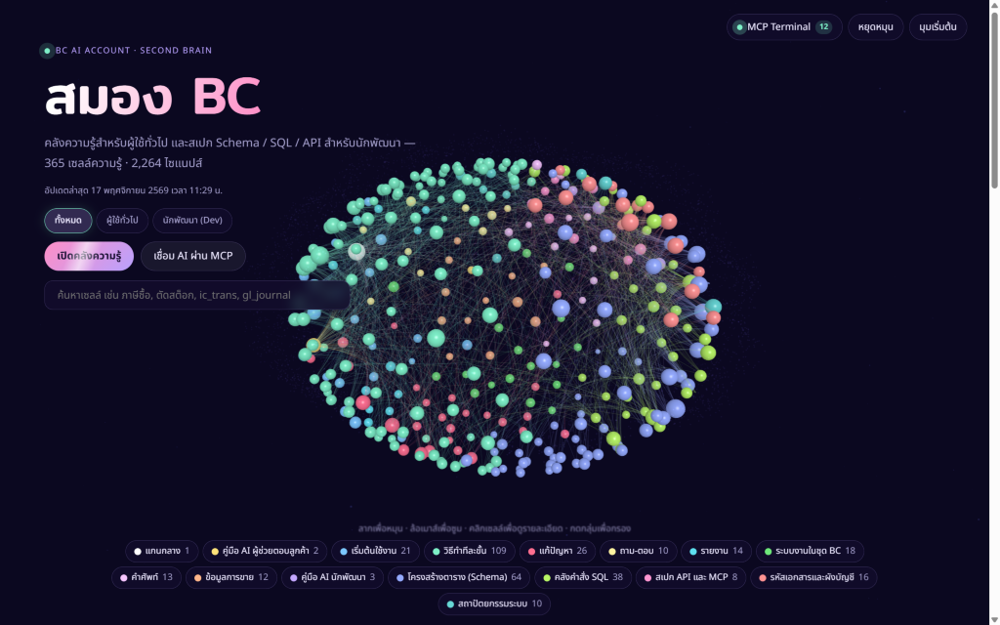
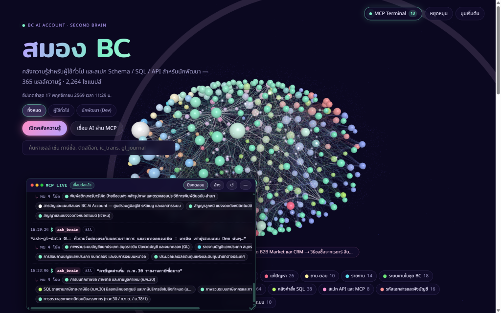
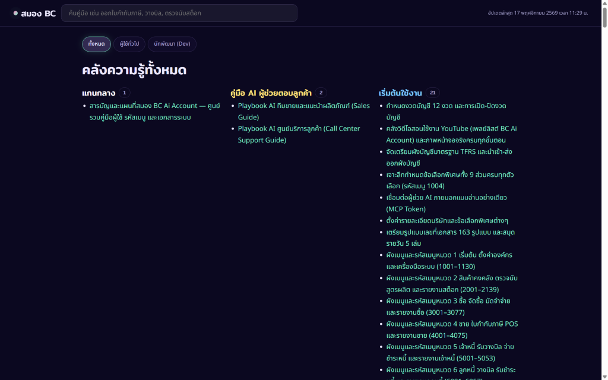
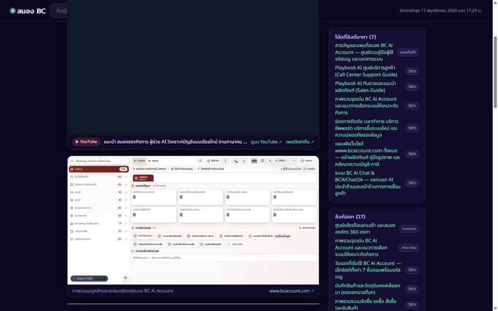

#  สมอง BC (BC Brain)

**เว็บไซต์สมอง 3D:** [brain.bcsmethai.com](https://brain.bcsmethai.com) · **MCP Endpoint:** `https://brain.bcsmethai.com/mcp` · **Skill (`/bcbrain`):** [SKILL.md](https://brain.bcsmethai.com/skills/bcbrain/SKILL.md) · **เว็บไซต์หลัก:** [bcaccount.com](https://bcaccount.com) · **YouTube Playlist:** [BC Ai Account](https://www.youtube.com/playlist?list=PLO9P7tPZLXB0)

[](https://brain.bcsmethai.com)

## Objective
คลังความรู้ระบบ **BC Ai Account** และระบบในชุด BC สกัดจากซอร์สโค้ดจริงใน `d:\bcaiaccount` ควบคู่กับข้อมูลเว็บไซต์หลัก `d:\bcaiwebsite-live` (`www.bcaccount.com`) และเพลย์ลิสต์วิดีโอสอนใช้งาน YouTube (`PLO9P7tPZLXB0`) รวม **380 โน้ต · 2,478 ไซแนปส์ (18 ชนิดความสัมพันธ์) ใน 16 โฟลเดอร์** รองรับ 2 กลุ่มเป้าหมายในระบบเดียว:
1. **โซนผู้ใช้ทั่วไป (`audience: "user"` — 9 โฟลเดอร์, 239 โน้ต)**: คู่มือภาษาไทยที่คนทั่วไปอ่านเข้าใจ (`playbook`, `start`, `howto`, `troubleshoot`, `faq`, `reports`, `systems`, `glossary`, `sales`) สำหรับเจ้าของกิจการ พนักงานบัญชี Call Center และฝ่ายขาย ครบทั้งสารบัญรหัสเมนู 4 หลักทั้ง **735 หน้าจอ** (`1001`–`9070`), ตารางราคา 4 รุ่นและโครงการสำนักงานบัญชี Partner, ตัวเชื่อมรูปภาพหน้าจอจริงจาก `www.bcaccount.com` และการ์ดวิดีโอ YouTube (`PLO9P7tPZLXB0`), คีย์ลัด/เมนูคลิกขวา, ปฏิทินภาษี/บทความความรู้ และคู่มือแก้ปัญหาหน้างานภาษาคนจริงครบทุกใบ (ไม่มีศัพท์โค้ดปน)
2. **โซนนักพัฒนา (`audience: "dev"` — 6 โฟลเดอร์, 140 โน้ต)**: เอกสารเทคนิคสำหรับนักพัฒนาและ AI เขียนโค้ดต่อยอด (`dev-playbook`, `schema`, `queries`, `api`, `doctypes`, `architecture`) ครอบคลุม Data Dictionary, คำสั่ง PostgreSQL `SELECT`/`WITH`, รหัส `trans_flag`, ผังบัญชี Dr/Cr, API/MCP Contract และสถาปัตยกรรมระบบ (พร้อมหน้าดัชนีกลาง `root` `index` = `both` อีก 1 โน้ต)

เปิดสาธารณะ 3 ช่องทางพร้อมรองรับ Google SEO & AI Search (GEO/AEO):
- **หน้าแรก (`/`)**: สมอง 3 มิติพร้อมตัวสลับโหมด (`ทั้งหมด` · `ผู้ใช้ทั่วไป` · `นักพัฒนา (Dev)`)
- **หน้าคลังโน้ต (`/n`, `/n/[slug]`)**: ค้นหาและอ่านรายโน้ต รองรับ `?mode=all|user|dev` และ `?q=...` พร้อม JSON-LD (`Organization`, `WebSite`, `SoftwareApplication`, `CollectionPage`, `BreadcrumbList`, `TechArticle`), OpenGraph/Twitter Card (`/icon.png`, `/opengraph-image.png`), `/robots.txt`, `/sitemap.xml` และ `/llms.txt`
- **MCP & REST Sidecar (`/mcp`, `/api/*`, `v3.0.0`, Compiled Go 1.26 Zero-CGO Sidecar `:3961`, `< 1 ms`)**: แยกออกจาก Next.js App Router เป็น Compiled Go HTTP Sidecar (`cmd/bcbrain-mcp`) ด้านหลัง Caddy พร้อม **15 MCP Tools** (`quick_answer` โหมด `normal`/`fast`/`ultra` + Structured Facts, `batch_ask`, `lookup_menu`, `lookup_error`, `search_sections`, `get_facts`, `verify_reference`, `whats_new`, `batch_read`, `ask_brain`, `search_brain`, `find_media`, `traverse_brain`, `read_note`, `list_notes`), Hybrid Multi-Signal RRF + Section BM25 + 256-dim Dense Semantic + Block-Aware Trimming, Runtime Grounding Verifier (`public/grounding-index.json`), Sanitized Gap Telemetry, **REST API + OpenAPI 3.1.0** (`/api/fast`, `/api/error`, `/api/sections`, `/api/facts`, `/api/whats-new`, `/api/verify`, `/api/gaps`, `/api/bootstrap-pack`, `/api/vault-pack`, `/api/openapi.json`, `/healthz`) และ Local Stdio MCP (`scripts/mcp-stdio.ts`, `< 1 ms`)

| หน้าต่าง MCP LIVE Terminal แบบเรียลไทม์ (ลากย้าย & ปรับขนาดได้) | คลังความรู้แยกโซน (`ทั้งหมด` · `ผู้ใช้ทั่วไป` · `นักพัฒนา`) |
|---|---|
|  |  |
| **ตัวเชื่อมวิดีโอ YouTube, ภาพหน้าจอจริง & ไซแนปส์เชื่อมโยงไป-กลับ** | **โครงข่ายประสาทสมอง BC (OpenGraph Neural Map)** |
|  |  |

## Workflow
1. **อัปเดตสมองอัตโนมัติทุก 1 ชั่วโมง (Read-Only 100% บน `d:\bcaiaccount`)**:
   - **Antigravity Automation (`Hourly BC Brain Sync & Deploy`)**: รันทุกต้นชั่วโมง (`CRON_TZ=Asia/Bangkok 0 * * * *`) ผ่าน `node scripts/hourly-sync.mjs --plan-only --json --diff` (ใช้ `.sync-cache/baseline.json.gz` เทียบ line-level diff เฉพาะส่วนที่เปลี่ยนจริงตั้งแต่รอบก่อน และจบแบบ `NOOP` ใน ~1 วินาทีหากไม่มีความเปลี่ยนแปลง) → อ่านโค้ดจริงใน `d:\bcaiaccount` แบบอ่านอย่างเดียว → อัปเดตโน้ตใน `vault/` → รัน `node scripts/hourly-sync.mjs --finalize`
   - **Windows Scheduled Task สำรอง (`\bcbrain\hourly-sync`)**: รัน `scripts/hidden.vbs` → `scripts/hourly-sync.cmd` → `node scripts/hourly-sync.mjs` ทุกชั่วโมงนาทีที่ `:30` แบบซ่อนหน้าต่างเพื่อรองรับช่วงที่ปิด IDE
   - ทุกคำสั่ง `git` ที่อ่าน `d:\bcaiaccount` ใช้ `--no-optional-locks` และห้ามสร้าง/แก้ไข/ลบไฟล์ใดๆ ใน `d:\bcaiaccount` เด็ดขาด
   - ทุกการอัปเดตต้องผ่าน **7 ด่านตรวจกันหลอนก่อน Deploy** (หากไม่ผ่านจะ rollback `vault/` กลับสภาพเดิมทันที):
     1. `node scripts/check-notes.mjs D:/bcaiaccount --strict` (frontmatter, slug, `sources:` EOF, wikilinks, ห้ามศัพท์โค้ดในโซน `user`, ห้ามข้อมูลอ่อนไหว)
     2. `node scripts/scan-secrets.mjs` (ห้ามคีย์/โทเค็น/รหัสผ่าน/hash/อีเมล/IP สาธารณะหลุด)
     3. `node scripts/verify-grounding.mjs` (ตรวจ 6 มิติ: `sources:` EOF, รหัสเมนู 4 หลักเทียบ `bcMenu.json`, ตาราง SQL เทียบ schema/backend จริง, เส้นทาง API ใน `vault/api/` เทียบ Mounted Chi Routes จาก `router.go`, ตาราง `menu-cat-1..9` แบบ 1:1 ครบ 735 หน้าจอ, และ shrink guard กันโน้ตหดหาย >45%)
     4. `npx tsc --noEmit`
     5. `npm test` (`scripts/selftest.ts`)
     6. `npm run test:deep` (`scripts/deep-test.ts` — 6 มิติ, Top1/Top5 100%, 0 isolation leaks)
     7. `node scripts/deploy.mjs` → `npm run build` + แพ็ก standalone/public/vault + สลับ `/opt/bcbrain` แบบ atomic (สำรอง `/opt/bcbrain.prev`) + ยิง `scripts/mcp-eval.mjs https://brain.bcsmethai.com/mcp` บน Production จริง (**หากไม่ผ่านจะ rollback `/opt/bcbrain.prev` บนเซิร์ฟเวอร์อัตโนมัติทันที**)
2. `npm run build` → `prebuild` รัน `scripts/scan-secrets.mjs` สแกนความลับใน `vault/` และไฟล์ skill หากพบ build จะหยุดทันที (พิมพ์เฉพาะ `ไฟล์:บรรทัด`)
3. Caddy (`brain.bcsmethai.com`) แยกเส้นทางความเร็วสูง: `@mcp_fast path /mcp /api/* /healthz` และ `/mcp/events` (`flush_interval -1`) → **`127.0.0.1:3961`** (`bcbrain-mcp.service` Compiled Go Sidecar `< 1 ms`) และหน้าเว็บ `/`, `/n/*` → **`127.0.0.1:3951`** (`bcbrain.service` Next.js)

โครงสร้างโค้ดหลัก:
- `lib/groups.ts` — นิยาม 16 โฟลเดอร์ (`root` = `both`, 9 โฟลเดอร์โซน `user`, 6 โฟลเดอร์โซน `dev`), สี, ชื่อภาษาไทย, `groupOf()`, `matchesAudience()`, `RelationType`, `RELATION_LABEL`, `inferRelation()`
- `lib/vault.ts`, `lib/vault-retrieval.ts` — Lean In-Memory GraphRAG v3: โหลด `vault/` (หรือแพ็ก gzip จาก `BC_VAULT_PACK_FILE`) แบบ atomic `VaultBundle`, สร้างเส้นประสาทเชื่อมโยงอัตโนมัติ 4 ชั้น, Block-Aware Trimming (`trimBlockAware`), Pre-Split Sections + Section-Level Inverted BM25 (`searchSections`), 256-dim Dense Semantic Vectors + Multi-Signal RRF, Structured Facts Extractor (`[menu]`, `[rule]`, `[limit]`, `[error]`, `[formula]`), O(1) Thai Error-Message Index (`lookupError`), Temporal Recency (`getWhatsNew`), ดัชนี O(1) (`lookupDirect()`), `getBootstrapPack()`, `getVaultPackGzip()` (~675 KB gzip + ETag), ระบบวัดความมั่นใจกันหลอน (`searchWithMeta()`), พิกัดสมอง 3D (`computeBrainLayout()`), แคช HTML กัน XSS และ `traverseGraph()`
- `cmd/bcbrain-mcp/*`, `scripts/export-go-pack.mjs` — Compiled Go 1.26 zero-CGO Single-Binary MCP & REST Sidecar (`v3.0.0`, **15 MCP Tools** + 10 REST Routes + OpenAPI 3.1 + Grounding Verifier + Section BM25 + Sanitized Gap Log + SSE `/mcp/events`) ตอบใน `< 1 ms` (~40 MB heap)
- `lib/mcp-engine.ts`, `lib/grounding-runtime.ts`, `lib/gap-log.ts`, `lib/openapi.ts`, `scripts/mcp-server.ts`, `scripts/mcp-stdio.ts` — ศูนย์กลาง Stateless JSON-RPC 2.0 MCP (`v3.0.0`, **15 Tools**) + Runtime Ground-Truth Verifier + Sanitized Gap Telemetry + OpenAPI 3.1.0 Spec + Pre-Serialized LRU Cache (`512` รายการ) ใช้ร่วมกันทั้ง Next.js App Router, REST `/api/*`, และ Local Stdio MCP (`< 1 ms`, auto-sync ผ่าน ETag ทุก 30 นาที)
- `lib/mcp-events.ts`, `app/mcp/events/route.ts` — Bus เหตุการณ์และสตรีม SSE (`/mcp/events`) สำหรับแสดง Terminal สดและปล่อยสัญญาณแสงบนสมอง 3D ทันทีเมื่อ `/mcp` ถูกเรียก (กรองความลับ/อีเมล/IP/เบอร์โทรอัตโนมัติ)
- `app/api/*/route.ts` — REST Endpoints รองรับ CDN/Edge caching (`ETag` / `304`): `/api/fast`, `/api/error`, `/api/sections`, `/api/facts`, `/api/whats-new`, `/api/verify`, `/api/gaps` (`no-store`), `/api/bootstrap-pack`, `/api/vault-pack`, `/api/openapi.json`
- `scripts/detect-changes.mjs`, `scripts/sync-cache.mjs`, `scripts/verify-grounding.mjs`, `scripts/wiki-lint.mjs`, `scripts/symbol-truth.mjs`, `scripts/grounding-lock.mjs`, `scripts/export-grounding-index.mjs`, `scripts/hourly-sync.mjs`, `scripts/deploy.mjs`, `scripts/load-env.mjs`, `scripts/install-hourly-task.mjs` — ชุดระบบอัปเดตสมองอัตโนมัติทุก 1 ชม. แบบอ่านอย่างเดียว + Incremental diff cache + Wiki-Lint + Symbol/Column Grounding + 7 ด่านตรวจกันหลอน + Cross-Compile Go Sidecar + Atomic Deploy & Auto-Rollback
- `components/Brain3D.tsx`, `components/Shell.tsx`, `app/page.tsx`, `app/n/page.tsx`, `app/n/[slug]/page.tsx` — หน้าเว็บสมอง 3 มิติ (ใช้พิกัดที่คำนวณจากเซิร์ฟเวอร์ทันที) และหน้าคลังโน้ตพร้อมตัวสลับโหมด 3 ปุ่ม
- `app/layout.tsx`, `app/robots.ts`, `app/sitemap.ts`, `public/llms.txt`, `public/sync-meta.json`, `public/grounding-index.json`, `app/icon.png`, `app/opengraph-image.png`, `next.config.ts` — Metadata, OpenGraph/Twitter Image, Sitemap/Robots/LLMs index และ HTTP Security & `Cache-Control` headers
- `.agents/skills/bcbrain/SKILL.md`, `public/skills/bcbrain/SKILL.md` — Skill `/bcbrain` สำหรับเชื่อมและเรียกใช้สมอง BC ผ่าน MCP (หรือ HTTP JSON-RPC fallback) ดาวน์โหลดได้ที่ `/skills/bcbrain/SKILL.md`
- `docs/client-prompts.md` — คู่มือและ Prompt สำเร็จรูปสำหรับอัปเกรดระบบลูกข่ายหลัก (`D:\yalecom`, `D:\jarvisbcaiaccount`) และ AI ตัวอื่นให้ใช้งาน BC Brain v3.0.0 ครบทั้ง 15 Tools และ OpenAPI 3.1.0

## Config
| ค่า | ที่ไหน | ความหมาย |
|---|---|---|
| `PORT=3951` / `PORT=3961`, `HOSTNAME=127.0.0.1` | `deploy/bcbrain.service`, `deploy/bcbrain-mcp.service` | Next.js Web (`:3951`) + Compiled Go MCP & REST Sidecar (`:3961`) หลัง Caddy |
| `BC_GO_PACK_FILE` | `deploy/bcbrain-mcp.service` | พาธไฟล์แพ็กความรู้ที่ Export ให้ Go Sidecar (`/opt/bcbrain/public/go-brain-pack.json`) |
| `BC_DEPLOY_HOST` | `.env.local` (gitignored, ดู `.env.example`) | ปลายทาง SSH สำหรับ `scripts/deploy.mjs` และ `deploy/deploy.sh` |
| `MAX_BODY_BYTES = 32768`, `RATE_LIMIT_MAX = 300` | `lib/mcp-engine.ts`, `cmd/bcbrain-mcp/main.go` | จำกัดขนาดคำขอ `/mcp` และ `POST /api/verify` ไม่เกิน 32 KB และไม่เกิน 300 ครั้ง/นาทีต่อ IP พร้อม CORS |
| `CACHE_MAX = 512`, `DEV_TTL_MS = 5000` | `lib/mcp-engine.ts`, `cmd/bcbrain-mcp/mcp.go`, `lib/vault.ts` | ขนาด Pre-Serialized LRU cache ของคำตอบ MCP และอายุแคช `VaultBundle` ในโหมด `dev` |
| `Cache-Control` headers | `next.config.ts`, `cmd/bcbrain-mcp/main.go` | `/llms.txt`, `/skills/*` (`max-age=300`), `/api/*` (`s-maxage=300..600` + ETag `304`), `/api/gaps` และ `/mcp` (`no-store`) |
| โฟลเดอร์, สี, โซน `audience` | `lib/groups.ts` | แมป 16 โฟลเดอร์ (`root`, 9 user, 6 dev) → ชื่อไทย, สีเซลล์, `audience` |
| กติกา AI สองโหมด & Speed-First | `lib/mcp-engine.ts` / `cmd/bcbrain-mcp/mcp.go`, `vault/playbook/`, `vault/dev-playbook/` | แนะนำ `quick_answer` / `lookup_menu` / `lookup_error` / `search_sections` / `verify_reference` เพื่อตอบไวและกันหลอน พร้อมแยกโซน `user` / `dev` เข้มงวด |
| ยกเว้นบรรทัดที่ไม่ใช่ความลับ | ใส่ `secret-scan:allow` ในบรรทัดนั้น | ข้าม `scripts/scan-secrets.mjs` เฉพาะบรรทัดที่ตรวจยืนยันแล้ว |

ไม่มี env ลับ ไม่มี API key ทั้งหน้าเว็บและ MCP เป็นระบบสาธารณะแบบอ่านอย่างเดียว (`.env.local` ใช้เฉพาะฝั่ง deploy เครื่องพัฒนาและถูก ignore ด้วย `.gitignore`)

## Dependency
Node 24+ (`"type": "module"`, รัน `.ts` โดยตรงในเทสต์), Go 1.26+ (zero-CGO compiled sidecar `cmd/bcbrain-mcp`), Next.js 16.4 (standalone), React 19.3, three 0.187, `@modelcontextprotocol/sdk` 1.32, marked 18.1, yaml 2.9, zod 4.6, TypeScript 7 · เซิร์ฟเวอร์: systemd + Caddy

## Usage example
```bash
npm install
npm run dev              # http://localhost:3000
npx tsc --noEmit         # ตรวจ TypeScript
npm test                 # selftest: groups, isolation, ตัดคำไทย, BM25, O(1) lookup, sync-cache, กัน XSS, ตัวสแกนความลับ
npm run test:deep        # deep-test: 6 มิติ (ตัดคำ/คำพ้อง 27 ข้อ, ค้นหา 116 เคส, แยกโซน 380 โน้ต, กราฟ 3D/XSS/PNG, fuzz, throughput)
node scripts/test-retrieval-v2.ts   # ทดสอบ retrieval v3 (block-aware trim, semantic RRF, facts, sections, error index, whats_new, traps)
go vet -C cmd/bcbrain-mcp ./... && go test -C cmd/bcbrain-mcp -v ./...  # ทดสอบ Go Sidecar 15 Tools + REST + ETag 304
npm run check            # ตรวจโน้ตใน vault (ส่ง path ของ bcaiaccount และ --strict เพื่อตรวจเข้มงวด)
npm run check:drift      # ตรวจโน้ตแบบ --strict พร้อมรายงานโน้ตที่ไฟล์โค้ดใน D:/bcaiaccount แก้ใหม่กว่าโน้ต
npm run wiki:lint        # ตรวจคุณภาพ cross-note wikilinks และโครงสร้างคลังโน้ต (--strict)
npm run verify:grounding # ตรวจความถูกต้องกันหลอน 6 มิติ (EOF + เมนู 735 หน้าจอ 1:1 + ตาราง SQL/คอลัมน์ + Chi routes + shrink guard)
npm run grounding:index  # สร้าง public/grounding-index.json จากซอร์สโค้ดจริง (อ่านอย่างเดียว)
npm run sync:check       # ตรวจว่า D:/bcaiaccount มีไฟล์เปลี่ยนหรือโน้ตได้รับผลกระทบอะไรบ้าง (อ่านอย่างเดียว)
npm run sync:plan        # วางแผนสกัดความรู้ (เพิ่ม --json --diff เพื่อดู line-level diff เทียบ baseline)
npm run sync:finalize    # รันครบ 7 ด่าน + deploy ขึ้น Production + ยิง mcp-eval + อัปเดต sync-meta/state
npm run deploy:win       # Refresh grounding index + Build + Export Go pack + Cross-Compile Go Sidecar + Atomic Deploy + live mcp-eval + auto-rollback
npm run task:install     # ติดตั้ง Windows Scheduled Task \bcbrain\hourly-sync
npm run scan             # สแกนความลับใน vault และไฟล์ skill
node scripts/mcp-eval.mjs http://127.0.0.1:3961/mcp         # ประเมิน Go Sidecar 15 tools + REST + 52 เคส (152 calls)
node scripts/mcp-eval.mjs https://brain.bcsmethai.com/mcp   # ประเมิน Production จริง 15 tools + REST + 52 เคส (152 calls)
```

เชื่อม AI ผ่าน MCP:
```bash
claude mcp add --transport http bcbrain https://brain.bcsmethai.com/mcp
```
Tools (**15 tools · v3.0.0** — เรียงตามความเร็ว):
- **`quick_answer(question, audience?, mode?, max_chars?, include_media?, include_facts?)`** — **ตอบเร็วสุดใน 1 รอบ** (`normal` ~2,000 อักษร, `fast` ~1,400 อักษร, หรือ `ultra` ~600 อักษร TL;DR สำหรับ Voice/LINE/Call Center) พร้อมข้อเท็จจริงสรุป (`facts`) และด่าน `🛑 Abstain` กันหลอน
- **`batch_ask(questions, audience?, mode?, max_chars_per_answer?, include_media?)`** — ตอบ **1–5 คำถามพร้อมกันใน 1 รอบเดียว** (ค่าเริ่มต้น `mode: "ultra"`) ตัดรอบเรียก LLM ซ้ำ
- **`lookup_menu(query, audience?, limit?)`** — **ค้นแบบ O(1) ใน `< 1 ms`** สำหรับรหัสเมนู 4 หลัก (`1001`–`9070`), รหัสจุดเดิม (`4.13`), ชื่อเมนูไทย หรือชื่อตาราง SQL (`ic_trans`, `gl_journal` เฉพาะโซน `dev`/`all`)
- **`lookup_error(query, audience?, limit?)`** — **ค้นข้อความแจ้งเตือน/Error ภาษาไทยแบบ O(1)** คืนข้อความจริง สาเหตุ-วิธีแก้ และ slug โน้ตตรงจุดพร้อม `🛑 Abstain` กันหลอน
- **`search_sections(query, audience?, limit?, max_chars?)`** — ค้นเจาะลึกระดับหัวข้อย่อย (`## Section` BM25) พร้อม Block-Aware Excerpt (ไม่ตัดกลางตาราง/รายการ/โค้ด) และ `Structured Facts`
- **`get_facts(query?, slugs?, kinds?, audience?, limit?)`** — ดึงข้อเท็จจริงแบบมีประเภท (`[menu]`, `[rule]`, `[limit]`, `[error]`, `[formula]`) กรองตามคำค้นหรือ slug (ไร้ศัพท์โค้ดในโหมด `user`)
- **`verify_reference(menus?, tables?, columns?, audience?)`** — ตัวตรวจอ้างอิง Ground Truth กันหลอน: ตรวจรหัสเมนู 4 หลักได้ทุกโหมด และตรวจตาราง SQL / `table.column` เฉพาะ `dev`/`all` (ปฏิเสธเด็ดขาดพร้อม `tablesRestricted: true` ในโหมด `user`)
- **`whats_new(days?, audience?, limit?)`** — รายการโน้ตที่อัปเดตล่าสุดภายใน N วัน เรียงจากใหม่สุดพร้อมวันที่ ISO และ TL;DR
- **`batch_read(slugs, audience?, query?, max_chars_per_note?, strip_links?)`** — อ่าน `1–5` โน้ตพร้อมกันใน **1 รอบเดียว** รองรับตัดเฉพาะหัวข้อตาม `query` และล็อกโซน `audience`
- **`ask_brain(question, audience?, compact?, max_notes?)`** — สังเคราะห์หลายโน้ตพร้อม `Media & Reference Links` (รูปภาพหน้าจอ + คลิป YouTube) และ Connected Graph Context 1 ทอด (รองรับ `compact: true`)
- **`search_brain(query, limit?, audience?)`** — Hybrid Multi-Signal RRF + BM25 + Section BM25 + รหัสเมนู 4 หลัก + คำพ้องไทย-SQL (default `limit=5` ลด Token) พร้อมอาร์เรย์ `images` และ `videos`
- **`find_media(query?, kind?, limit?, audience?)`** — ดึงลิงก์รูปภาพหน้าจอ (`https://bcaccount.com/...`), วิดีโอ YouTube (`PLO9P7tPZLXB0` พร้อม `thumbnailUrl`/`embedUrl`) และหน้าเว็บอ้างอิงในรูปแบบ JSON พร้อมแชร์
- **`traverse_brain(slug, to_slug?, depth?, direction?, relation?, folder?, limit?, audience?)`** — เดินกราฟ 1–3 ทอดหรือหาเส้นทางสั้นสุดระหว่าง 2 โน้ต
- **`read_note(slug, query?, max_chars?)`** — อ่านโน้ตตาม `slug` พร้อมสรุปลิงก์สื่อและลิงก์ไป-กลับ (ส่ง `query`/`max_chars` เพื่อตัดเฉพาะส่วนที่ต้องการได้)
- **`list_notes(folder?, tag?, audience?)`** — แสดงรายชื่อโน้ตกรองตามโฟลเดอร์ แท็ก หรือ `audience`

REST API ความเร็วสูง (OpenAPI 3.1) & Local Stdio MCP (`< 1 ms`, ไร้ RTT ข้ามประเทศ):
```bash
# Edge-cacheable REST (s-maxage=300, ETag 304)
curl "https://brain.bcsmethai.com/api/fast?q=%E0%B9%80%E0%B8%8A%E0%B9%87%E0%B8%84%E0%B9%80%E0%B8%94%E0%B9%89%E0%B8%87&audience=user&mode=ultra"
curl "https://brain.bcsmethai.com/api/error?q=%E0%B8%A5%E0%B9%87%E0%B8%AD%E0%B8%81%E0%B8%AB%E0%B8%99%E0%B9%88%E0%B8%A7%E0%B8%A2%E0%B8%95%E0%B9%89%E0%B8%99%E0%B8%97%E0%B8%B8%E0%B8%99%E0%B9%81%E0%B8%A5%E0%B9%89%E0%B8%A7&audience=user"
curl "https://brain.bcsmethai.com/api/sections?q=%E0%B8%AA%E0%B9%88%E0%B8%A7%E0%B8%99%E0%B8%97%E0%B8%B5%E0%B9%88%204&audience=user"
curl "https://brain.bcsmethai.com/api/facts?slugs=start-erp-options-9-tabs&kinds=menu&audience=user"
curl "https://brain.bcsmethai.com/api/whats-new?days=7&audience=user"
curl -X POST "https://brain.bcsmethai.com/api/verify" -H "Content-Type: application/json" -d '{"menus":["4013"],"tables":["ic_trans"],"columns":["ic_trans.doc_no"],"audience":"dev"}'
curl "https://brain.bcsmethai.com/api/openapi.json"
# Context-Caching Bootstrap Pack (ยัดลง System Prompt บอท -> ตอบเรื่องหลัก 0 ms)
curl "https://brain.bcsmethai.com/api/bootstrap-pack?audience=user"
# Local Stdio MCP (ซิงก์แพ็ก gzip ~675KB จาก /api/vault-pack ด้วย ETag ลง RAM เครื่องท้องถิ่น)
node scripts/mcp-stdio.ts --sync
```

ติดตั้งและใช้งาน Skill `/bcbrain`:
```bash
mkdir -p ~/.claude/skills/bcbrain && curl -fsSL https://brain.bcsmethai.com/skills/bcbrain/SKILL.md -o ~/.claude/skills/bcbrain/SKILL.md
```
- `/bcbrain <คำถามใช้งาน>` — โหมดผู้ใช้ทั่วไป / Call Center / ฝ่ายขาย (`audience: "user"`)
- `/bcbrain dev <โจทย์ SQL/Schema/API>` — โหมดนักพัฒนา (`audience: "dev"`)
- `/bcbrain setup` — แสดงวิธีผูก MCP `https://brain.bcsmethai.com/mcp` ตามเครื่องมือที่ใช้

## Limitation
- ใช้ Hybrid Multi-Signal RRF (BM25 + Section BM25 + 256-dim Hashed Semantic Vectors + O(1) Menu/Error/Table Index + 1-hop Graph Boost) แบบไร้ GPU/API ภายนอกเพื่อความเร็ว `< 1 ms` — หากคลังเติบโตเกิน ~2,000 โน้ตควรพิจารณา embedding โมเดลเพิ่มเติม
- โน้ตเป็นภาพถ่ายโค้ด ณ วันที่สกัด (ซิงก์อัตโนมัติทุกชั่วโมง) หากโค้ดใน `d:\bcaiaccount` เพิ่งแก้ไขระหว่างรอบให้รัน `npm run sync:plan` หรือยึดโค้ดจริงเป็นหลักเสมอ
- ขอบเขตจำกัดเฉพาะระบบใน `d:\bcaiaccount` และเว็บไซต์ทางการ `d:\bcaiwebsite-live` (`bcaccount.com`) เท่านั้น
- MCP และ REST API เปิดสาธารณะแบบอ่านอย่างเดียว จำกัดขนาดคำขอ 32 KB และจำกัดอัตราเรียก 300 ครั้ง/นาทีต่อ IP ในหน่วยความจำของโปรเซส พร้อมรองรับ CORS (ไม่เปิด SSE stream บน `GET /mcp` เพื่อลดการค้างการเชื่อมต่อ)
- โซนผู้ใช้ทั่วไปอ้างอิงเฉพาะตารางราคามาตรฐาน 4 รุ่นจาก `sales-pricing-packages` และโครงการสำนักงานบัญชีจาก `sales-accounting-partner` เท่านั้น ห้าม AI แต่งส่วนลดพิเศษหรือเงื่อนไขสัญญานอกตารางเอง (ส่งต่อ `https://bcaccount.com/quotation` หรือ LINE `@bcaccount`)
- ชื่อไฟล์ (`slug`) ต้องเป็น ascii kebab-case ตัวเล็กและไม่ซ้ำกันทั้ง `vault/`
