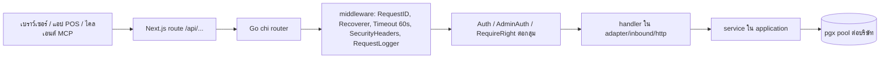

# ภาพรวมแค็ตตาล็อก API

โน้ตนี้เป็นศูนย์กลาง (hub) ของมิติ "API catalog" ใน BC Brain: อธิบายว่าคำขอหนึ่งเดินทางผ่านอะไรบ้างตั้งแต่เบราว์เซอร์ถึงฐานข้อมูล, middleware ที่ครอบ, รูปแบบ response/error, ขีดจำกัด และดัชนีของโน้ต API ทั้ง 19 ฉบับ. รายละเอียดเชิงสถาปัตยกรรมอยู่ที่ [[backend-overview]], [[be-hexagonal-architecture]], [[be-http-router-routes]] และฝั่งหน้าเว็บที่ [[fe-api-proxy-routes]].

## 1. วงจรคำขอ (request lifecycle)

| ขั้น | ทำอะไร | ที่มา |
|---|---|---|
| 1. ไคลเอนต์ | เว็บเรียก `/api/...` ของ Next (cookie session) ; แอป POS และ AI ภายนอกถือ token ของตัวเอง | โน้ตแต่ละกลุ่ม |
| 2. Next proxy (BFF) | ตรวจ session (`requireSession`), ต่ออายุ/ขอ access token (`getValidAccessToken`), ส่งต่อไป Go ที่ `SERVICE_BASE_URL` ด้วย `fetchServiceWithAuthRetry` (ลองใหม่เมื่อ 401, เติม `X-Admin-Api-Key` ให้ endpoint ที่มี `/admin`), ห่อผลเป็น `ok()`/`fail()` | frontend/src/lib/api-server.ts:34-51, 248, 388, 496, 555 |
| 3. Go router | chi router ลงทะเบียนกลุ่ม path ทั้งหมดไฟล์เดียว | backend/internal/adapter/inbound/http/router.go |
| 4. middleware global | `RequestID` -> `Recoverer` -> `Timeout(60s)` -> `SecurityHeaders` -> `RequestLogger` | router.go:62-66 |
| 5. middleware ต่อกลุ่ม | `Auth(verifier)` อ่าน `Authorization: Bearer`, ตรวจ access token, ใส่ claims ลง context; `AdminAuth(key)` ตรวจ `X-Admin-Api-Key` แบบ constant-time; `RequireRight` ตรวจสิทธิ์เมนูตาม action | middleware/auth.go:39, adminauth.go:11, permission.go |
| 6. handler | แปลง request, ดึง provider/database/user จาก claims (ไม่เชื่อค่าจาก body), เรียก service | adapter/inbound/http/<กลุ่ม>/handler.go |
| 7. service | ตรรกะธุรกิจ ใน `application/*` (query, process, identity, tenant ฯลฯ) | backend/internal/application |
| 8. DB | pool แยกต่อบริษัท (ฐาน Main + ฐานบริษัท) ผ่านตัวจัดการ pool | [[be-db-pool-manager]], [[be-multi-tenant]] |

หลักการสำคัญ: บริษัท/ผู้ใช้ที่ handler ใช้มาจาก JWT claims เสมอ (ดู [[be-jwt-session-tokens]]) ดังนั้นไคลเอนต์เลือกบริษัทได้เฉพาะตอน `select-company` ([[api-auth-login]]).

## 2. แผนที่เส้นทางใน router.go

| prefix | middleware | โน้ต | router.go |
|---|---|---|---|
| `/health`, `/swagger/*` (dev) | ไม่มี | [[api-ops-health-monitormap]] | 68-71 |
| `/auth/*` | public (ยกเว้น `/auth/me` ใช้ `Auth`) | [[api-auth-login]] | 73-84 |
| `/query/{list,limit,batch}` | `Auth` | [[api-query-gateway]] | 90-102 |
| `/query/{exec,execBatch}` | `Auth` + `queryWriteGuard` (RequireRight) | [[api-query-exec]] | 85-102 |
| `/blob/insert` | `Auth` | [[api-blob]] | 105-111 |
| `/admin/providers` | `AdminAuth` | [[api-tenant]] | 114-123 |
| `/process/*` และ `/api/v1/process/*` | `Auth` + `RequireRight(RequiredRight)` | [[api-process-run]] และกลุ่ม action ด้านล่าง | 126-208 |
| `/api/v1/admin/*` | `AdminAuth` | [[api-admin-console]], [[api-admin-workspace]] | 211-247 |
| `/api/v1/{dashboard,crm,ai,wms,tms,procure,etax,market,autocare}` | `Auth` | [[api-business-modules]] | 250-326 |
| `/api/v1/pos/*` | `Pos.Auth` (token เครื่อง หรือ user) + `DeviceOnly`/`UserOnly` | [[api-pos]] | 329-349 |
| `/api/v1/monitormap/tile` | POST ใช้ `Auth` | [[api-ops-health-monitormap]] | 352-358 |
| `/mcp`, `/api/v1/mcp`, `/api/v1/mcp/tokens` | token MCP / `AdminAuth` | [[api-mcp]] | 360-371 |

ฝั่ง Next มี route.ts ราว 75 ไฟล์ใต้ `frontend/src/app/api/` (query, process/*, admin, auth, workspace, pos, mcp, โมดูลธุรกิจ และ route เฉพาะชั้น Next เช่น fraudwarning, workmonitor, help, lineoa, monitormap).

## 3. รูปแบบ response และ error

| ชั้น | สำเร็จ | ล้มเหลว | ที่มา |
|---|---|---|---|
| Go โมดูลธุรกิจ / query | JSON ดิบของผลลัพธ์ | `{"error":{"message":"..."}}` | response/response.go:49-79 |
| Go `/process/*` | `{"ok":true,"data":...}` | เหมือนข้างบน | [[api-process-run]] |
| Go admin / MCP tokens / POS | `{"ok":true,"data":...}` (POS บาง route `{ok,section}`) | admin: `{"ok":false,"error":"...","code":"..."}`; POS ส่วนใหญ่ใช้ `response.Error` | [[api-admin-console]], [[api-pos]] |
| MCP JSON-RPC | `result` ใน JSON-RPC 2.0 | `error` ใน HTTP 200 (ยกเว้น 401/405) | [[api-mcp]] |
| Next BFF | `{ok:true,data}` | `{ok:false,error,code}` เช่น `NO_TOKEN`, `NO_SESSION`, `BACKEND_UNAVAILABLE` | api-server.ts:34-51, 496-520 |

การแปลง `apperr` เป็นสถานะ HTTP: Validation=400, Unauthorized=401, Forbidden=403, NotFound=404, Conflict=409, อื่น ๆ=500 พร้อมข้อความ `internal server error` (ไม่เปิดเผยสาเหตุ) — รายละเอียดที่ [[be-error-response-shape]].

## 4. สรุปขีดจำกัดที่พบ

| เรื่อง | ค่า | ที่มา/โน้ต |
|---|---|---|
| timeout ของทุกคำขอ | 60 วินาที | router.go:64 |
| body `/process/*` | 1 MB (ค่าเริ่มต้น) ถึง 64 MB (docpicture/save) ตาม route | [[api-process-run]] |
| body `/query/*` | อ่านด้วย `peekJSON` สูงสุด 1 MB สำหรับตรวจสิทธิ์ | [[api-query-exec]] |
| `/blob/insert` | ดูขนาดรูปในโน้ต | [[api-blob]] |
| โมดูลธุรกิจ | multipart 32 MB (wms/tms/procure/etax), 10-12 MB (crm), autocare 2 MB | [[api-business-modules]] |
| POS | บิล 1 MB, config/shift 1 MB, สลิป 5 MB, sync limit สูงสุด 2000 | [[api-pos]] |
| MCP | body 2 MB, batch <= 20, timeout 35 วินาที, SQL timeout 15 วินาที | [[api-mcp]] |
| admin key | header `X-Admin-Api-Key`; ค่าว่างใน config = ปฏิเสธทุกคำขอ | adminauth.go:18-28, [[api-tenant]] |

## 5. ดัชนีโน้ต API (19 ฉบับ)

| โน้ต | ขอบเขต | auth หลัก |
|---|---|---|
| [[api-overview]] | ฮับ: วงจรคำขอ middleware รูปแบบ response ดัชนี | - |
| [[api-auth-login]] | `/auth/login`, `select-company`, `me`, `refresh`, `logout` และ Next `/api/auth/*` | public / Bearer |
| [[api-query-gateway]] | `/query/list`, `limit`, `batch` (อ่านอย่างเดียว) | Bearer |
| [[api-query-exec]] | `/query/exec`, `execBatch` (เขียน, write guard) | Bearer + right |
| [[api-blob]] | `/blob/insert` อัปโหลดรูปพร้อมแทรกแถว | Bearer |
| [[api-tenant]] | `/admin/providers` ลงทะเบียนผู้ให้บริการ + กลไก AdminAuth | admin key |
| [[api-admin-console]] | `/api/v1/admin/*` provider, user, database, main-query, menu-permissions | admin key |
| [[api-admin-workspace]] | `/api/v1/admin/workspace/*` ล็อกอิน Google เลือกฐาน สมาชิก line-binding | admin key (+ชั้น Next) |
| [[api-process-run]] | เครื่องยนต์ `/process/*` เส้นทาง สิทธิ์ ขนาดบอดี้ | Bearer + right |
| [[api-proc-actions-transaction]] | action เอกสาร/ธุรกรรม: trans, doc, lookup, cheque, tax, transgrid | Bearer + right |
| [[api-proc-actions-stock]] | action สต็อก: stock/rebuild, stocktools, itempicture ฯลฯ | Bearer + right |
| [[api-proc-actions-gl]] | action บัญชีแยกประเภท: gl/rebuild, journal, ปิดงวด | Bearer + right |
| [[api-proc-actions-master]] | action ข้อมูลหลัก: master, itemmaster, itemdetail, barcode, docpicture | Bearer + right |
| [[api-proc-actions-report]] | รายงาน: report/run, report/pdf, ai-report-* | Bearer + right |
| [[api-proc-actions-workflow]] | workflow: change-code, audit-list, import ฯลฯ | Bearer + right |
| [[api-business-modules]] | dashboard, crm, ai, wms, tms, procure, etax, market, autocare | Bearer |
| [[api-pos]] | `/api/v1/pos/*` ซิงก์ บิล สื่อ ตั้งค่า เครื่อง | token เครื่อง / Bearer |
| [[api-mcp]] | MCP แบบอ่านอย่างเดียว + จัดการ token | token MCP / admin key |
| [[api-ops-health-monitormap]] | `/health`, `/swagger`, monitormap tile และ route เฉพาะชั้น Next | หลากหลาย |

## 6. ข้อสังเกตข้ามกลุ่ม (รวบรวมจากโน้ตย่อย)

1. ค่าเงินในโมดูลธุรกิจเป็น float64 ขัดกับแนวปฏิบัติด้านเงิน/ความถูกต้องของข้อมูล ([[std-data-integrity-money-transactions]]).
2. ชื่อบริษัท/tenant ไม่ถูกคัดลอกมาในโน้ต API; ใช้ placeholder เช่น `<token>`, `<provider>`, `<adminKey>` แทน.

## ที่มาในโค้ด

- backend/internal/adapter/inbound/http/router.go:62-66 (middleware global), :68-71, :73-84, :85-111, :114-123, :126-208, :211-247, :250-326, :329-349, :352-358, :360-371
- backend/internal/adapter/inbound/http/middleware/auth.go:39-61 (Auth), middleware/adminauth.go:11-28 (AdminAuth), middleware/permission.go (RequireRight)
- backend/internal/adapter/inbound/http/response/response.go:49-79 (รูปแบบ error)
- frontend/src/lib/api-server.ts:22 (SERVICE_BASE_URL), :34-51 (ok/fail), :248 (requireSession), :388 (fetchServiceWithAuthRetry), :496 (proxyToService), :555 (getValidAccessToken)
- frontend/src/app/api/**/route.ts (75 ไฟล์)
