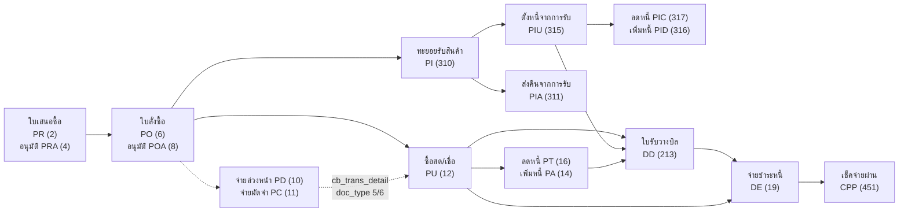
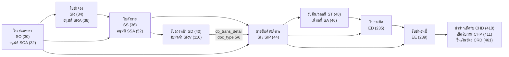

# สายโซ่การอ้างอิงเอกสาร (Document Flow) และสถานะ `used_status` / `doc_success`

ใน BC Ai Account เอกสารตั้งแต่ต้นน้ำถึงปลายน้ำเชื่อมโยงกันผ่านรหัสอ้างอิงในหัวเอกสาร (`doc_ref`) รายการสินค้า (`ic_trans_detail.ref_doc_no` / `doc_ref`) การวางบิล/รับจ่ายชำระ (`ap_ar_trans_detail.billing_no`) และการตัดเงินมัดจำ (`cb_trans_detail.trans_number`)

เมื่อเอกสารปลายน้ำถูกบันทึก แก้ไข ลบ หรือยกเลิก ฟังก์ชัน `recomputeDocStatus` ใน `doc_flow.go` และ `recheckDocFlowTx` ใน `service.go` จะคำนวณสถานะของเอกสารต้นน้ำใหม่อัตโนมัติ (ดูคู่กับการยกเลิกที่ [[doc-cancel-and-approve]] และคำสั่งค้นหาสายโซ่เอกสารที่ [[sql-sale-document-lookup]])

---

## 1. แผนผังสายโซ่เอกสารหลัก (End-to-End Document Chains)

### 1.1 วงจรจัดซื้อและเจ้าหนี้ (Procure-to-Pay)

### 1.2 วงจรขายและลูกหนี้ (Order-to-Cash)

### 1.3 วงจรคลังสินค้า (Inventory Internal Flow)
- **ขอเบิก → เบิก → รับคืน**: ขอเบิก `122` (`RIO`) → เบิกวัตถุดิบ `56` (`IO`) → รับคืนจากการเบิก `58` (`IR`)
- **ขอโอน → โอนคลัง**: ขอโอน `124` (`RIM`) → โอนออก `72` (`IM`) + แฝดรับเข้า `70` (`IM`)
- **ตรวจนับ → ปรับปรุง**: ขอตรวจนับ `276` (`RCO`) → ใบตรวจนับ `76` (`CO`) → ปรับปรุงเพิ่ม `66` (`IA`) / ปรับปรุงลด `68` (`IS`)

---

## 2. คอลัมน์เชื่อมโยงระหว่างตาราง (Foreign Reference Columns)

นักพัฒนาที่เขียน SQL ย้อนรอยเอกสาร (เช่นใน `doc_flow_graph.go`) ต้องทราบว่าแต่ละช่วงใช้คอลัมน์ต่างกันดังนี้:

| ความสัมพันธ์ ต้นน้ำ → ปลายน้ำ | ตารางปลายน้ำ | คอลัมน์ที่เก็บเลขที่เอกสารต้นน้ำ | เงื่อนไขเพิ่มเติม |
|---|---|---|---|
| `PR (2)` → `PO (6)` | `ic_trans_detail` | `ref_doc_no` (และหัว `ic_trans.doc_ref`) | `trans_flag = 6 AND COALESCE(last_status, 0) = 0` |
| `PO (6)` → `PU (12)` / `PI (310)` / `POC (7)` | `ic_trans_detail` | `ref_doc_no` | เทียบจำนวนหน่วยฐาน (`qty * stand_value / divide_value`) |
| `PI (310)` → `PIU (315)` / `PIA (311)` | `ic_trans_detail` | `doc_ref` หรือ `ref_doc_no` | `trans_flag IN (315, 311)` |
| `QT (30)` → `SR (34)` / `SO (36)` / `SI (44)` | `ic_trans_detail` | `ref_doc_no` | เทียบจำนวนหน่วยฐาน |
| `SR (34)` → `SO (36)` / `SRC (39)` | `ic_trans_detail` | `ref_doc_no` | เทียบจำนวนหน่วยฐาน |
| `SO (36)` → `SI (44)` / `SSC (37)` | `ic_trans_detail` | `ref_doc_no` | เทียบจำนวนหน่วยฐานเพื่ออัปเดต `doc_success` |
| บิลขาย/ซื้อ → ลดหนี้/เพิ่มหนี้ (`48,46` / `16,14`) | `ic_trans` | `doc_ref` (และ `ic_trans_detail.ref_doc_no`) | อ้างเลขใบกำกับภาษีเดิม |
| เงินล่วงหน้า/มัดจำ (`10,11,40,110`) → ตัดใช้ในบิล | `cb_trans_detail` | `trans_number` | `doc_type = 5` (เงินล่วงหน้า), `doc_type = 6` (เงินมัดจำ) |
| เงินล่วงหน้า/มัดจำ → รับคืน/จ่ายคืน (`20,25,42,112`) | `ic_trans` | `doc_ref` | อ้างเลขใบมัดจำต้นฉบับ |
| บิลหนี้ (`12,315,44,81..103,1802`) → ใบวางบิล (`213,235`) | `ap_ar_trans_detail` | `billing_no` + `bill_type` | `ap_ar_trans_detail.trans_flag IN (213, 235)` |
| บิลหนี้ / ใบวางบิล → รับ/จ่ายชำระ (`239, 19`) | `ap_ar_trans_detail` | `billing_no` + `bill_type` | `ap_ar_trans_detail.trans_flag IN (239, 19)` |
| รับ/จ่ายเช็ค → นำฝาก/ผ่าน/คืน/เปลี่ยนเช็ค (`410`–`456`) | `ic_trans_detail` | `chq_number` (เชื่อม `cb_chq_list.chq_number`) | ดูรายละเอียดใน [[doc-impact-cash-bank-cheque]] |

---

## 3. ความหมายของคอลัมน์สถานะเอกสารใน `ic_trans` และ `ap_ar_trans`

| คอลัมน์ | ค่าที่เป็นไปได้ | ความหมายและการคำนวณจริงใน `doc_flow.go` |
|---|---|---|
| **`last_status`** | `0` = ปกติ (Active) `1` = ยกเลิกทั้งใบ (Cancelled) | **สำคัญที่สุด**: เอกสารที่ถูกยกเลิกทั้งใบจะถูกตั้ง `last_status = 1` ทั้งที่หัวเอกสารและตารางบรรทัด (`ic_trans_detail.last_status = 1`, `ap_ar_trans_detail.last_status = 1`, `cb_trans.last_status = 1`) **ทุก Query รายงานและยอดคงเหลือต้องกรอง `COALESCE(last_status, 0) = 0` เสมอ** |
| **`approve_status`** | `0` = รออนุมัติ / ไม่ใช่อนุมัติ `1` = อนุมัติแล้ว `2` = ไม่อนุมัติ / ยกเลิกอนุมัติ | ใช้บนเอกสารที่มีขั้นตอนอนุมัติ (`PR=2`, `PO=6`, `QT=30`, `SR=34`, `SO=36`) คำนวณจากใบอนุมัติล่าสุดที่อ้าง `doc_ref` มายังเอกสารนี้ |
| **`used_status`** | `0` = ยังไม่ถูกนำไปอ้างอิง `1` = ถูกนำไปอ้างอิงแล้ว (บางส่วนหรือทั้งหมด) `2` = ถูกอ้างอิงครบ/ปิดยอดแล้ว (ในบางประเภท) | บอกว่าเอกสารนี้ถูกดึงไปใช้ต่อแล้วหรือยัง เช่น `PO` ถูกดึงไปรับของ `12/310`, บิลเชื่อถูกดึงไปวางบิล `213/235` หรือรับชำระ `19/239`, มัดจำถูกตัดใช้แล้ว |
| **`used_status_2`** | `0` = ปกติ `1` = ถูกอ้างอิงขั้นที่สอง | ใช้แยกสถานะการอ้างอิงสายรอง เช่น เงินมัดจำที่ถูกผูกกับ PO/SO เทียบกับการตัดชำระจริง |
| **`doc_success`** | `0` = ยังค้างส่ง/ค้างรับ (Open) `1` = ดำเนินการครบทุกรายการแล้ว (Completed) | คำนวณระดับหน่วยฐาน (`qty * stand_value / divide_value`): เมื่อผลรวมจำนวนที่ส่ง/รับจริง **บวก** จำนวนที่ยกเลิกรายบรรทัด (`cancel_type = 2`) `>=` จำนวนสั่งตั้งต้นทุกรายการ ระบบจะตั้ง `doc_success = 1` |

### สูตรตรวจสอบ `doc_success` ของใบสั่งขาย (`trans_flag = 36`) จาก `service.go:821-837`
ใบสั่งขาย `h` (`trans_flag = 36`) จะได้ `doc_success = 1` ก็ต่อเมื่อผลรวมปริมาณหน่วยฐานของทุกรายการสินค้าใน `ic_trans_detail` ของใบสั่งขาย น้อยกว่าหรือเท่ากับผลรวมปริมาณหน่วยฐานในเอกสารปลายน้ำ `trans_flag IN (37, 44)` (ใบยกเลิกสั่งขายรายบรรทัด + ใบขายจริง) ที่ `ref_doc_no = h.doc_no` และ `COALESCE(last_status, 0) = 0` (ดูตัวอย่าง SQL ดึงงานค้างส่งที่ [[sql-sale-quotation-so-backlog]] และ [[sql-buy-pr-po-grn-backlog]])
