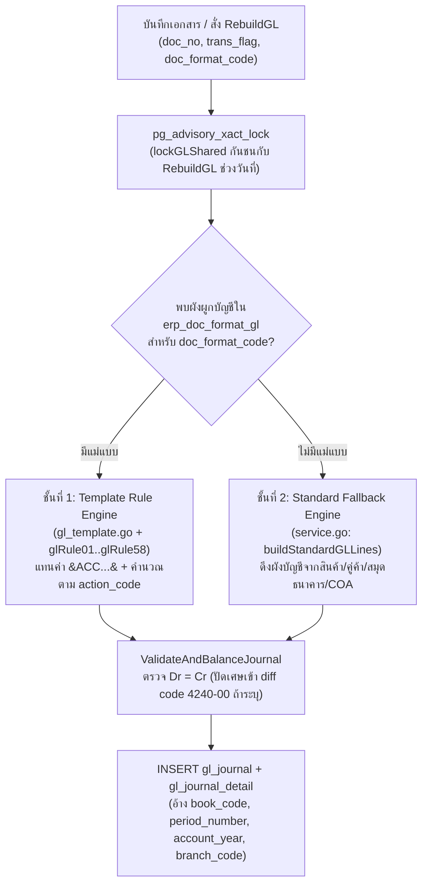

# กลไก GL Auto-Posting Engine ตัวแปร `&ACC...&` และกฎ `glRule01`–`glRule58`

BC Ai Account ใช้สถาปัตยกรรมการโพสต์บัญชีแยกประเภทอัตโนมัติแบบ **2 ชั้น (Two-Tier Posting Engine)** เพื่อให้ยืดหยุ่นตามผังผูกบัญชีของแต่ละบริษัท และรับประกันว่าใบสำคัญทุกใบสมดุล (`SUM(debit) = SUM(credit)`) 100% ตามกฎเหล็กบัญชีใน [[dev-rules-accounting-sql]]

---

## 1. สถาปัตยกรรม 2 ชั้นในการสร้างรายการบัญชี (`gl_journal` + `gl_journal_detail`)

### ชั้นที่ 1: Template Rule Engine (`gl_template.go` + `gl_template_rules.go`)
- อ่านบรรทัดแม่แบบจากตาราง **`erp_doc_format_gl`** ตามรหัส `doc_format_code` (ซึ่ง Seed ค่าเริ่มต้น 56 หน้าจอจาก `gl_template_defaults.json`)
- จับคู่ `screen_code` ของฟอร์แมตเข้ากับตาราง `glRuleByScreen` (`59` รหัสหน้าจอ → ฟังก์ชัน `glRule01` ถึง `glRule58`)
- แต่ละบรรทัดใน `erp_doc_format_gl` กำหนด `action_code` (หมายเลขสูตรดึงยอดเงิน), `debit_account_code`, `credit_account_code` และ `condition_case` (กรองตาม `inquiry_type + 1` เช่น `"1,3"` เฉพาะเงินเชื่อ หรือ `"2,4"` เฉพาะเงินสด)

### ชั้นที่ 2: Standard Fallback Engine (`service.go:buildStandardGLLines`)
- ทำงานอัตโนมัติเมื่อบริษัทสร้าง `doc_format_code` ใหม่แล้วยังไม่ได้ผูกบรรทัดใน `erp_doc_format_gl`
- สร้างคู่บัญชีมาตรฐานครบทุกขา (ยอดสินค้า/บริการ, ภาษีซื้อ/ภาษีขาย, ภาษีพัก ม.78/1, เจ้าหนี้ยังไม่ถึงกำหนด `2113-00`, หักมัดจำ/เงินล่วงหน้า, ภาษีหัก ณ ที่จ่าย, เงินสด/โอน/เช็ค/บัตรเครดิต และผลต่างอัตราแลกเปลี่ยน)

---

## 2. ความหมายตัวแปรผังบัญชีไดนามิก (`&ACC...&` Macros)

ในตาราง `erp_doc_format_gl` นักบัญชีและนักพัฒนาสามารถระบุรหัสบัญชีเป็นตัวแปร `&...&` คั่นด้วย `,` เพื่อกำหนดรหัสสำรอง (Fallback) เช่น `&ACCAR&,1121-00` หมายถึง *"ใช้ผังบัญชีเฉพาะของลูกหนี้รายนั้นก่อน ถ้าไม่ได้ตั้งไว้ให้ใช้ `1121-00`"* (`gl_template.go`):

| ตัวแปร Macro | แหล่งที่มาของรหัสผังบัญชีที่ระบบไปดึงมาแทนค่า | รหัสสำรองมาตรฐาน (TFRS) |
|---|---|---|
| **`&ACCAR&`** | รหัสบัญชีลูกหนี้เฉพาะรายใน `ar_customer_detail.account_code` (หรือ `ar_customer`) | `1121-00` ลูกหนี้การค้า |
| **`&ACCAP&`** | รหัสบัญชีเจ้าหนี้เฉพาะรายใน `ap_supplier_detail.account_code` (หรือ `ap_supplier`) | `2111-00` เจ้าหนี้การค้า |
| **`&ACC1&`** | รหัสบัญชีซื้อ/สินค้าคงเหลือระดับตัวสินค้า/กลุ่มสินค้า (`ic_inventory` → `account_code_1` / `group_code`) | `5111-00` ซื้อสินค้า หรือ `1131-00` สินค้าคงเหลือ |
| **`&ACC2&`** | รหัสบัญชีต้นทุนขายระดับตัวสินค้า/กลุ่มสินค้า (`ic_inventory` → `account_code_2`) | `5110-00` ต้นทุนขายสินค้า |
| **`&ACC3&`** | รหัสบัญชีรายได้จากการขายระดับตัวสินค้า/กลุ่มสินค้า (`ic_inventory` → `account_code_3`) | `4110-00` รายได้จากการขาย |
| **`&ACC4&`** | รหัสบัญชีรับคืน/ส่งคืนสินค้าตามทะเบียนสินค้า (`account_code_4`) | `4120-00` / `5112-00` |
| **`&ACC&`** | รหัสบัญชีตามบริบทของบรรทัดย่อย เช่น รหัสรายได้อื่น (`erp_income_list.account_code`), รหัสค่าใช้จ่ายอื่น (`erp_expenses_list.account_code`), หรือรหัสวงเงินสดย่อย (`cb_petty_cash.account_code`) | `4210-00` / `5290-00` / `1111-01` |
| **`&ACCBANK1&`** | รหัสบัญชีเงินฝากธนาคารของสมุดบัญชี (`erp_pass_book.account_code` หรือ `account_code_1`) จากแถวโอนเงิน/นำฝาก (`cb_trans_detail` `doc_type=1` หรือ `ic_trans_detail`) | `1112-01` เงินฝากออมทรัพย์ |
| **`&ACCBANK2&`** | รหัสบัญชีเช็คจ่ายล่วงหน้า/กระแสรายวันของสมุดบัญชี (`erp_pass_book.account_code_2`) สำหรับเช็คจ่าย | `2112-00` เช็คจ่ายลงวันที่ล่วงหน้า |
| **`&ACCBANK&`** | รหัสบัญชีเช็ครับล่วงหน้า / บัตรเครดิต / ธนาคาร ตามชนิดตราสาร (`doc_type = 2` → `1122-00`, `doc_type = 3` → `1123-00`) | `1122-00` หรือ `1123-00` |

---

## 3. ตารางดัชนี `glRuleByScreen` ทั้ง 59 รหัสหน้าจอ (`gl_template_rules.go:20-80`)

| รหัสหน้าจอ (`screen_code`) | `trans_flag` | กฎคำนวณ | คำอธิบายหน้าจอ |
|---|---:|---|---|
| `EPO`, `EPD`, `EPC` | `260, 264, 262` | `glRule01`–`glRule03` | ค่าใช้จ่ายอื่น / เพิ่มหนี้ / ลดหนี้ค่าใช้จ่ายอื่น |
| `OI`, `ODN`, `OCN` | `250, 254, 252` | `glRule04`–`glRule06` | รายได้อื่น / เพิ่มหนี้ / ลดหนี้รายได้อื่น |
| `PCD`, `PRM` | `300, 301` | `glRule07`–`glRule08` | คืน/ลดวงเงินสดย่อย และ รับ/เพิ่มวงเงินสดย่อย |
| `DM`, `WM`, `TM` | `401, 402, 422` | `glRule09`–`glRule11` | ฝากเงิน, ถอนเงิน, โอนเงินระหว่างธนาคาร |
| `CHP`, `CRT`, `CDE`, `CRC`, `CHD`, `CND` | `411, 412, 416, 413, 410, 418` | `glRule12`–`glRule17` | เช็ครับ: ผ่าน, คืน, เปลี่ยนเช็ค, ขาดสิทธิ์, นำฝาก, คืนเช็คตั้งหนี้ใหม่ |
| `CPP`, `CPR`, `CPE`, `CHC` | `451, 453, 456, 452` | `glRule18`–`glRule21` | เช็คจ่าย: ผ่าน, คืน, เปลี่ยนเช็ค, ขาดสิทธิ์ |
| `CRD`, `CRN`, `WLD` | `461, 462, 463` | `glRule22`–`glRule24` | บัตรเครดิตผ่าน, ยกเลิกบัตรเครดิต, Wallet ผ่าน |
| `EE`, `AOB`, `ADO`, `ACO` | `239, 99, 101, 103` | `glRule25`–`glRule28` | รับชำระหนี้ลูกหนี้, ตั้ง/เพิ่ม/ลดหนี้อื่นลูกหนี้ |
| `DE`, `COB`, `CCO`, `CDO` | `19, 87, 91, 89` | `glRule29`–`glRule32` | จ่ายชำระหนี้เจ้าหนี้, ตั้ง/ลด/เพิ่มหนี้อื่นเจ้าหนี้ |
| `IO`, `IM`, `IR`, `IA`, `IS`, `IF` | `56, 72, 58, 66, 68, 60` | `glRule33`–`glRule38` | เบิก, โอนออก, รับคืนเบิก, ปรับปรุงเพิ่ม, ปรับปรุงลด, รับสินค้าสำเร็จรูป |
| `PD`, `PDR`, `PC`, `PCR` | `10, 20, 11, 25` | `glRule39`–`glRule42` | จ่ายเงินล่วงหน้า/รับคืน, จ่ายเงินมัดจำ/รับคืน |
| `PU`, `PT`, `PA` | `12, 16, 14` | `glRule43`–`glRule45` | ซื้อสินค้า/บริการ, ส่งคืน/ลดหนี้ซื้อ, เพิ่มหนี้ซื้อ |
| `PI`, `PIU`, `PIA`, `PIC`, `PID` | `310, 315, 311, 317, 316` | `glRule46`–`glRule50` | ทะยอยรับตาม PO, ตั้งหนี้, ส่งคืนรับ, ลดหนี้, เพิ่มหนี้ |
| `SD`, `SDR`, `SRV`, `SRT` | `40, 42, 110, 112` | `glRule51`–`glRule54` | รับเงินล่วงหน้า/คืนเงิน, รับเงินมัดจำ/คืนเงิน |
| `SI`, `SIP`, `ST`, `SA` | `44, 44, 48, 46` | `glRule55`–`glRule57` | ขายสินค้า/บริการ, ขาย POS, รับคืน/ลดหนี้ขาย, เพิ่มหนี้ขาย |
| `ASS` | `1802` | `glRule58` | ขาย/จำหน่ายสินทรัพย์ถาวร |

---

## 4. กฎการรวมยอด การปัดเศษ และการสั่ง `RebuildGL`

1. **การรวมบรรทัดบัญชีซ้ำ (`erp_option.gl_trans_type`)**: หากตั้งค่า `gl_trans_type = 1` (Compound) และเอกสารหนึ่งมีสินค้าหลายชิ้นที่ชี้ไปยังผังบัญชีเดียวกัน (เช่น `4110-00`) ระบบจะรวมยอดลงบรรทัดเดียวโดยอัตโนมัติ ยกเว้นระบุ `action_code` แบบแยกบรรทัด (เช่น `1008` ตั้ง `noCompound = true` หรือรายการย่อยธนาคาร/เช็ค)
2. **การปัดเศษอัตโนมัติ (`action_code = 90`)**: บรรทัดที่มี `action_code = 90` (ปกติผูกกับ `4240-00`) ทำหน้าที่รับผลต่างทศนิยมระดับสตางค์ที่เกิดจากการคูณอัตราแลกเปลี่ยนหรือแยกภาษีรวมใน หากผลต่างไม่เกินเกณฑ์ปัดเศษ แต่ถ้ารายการไม่สมดุลจริง (เช่น ผังบัญชีหายข้างหนึ่ง) `ValidateAndBalanceJournal` จะปฏิเสธการบันทึกทันที
3. **วิธีบันทึกบัญชีสินค้าคงเหลือ (`erp_option.inventory_gl_post`)**:
   - **Periodic (`inventory_gl_post = 0` — ค่าเริ่มต้น SME ทั่วไป)**: `runGLTemplate` (`gl_template.go:284-286`) จะ **ข้ามแถวแม่แบบที่มี `condition_number` เป็น `101` หรือ `103` โดยอัตโนมัติ** บิลซื้อเดบิต `5111-00 ซื้อสินค้า` และบิลขายไม่ลงคู่บัญชีต้นทุนขายรายใบ
   - **Perpetual (`inventory_gl_post = 1` — ต่อเนื่อง)**: บิลซื้อเดบิต `1131-00 สินค้าคงเหลือ`, บิลขายสร้างคู่บัญชี `action_code = 101` (`Dr 5110-00 ต้นทุนขาย`) และ `action_code = 103` (`Cr 1131-00 สินค้าคงเหลือ`) จาก `sum_of_cost` ใน `ic_trans_detail`
   - *(หมายเหตุ: `loadGLOptions` ใน `gl_template.go:733-768` อ่านทั้ง `inventory_gl_post` Default `0` และ `discout_type` Default `1` จาก `erp_option`)*
4. **รายการ `glRebuildTransFlags` (`service.go:2562-2585`)**: เมื่อสั่งประมวลผลโพสต์บัญชีใหม่ (`RebuildGL`) ระบบจะใช้ Advisory Lock ป้องกันการชนกับผู้ใช้หน้าจอ ลบเฉพาะใบสำคัญที่เกิดจากเอกสารอัตโนมัติ (`trans_direct = 0` ในช่วงวันที่ที่เลือก โดย **ไม่แตะใบสำคัญที่คีย์มือ `trans_flag = 0` หรือใบประมวลผลค่าเสื่อม `1801` / ปิดบัญชี `journal_type = 2`**) แล้วสร้างใหม่ทั้งหมดให้ตรงกับเอกสารปัจจุบัน 100% *(หมายเหตุ: `trans_flag = 54` อยู่ใน `glRebuildTransFlags` เพื่อโพสต์ GL เฉพาะใบรับสินค้าสำเร็จรูปจากการผลิต BOM ที่เชื่อมกับ `ic_assembly_order.receipt_doc_no` เท่านั้น ส่วนเอกสารยอดยกมาสต็อก `54` ทั่วไปจะข้ามไม่โพสต์ GL)*

ดูตารางคู่บัญชี Dr/Cr รายหน้าจอครบทุกรหัสได้ที่ [[doc-gl-templates-trade-apar]] และ [[doc-gl-templates-cb-ic-fa]]
