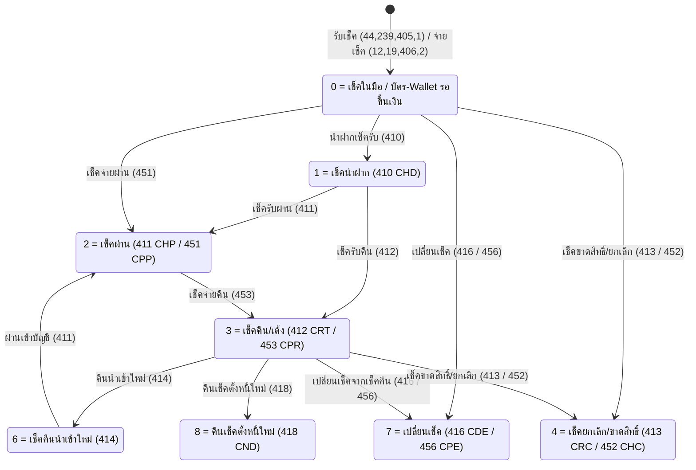

# ผลกระทบเอกสารต่อเงินสด ธนาคาร เงินสดย่อย ทะเบียนเช็ค บัตรเครดิต และ Wallet

ทุกครั้งที่มีการรับเงินหรือจ่ายเงินในเอกสารซื้อสด ขายสด/POS มัดจำ รายได้อื่น ค่าใช้จ่ายอื่น ใบเสร็จรับเงิน (`239`) หรือใบจ่ายชำระหนี้ (`19`) ระบบจะบันทึกส่วนประกอบการชำระเงินลงในตาราง **`cb_trans`** (สรุปยอดหัวบิล) และ **`cb_trans_detail`** (แจกแจงรายบรรทัดตามสมุดบัญชี/เลขที่เช็ค/เลขบัตร/ใบมัดจำ) พร้อมอัปเดตทะเบียนเช็คและบัตรใน **`cb_chq_list`** (ดู SQL รายงานการเงินครบชุดที่ [[sql-cb-cash-bank-balance]] และ [[sql-cb-cheque-card-register]])

---

## 1. โครงสร้าง `cb_trans` และรหัส `doc_type` ใน `cb_trans_detail`

### 1.1 ตารางหัวการรับ-จ่ายเงิน (`cb_trans`)
- เชื่อมกับเอกสารแม่ด้วย `(doc_no, trans_flag)`
- **`pay_type`**: `1` = รับเงิน (Cash/Bank Inflow), `2` = จ่ายเงิน (Cash/Bank Outflow)
- คอลัมน์ยอดเงินแยกตามช่องทาง (`NUMERIC`):
  - `cash_amount`: เงินสด
  - `sum_amount_transfer` (หรือ `tranfer_amount`): เงินโอนผ่านธนาคาร
  - `sum_amount_chq` (หรือ `chq_amount`): เช็ครับ / เช็คจ่าย
  - `sum_amount_credit_card` (หรือ `credit_card_amount`) และ `charge_word` / `credit_card_charge`: บัตรเครดิตและค่าชาร์จบัตร
  - `petty_cash_amount`: เงินสดย่อย
  - `sum_advance_amount` / `sum_deposit_amount`: ยอดตัดเงินล่วงหน้า / ยอดตัดเงินมัดจำ
  - `total_tax_at_pay`: ภาษีหัก ณ ที่จ่ายที่หักไว้ ณ วันรับ/จ่ายเงิน
  - `total_income_other` / `total_expense_other`: รายได้อื่น / ค่าใช้จ่ายอื่น (เช่น ค่าธรรมเนียมธนาคาร ส่วนลดเงินสด เงินขาด/เกิน)

### 1.2 รหัส `doc_type` ในตารางรายละเอียดช่องทางชำระเงิน (`cb_trans_detail`)

| `doc_type` | ช่องทางการรับ-จ่าย | คอลัมน์อ้างอิงสำคัญใน `cb_trans_detail` |
|---:|---|---|
| **`1`** | เงินโอนธนาคาร (Bank Transfer) | `pass_book_code` → `erp_pass_book.code`, `bank_code`, `bank_branch`, `amount` |
| **`2`** | เช็ครับ / เช็คจ่าย (Cheque) | `chq_number` → `cb_chq_list.chq_number`, `chq_due_date`, `bank_code`, `pass_book_code` (สำหรับเช็คจ่าย), `amount` |
| **`3`** | บัตรเครดิต (Credit Card) | `trans_number` / `chq_number` (เลขสลิป/บัตร), `credit_type`, `charge_value`, `amount` |
| **`4`** | เงินสดย่อย (Petty Cash) | `trans_number` / `petty_cash_code` → `cb_petty_cash.code`, `amount` |
| **`5`** | ตัดเงินล่วงหน้า (Advance Cut) | `trans_number` = เลขที่ใบเงินล่วงหน้า (`10, 9010` หรือ `40, 9040`), `amount` |
| **`6`** | ตัดเงินมัดจำ (Deposit Cut) | `trans_number` = เลขที่ใบเงินมัดจำ (`11, 9011` หรือ `110, 9110`), `amount` |
| **`11`** | ค่าใช้จ่ายอื่น / หักอื่นๆ ณ วันรับ-จ่าย | `trans_number` → `erp_expenses_list.code`, `amount` |
| **`12`** | รายได้อื่น / รับเพิ่มอื่นๆ ณ วันรับ-จ่าย | `trans_number` → `erp_income_list.code`, `amount` |
| **`21`** | กระเป๋าเงินอิเล็กทรอนิกส์ (e-Wallet) | เชื่อมรายการขึ้นเงิน Wallet (`trans_flag = 463`) |

> **กฎเหล็กการกรองยกเลิกของ `cb_trans` และ `cb_trans_detail` (`cbmParentOK` ใน `report_menu_cb.go:155-160`)**:
> นอกจากการตรวจ `COALESCE(cb.last_status, 0) = 0` แล้ว ต้องตรวจสถานะเอกสารแม่ตาม `trans_flag` เสมอ:
> - ถ้า `trans_flag IN (19, 239)` → ตรวจหัวใน **`ap_ar_trans`** ว่า `COALESCE(last_status, 0) = 0`
> - ถ้า `trans_flag = 1802` → ตรวจหัวใน **`as_trans`** ว่า `COALESCE(last_status, 0) = 0`
> - รหัสอื่นๆ ทั้งหมด → ตรวจหัวใน **`ic_trans`** ว่า `COALESCE(last_status, 0) = 0`

---

## 2. ทะเบียนเช็ค บัตรเครดิต และ Wallet (`cb_chq_list`)

ตาราง `cb_chq_list` เก็บทะเบียนตราสารรอเรียกเก็บ/รอตัดบัญชี แยกประเภทด้วยคอลัมน์ **`chq_type`**:
- `chq_type = 1`: เช็ครับจากลูกค้า (Post-dated Cheque Received)
- `chq_type = 2`: เช็คจ่ายให้เจ้าหนี้ (Post-dated Cheque Payable — ผูกสมุดบัญชีกระแสรายวัน `pass_book_code`)
- `chq_type = 3`: สลิปบัตรเครดิตรับรอขึ้นเงิน (Credit Card Slip Receivable)
- `chq_type = 21`: รายการรับชำระผ่าน e-Wallet รอโอนเข้าธนาคาร

### State Machine ของสถานะเช็คและบัตร (`cb_chq_list.status` จาก `cheque.go:19-41` และ `report_menu_cb.go:152, 559, 583`)

| ค่า `status` | ความหมายใน `cbmChqStatus` และ `chequeStatusSQL` | เอกสาร `trans_flag` ที่ทำให้เกิดสถานะ & ผลต่อ GL |
|---:|---|---|
| **`0`** | เช็คในมือ (`405/406`) / บัตรเครดิตและ Wallet รอขึ้นเงิน | รับเช็ค/จ่ายเช็ค/บัตรตั้งต้น — เช็ครับ `1122-00`, เช็คจ่าย `2112-00`, บัตร `1123-00` (ยังไม่ออก `410`–`463`) |
| **`1`** | เช็คนำฝาก (`chq_type = 1`) / **บัตร-Wallet ขึ้นเงินแล้ว (`chq_type = 3, 21`)** | `410 CHD` → `1122-01` เช็ครับระหว่างเรียกเก็บ / **`461 CRD` หรือ `463 WLD` → ตัดยอดบัตรหรือ Wallet เข้าธนาคารแล้ว (`cheque.go:25-27, 41`)** |
| **`2`** | เช็คผ่าน (`chq_type = 1, 2`) / **ยกเลิกบัตรเครดิต (`chq_type = 3`)** | `411 CHP` / `451 CPP` → เงินเข้า/ออกสมุดธนาคารตาม `erp_pass_book` / **`462 CRN` → ยกเลิกบัตรเครดิต (`cheque.go:25, 41`)** |
| **`3`** | เช็คคืน / เช็คเด้ง (`chq_type = 1, 2`) | `412 CRT` (กลับบัญชี `1122-00`) / `453 CPR` (`Dr ธนาคาร / Cr เจ้าหนี้`) |
| **`4`** | เช็คยกเลิก / เช็คขาดสิทธิ์ (`chq_type = 1, 2`) | `413 CRC` (`Dr ลูกหนี้ / Cr 1122-00`) / `452 CHC` (`Dr ธนาคาร / Cr เจ้าหนี้`) |
| **`5`** | เช็คขายลด (`cbmChqStatus` ใน `report_menu_cb.go:152`) | ป้ายสถานะรายงานสำหรับเช็คขายลด |
| **`6`** | เช็คคืนนำเข้าใหม่ (`chq_type = 1`) / เอกสารต้นทางถูกยกเลิก | `414` (`cheque.go:19, 47` แมป `414 → 6`; `service.go:2456` ใช้ใน `glRebuildTransFlags`) **และ** `chequeStatusSQL` (`cheque.go:36-43`) ตั้ง `status = 6` อัตโนมัติเมื่อเอกสารต้นทาง (`ic_trans` หรือ `ap_ar_trans`) มี `last_status = 1` |
| **`7`** | เช็คเปลี่ยน (`chq_type = 1, 2`) | `416 CDE` / `456 CPE` (จับคู่ใบเดิมผ่าน `COALESCE(NULLIF(d.chq_number, ''), d.item_code)`) |
| **`8`** | เช็คตั้งหนี้ใหม่ (`chq_type = 1`) | `418 CND` (`Dr 1121-00 ลูกหนี้การค้า / Cr 1122-00 เช็ครับ`, จับคู่ด้วย `d.item_code`) |

> **ข้อควรระวังสำหรับบัตรเครดิต (`chq_type = 3`) และ Wallet (`chq_type = 21`)**:
> 1. ใน `chequeStatusSQL` (`cheque.go:46-49`): `461 → 1`, `462 → 2`, `463 → 1` ดังนั้นรายการที่ **รอขึ้นเงิน** คือ **`COALESCE(c.status, 0) = 0`** เท่านั้น (ตรงกับ `menu_statement_advance` ใน `report_menu_cb.go:583`: `((c.chq_type IN (1, 2) AND c.status IN (0, 1)) OR (c.chq_type = 3 AND c.status = 0))`)
> 2. **เคล็ดลับการเชื่อมประวัติเช็ค**: เอกสารปฏิบัติการเช็คและบัตร (`410`–`463`) เก็บรายการเช็คแต่ละใบไว้ในตาราง **`ic_trans_detail`** โดยใส่เลขที่เช็คใน `ic_trans_detail.chq_number` และใส่รหัสสมุดเงินฝากธนาคารใน `ic_trans_detail.item_code` (ยกเว้น `418` และ `416`/`456` รุ่นเก่าที่เก็บรหัสเช็คเดิมไว้ใน `item_code` ด้วยตาม `cheque.go:54-60`)
> 3. **อัปเดตสถานะอัตโนมัติและการค้นหาเช็คข้ามคู่ค้า**: `rebuildTransDerived` (`trans.go:775-829`, โดยเฉพาะ `810-827`) อ่านเลขที่เช็คในแท็บรับ-จ่ายเงินจาก `cb_chq_list` ด้วย เพื่อคำนวณ `cb_chq_list.status` ใหม่ให้ทั้งเอกสารบริหารเช็ค (`isChequeFlag`) และเอกสารทั่วไปที่มีเช็คในแท็บรับ-จ่ายเงิน; ส่วน `ChequeCandidates` (`cheque.go:283-301`) เมื่อเปิด `SearchChequeOtherCust` จะค้นหาเช็คข้ามคู่ค้าได้สำหรับ `416, 418, 456` (`c.status IN (0,3)`)

---

## 3. คู่แฝดโอนเงินระหว่างธนาคาร (`422` → `420` `SyncTransferPair`)

คล้ายกับการโอนคลังสินค้า (`72`→`70`) เมื่อบันทึกเมนู **โอนเงินระหว่างธนาคาร** (`trans_flag = 422`, ฟอร์แมต `TM`):
- บรรทัด `ic_trans_detail` ของ `422` เก็บรหัสสมุดบัญชีต้นทาง (ขาโอนออก) ใน `item_code` และสมุดบัญชีปลายทาง (ขารับโอนเข้า) ใน `item_code_2` พร้อมค่าธรรมเนียมธนาคารใน `fee_amount` (หรือ `sum_of_cost`)
- ฟังก์ชัน `SyncTransferPair` สร้างรายการคู่แฝด **`trans_flag = 420`** (ขาเงินเข้าสมุดปลายทาง) ด้วย `doc_no` เดียวกัน เพื่อให้รายงานเคลื่อนไหวบัญชีเงินฝากธนาคาร (`cbmPassbookCTE` ใน `report_menu_cb.go:765-798`) ดึงยอดเคลื่อนไหวของสมุดเงินฝากทั้ง 4 แหล่งได้อย่างครบถ้วน:
  1. เงินโอนรับ/จ่ายจากเอกสารการค้าและรับ-จ่ายชำระหนี้ (`cb_trans_detail` ที่ `doc_type = 1`)
  2. เอกสารฝาก-ถอน-โอน-เช็คผ่าน-ขึ้นเงินบัตร (`ic_trans_detail` ที่ `trans_flag IN (401, 402, 411, 412, 420, 422, 451, 453, 461, 463)`)
  3. ค่าธรรมเนียมธนาคารของใบโอนเงิน `422` (`fee_amount`)
  4. ยอดยกมาสมุดเงินฝากธนาคาร (`ic_trans` ที่ `trans_flag = 604`)
