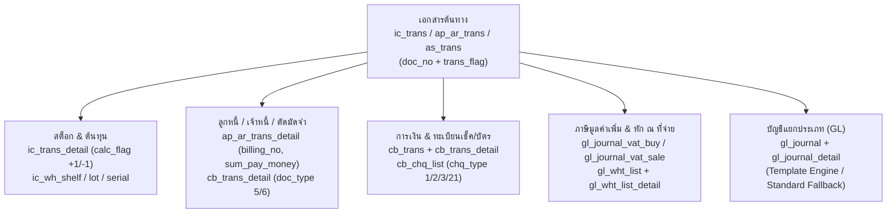

# ภาพรวมประเภทเอกสาร รหัส `trans_flag` และผลกระทบทางบัญชี

ในระบบ BC Ai Account เอกสารทางธุรกิจทุกหน้าจอจะถูกระบุตัวตนด้วยรหัสตัวเลข **`trans_flag`** (`INTEGER`) ควบคู่กับรหัสรูปแบบเอกสาร **`doc_format_code`** (เช่น `SI`, `PU`, `EE`, `DE`, `JV`) และประเภทธุรกรรมหลัก **`trans_type`** (`0`=โอน/รายวันทั่วไป, `1`=ซื้อ/เจ้าหนี้/จ่าย, `2`=ขาย/ลูกหนี้/รับ, `3`=คลังสินค้า)

เอกสารนี้เป็นจุดเริ่มต้นสำหรับนักพัฒนาและ AI ที่ต้องการต่อยอดระบบ อ่านข้อมูลข้ามโมดูล หรือสร้างรายงานทางการเงินให้ตรงตามมาตรฐาน BC 5.5 และ TFRS 100% (ดูแผนที่หลักที่ [[index]], คู่มือนักพัฒนาที่ [[playbook-dev]] และกฎเหล็กตัวเลขที่ [[dev-rules-accounting-sql]])

---

## 1. สถาปัตยกรรม 5 ตารางหัวเอกสารหลัก (Header Tables)

ระบบไม่ได้แยกตารางตามเมนูย่อยนับร้อยตาราง แต่จัดกลุ่มเก็บหัวเอกสารไว้ใน **5 ตารางหลัก** ตามบทบาททางธุรกิจ และแยกข้อมูลประกอบ (การชำระเงิน ภาษี รายการบัญชี) ออกเป็นตารางบริวารที่ใช้คีย์ร่วม `(doc_no, trans_flag)`:

| ตารางหัวเอกสาร | ตารางรายละเอียด (Detail) | เก็บเอกสารกลุ่มใด (`trans_flag` หลัก) | คอลัมน์กรองยกเลิก |
|---|---|---|---|
| `ic_trans` | `ic_trans_detail` | ซื้อ-ขาย-สั่งจอง-มัดจำ (`2`–`52`, `110`–`113`, `310`–`337`), คลังสินค้า (`54`–`76`, `122`–`128`, `276`), ตั้ง/เพิ่ม/ลดหนี้อื่น AP/AR (`81`–`104`), รายได้/รายจ่ายอื่น (`250`–`265`), เงินสดย่อย (`300`–`303`), ฝาก-ถอน-โอน-เช็ค-บัตร-Wallet (`401`–`476`, `602`, `604`), ยกมามัดจำ (`9010`–`9110`) | `COALESCE(last_status, 0) = 0` |
| `ap_ar_trans` | `ap_ar_trans_detail` | ใบรับวางบิลเจ้าหนี้ (`213`), ใบวางบิลลูกหนี้ (`235`), จ่ายชำระหนี้เจ้าหนี้ (`19`), รับชำระหนี้ลูกหนี้ (`239`) และเอกสารยกเลิก (`23, 214, 236, 240`) | `COALESCE(last_status, 0) = 0` |
| `cb_trans` | `cb_trans_detail` | ส่วนสรุปช่องทางรับ-จ่ายเงิน (เงินสด เงินโอน เช็ค บัตรเครดิต เงินสดย่อย ตัดมัดจำ ภาษีหัก ณ ที่จ่าย) ของเอกสารการค้าและเอกสารการเงินทุกชนิด | `COALESCE(last_status, 0) = 0` + ตรวจหัวเอกสารแม่ |
| `as_trans` | `as_trans_detail` | ประมวลผลค่าเสื่อมราคาสินทรัพย์ถาวร (`1801`) และขาย/จำหน่ายสินทรัพย์ถาวร (`1802`) | `COALESCE(last_status, 0) = 0` (เฉพาะ `1802`; ส่วน `1801` ใช้การลบทั้งใบ) |
| `gl_journal` | `gl_journal_detail` | สมุดรายวันทั่วไป/รับ/จ่าย/ซื้อ/ขาย ทั้งที่บันทึกมือ (`trans_flag = 0` หรือ `601`) และที่โพสต์อัตโนมัติจากเอกสารต้นทางทุกโมดูล | `COALESCE(is_pass, 0) IN (0, 1)` และตรวจเอกสารต้นทางไม่ถูกยกเลิก |

> **ข้อควรระวังสำคัญ**: เอกสารกลุ่มตั้งหนี้/เพิ่มหนี้/ลดหนี้ยกมาและหนี้อื่นๆ ของ AP (`81`–`92`) และ AR (`93`–`104`) ถูกเก็บอยู่ในตาราง **`ic_trans`** (ไม่ใช่ `ap_ar_trans`) ตามโครงสร้างดั้งเดิมของ BC 5.5 โดย `ap_ar_trans` จะเก็บเฉพาะใบวางบิล (`213`, `235`) และใบรับ/จ่ายชำระหนี้ (`19`, `239`) เท่านั้น

---

## 2. แผนผังการไหลของข้อมูลจาก 1 เอกสารสู่ตารางบริวาร

เมื่อบันทึกเอกสารผ่าน Process Engine ระบบจะประมวลผลภายใน Database Transaction เดียวกัน:
1. บันทึกหัวเอกสารและรายการบรรทัด พร้อมคำนวณภาษีและส่วนลดด้วยทศนิยมแม่นยำ (`*big.Rat` / `NUMERIC`)
2. อัปเดตสถานะการอ้างอิงเอกสารต้นทาง (`used_status`, `doc_success`) ตามกติกาใน [[doc-flow-and-status]]
3. บันทึกตารางการรับ-จ่ายเงิน (`cb_trans`, `cb_trans_detail`) และทะเบียนเช็ค/บัตรเครดิต (`cb_chq_list`)
4. สร้างรายการภาษีซื้อ/ภาษีขาย (`gl_journal_vat_buy`, `gl_journal_vat_sale`) และภาษีหัก ณ ที่จ่าย (`gl_wht_list`, `gl_wht_list_detail`)
5. โพสต์บัญชีแยกประเภท (`gl_journal`, `gl_journal_detail`) ผ่านผังบัญชีผูกเอกสาร (`erp_doc_format_gl`) หรือ fallback มาตรฐาน พร้อมตรวจสอบ `SUM(debit) = SUM(credit)` เสมอ

---

## 3. สารบัญหมวด `doctypes` ทั้งหมด

### หมวดรหัสเอกสาร การอ้างอิง และการยกเลิก
- [[doc-trans-flag-catalog]] — ตารางแม่บทรหัส `trans_flag` ครบทุกโมดูล (ซื้อ, ขาย, POS, สต็อก, AP, AR, การเงิน, เช็ค/บัตร/Wallet, GL, สินทรัพย์, ยกเลิก, อนุมัติ, ยอดยกมา)
- [[doc-formats-and-books]] — รหัสรูปแบบเอกสารมาตรฐาน 163 รายการ (`erp_doc_format`), สมุดรายวัน 5 เล่ม (`gl_journal_book` `01`–`05`) และกติการันเลขที่เอกสารอัตโนมัติ
- [[doc-flow-and-status]] — สายโซ่การอ้างอิงเอกสาร (Document Flow Graph) และการคำนวณสถานะ `last_status`, `used_status`, `used_status_2`, `doc_success`, `approve_status`
- [[doc-cancel-and-approve]] — กลไกเอกสารใบยกเลิก/ใบอนุมัติแยกใบ, การยกเลิกรายบรรทัด (`cancel_type = 2`), การล็อกเอกสารที่ถูกอ้างอิง และการกลับรายการ GL อัตโนมัติ
- [[doc-calc-vat-discount]] — สูตรคำนวณส่วนลด (`discount_word`), ภาษีมูลค่าเพิ่ม 4 รูปแบบ (`vat_type` `0`–`3`), สินค้าชุด และความหมาย `inquiry_type` แยกตาม `trans_flag`

### หมวดผลกระทบต่อโมดูลย่อย (Sub-ledger Impacts)
- [[doc-impact-stock-lot-serial]] — ผลกระทบต่อสต็อก (`calc_flag` `+1`/`-1`/`0`), คู่แฝดใบโอนคลัง `72`→`70`, ลำดับคำนวณต้นทุนเฉลี่ย/FIFO และล็อต/ซีเรียล
- [[doc-impact-ar-ap-deposit]] — เงื่อนไขตั้งหนี้/ลดหนี้ AR & AP, บทบาท 3 แบบของ `ap_ar_trans_detail`, เครื่องหมายลบของใบลดหนี้ และการตัดเงินมัดจำ/เงินล่วงหน้า
- [[doc-impact-tax-vat-wht]] — กติกาตารางภาษีซื้อ-ภาษีขาย, ภาษีบริการยังไม่ถึงกำหนด (มาตรา 78/1) และทะเบียนภาษีหัก ณ ที่จ่าย
- [[doc-impact-cash-bank-cheque]] — โครงสร้าง `cb_trans` / `cb_trans_detail`, สถานะเช็ครับ-เช็คจ่าย-บัตรเครดิต-Wallet (`cb_chq_list`) และคู่แฝดโอนเงินธนาคาร `422`→`420`

### หมวดผังบัญชีและการลงบัญชีอัตโนมัติ (GL Auto-Posting & TFRS COA)
- [[doc-gl-coa-standard]] — ผังบัญชีมาตรฐาน TFRS (`XXXX-XX` ครบ 68 บัญชี), ประเภทหมวดบัญชี `0`–`4` และการจับคู่ผังบัญชีปรับแต่งเอง
- [[doc-gl-posting-engine]] — กลไก GL Posting Engine 2 ชั้น (`glRule01`–`glRule58` + `buildStandardGLLines`), ตัวแปร `&ACC...&`, การปัดเศษ และการล็อก Rebuild GL
- [[doc-gl-templates-trade-apar]] — ตารางแม่แบบคู่บัญชี Dr/Cr และ `action_code` หมวดซื้อ, ขาย/POS, เจ้าหนี้ (AP) และลูกหนี้ (AR)
- [[doc-gl-templates-cb-ic-fa]] — ตารางแม่แบบคู่บัญชี Dr/Cr และ `action_code` หมวดเงินสด/ธนาคาร/เงินสดย่อย, เช็ค/บัตร/Wallet, สต็อก และสินทรัพย์ถาวร

---

## 4. เชื่อมโยงหมวดอื่นสำหรับนักพัฒนา
- โครงสร้างคอลัมน์และ Primary Key ของแต่ละตาราง → [[schema-overview]]
- คำสั่ง SQL `SELECT` / `WITH` สำเร็จรูปสำหรับดึงยอดขาย ลูกหนี้ เจ้าหนี้ งบการเงิน และภาษี → [[sql-overview]]
- การเรียกใช้งานผ่าน MCP Gateway และ Process/Report API → [[api-overview]] และ [[api-mcp-gateway]]
- สถาปัตยกรรมระบบ Multi-Tenant และการพัฒนาต่อยอด → [[arch-overview]] และ [[dev-integration-quickstart]]
- [[posts_rule::doc-price-engine-ref-import-calc]] — ลำดับการดึงราคาขาย 7 ขั้น สูตรส่วนลด การปัดเศษ การดึงเอกสารอ้างอิง และ Subledger Reconcile
- [[posts_rule::doc-marketplace-payroll-dbd-evrt]] — กฎคำนวณและลงบัญชี GL ของ Marketplace, Payroll ม.33 (2569), DBD Taxonomy, e-VRT ภ.พ.10 และ Print Audit
