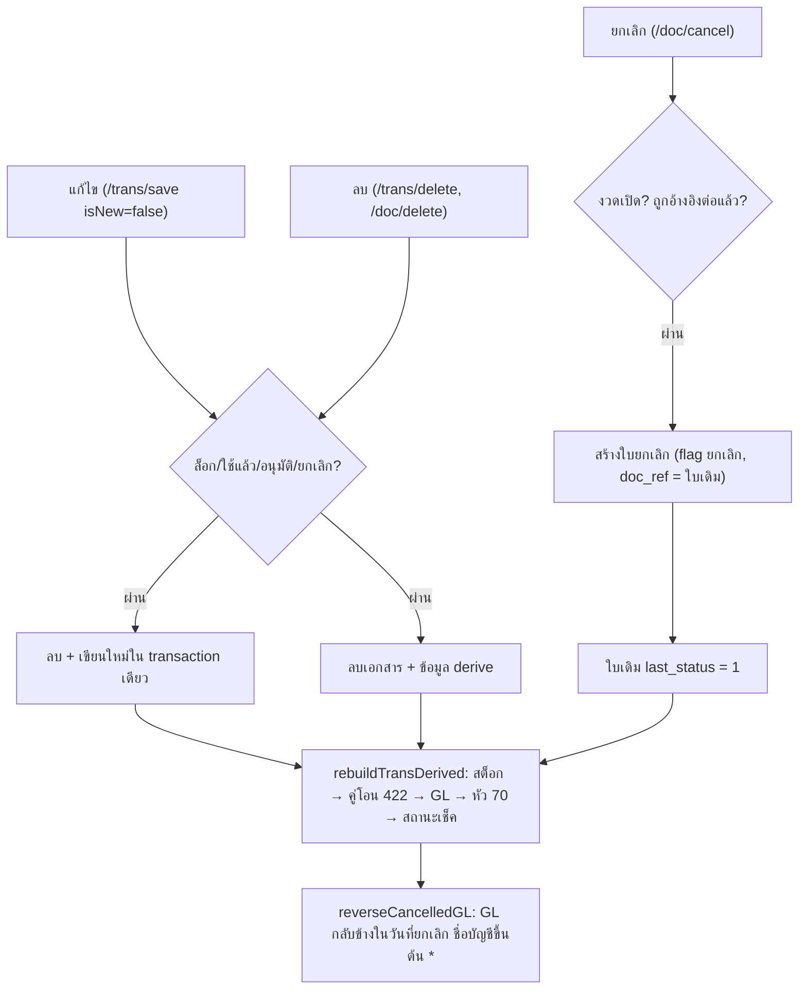

# แก้ไข ลบ ยกเลิกเอกสาร และผลย้อนกลับ (Edit, Delete, Cancel & Reversal)

ระบบมี 3 ทาง:
- แก้ไข: ลบแล้วเขียนเอกสารเดิมใหม่ทั้งใบ
- ลบ: เอกสารหายไปพร้อมข้อมูลที่ derive จากมัน
- ยกเลิก: สร้างเอกสารยกเลิกใบใหม่ที่อ้างใบเดิม แล้วกลับรายการ GL ในวันที่ยกเลิก

ทั้งสามทางจะคำนวณสต็อก/GL/เช็คใหม่ด้วย `rebuildTransDerived` เสมอ ดู [[acc-transaction-delete-edit]] และ [[proc-doc-cancel-approve]]

## ภาพรวม

## ขั้นตอน

| ขั้น | เอกสาร/หน้าจอ | ตารางที่เขียน | ผลบัญชี/สต็อก | path:line |
|---|---|---|---|---|
| 1 | แก้ไขเอกสารสินค้า (`SaveTrans` เอกสารเดิม) | [[tbl-ic-trans]], [[tbl-ic-trans-detail]] + ตารางลูก (ลบแล้วเขียนใหม่) | ล็อกเอกสารและสินค้า แล้วคำนวณสต็อกของสินค้าทั้งชุดเก่าและใหม่ สร้าง GL ใหม่ | `backend/internal/application/process/trans.go:267`, `:510`, `:593` |
| 2 | ลบเอกสารสินค้า (`DeleteTrans`) | ลบ ic_trans และข้อมูลลูก, GL อัตโนมัติ | สต็อกของสินค้าในใบถูกคำนวณใหม่ GL ของใบหายไป | `backend/internal/application/process/trans.go:382`, `:395` |
| 3 | ลบเอกสารหนี้ (`DeleteDoc` → `apArPlan`) | ลบ [[tbl-ap-ar-trans-detail]], [[tbl-ap-ar-trans]], [[tbl-cb-trans]], [[tbl-cb-trans-detail]], [[tbl-cb-chq-list]] | ยอดค้างของบิลกลับมา (คำนวณสด) · GL ของ 19/239 ถูกสร้างใหม่ | `backend/internal/application/process/docs.go:166`, `:179`, `:220`, `:483` |
| 4 | ยกเลิกเอกสาร (`CancelDoc`) หน้าจอ `UniversalCancelConfirmScreen` | ใบยกเลิกใหม่ใน `ic_trans`/`ap_ar_trans` (flag ยกเลิก + `doc_ref`) · ยกเลิกรายบรรทัด (`CancelType=2`) เขียนรายการยกเลิกด้วย | ใบเดิม `last_status=1` → หลุดจาก `stockRowsSQL` และรายงาน VAT · สถานะ doc flow ของใบต้นทางคำนวณใหม่ | `backend/internal/application/process/doc_cancel.go:120`, `:135`, `:162-178`, `:181`, `:187`, `:190`, `frontend/account/transaction/UniversalCancelConfirmScreen.tsx` |
| 5 | กลับรายการ GL ของใบยกเลิก | [[tbl-gl-journal]], [[tbl-gl-journal-detail]] ในเลขที่ใบยกเลิก | สลับ Dr/Cr ของ GL ใบเดิมทุกบรรทัด ลงวันที่ใบยกเลิก ชื่อบัญชีขึ้นต้นด้วย `*` · GL ใบเดิมยังอยู่ ผลรวมสุทธิเป็นศูนย์ | `backend/internal/application/process/doc_cancel.go:585-662`, `backend/internal/application/process/service.go:1678` |
| 6 | คืนสถานะ (Undo) | ลบใบยกเลิกและรายการกลับ | ใบเดิมกลับมาเป็น last_status 0 สต็อก/GL คำนวณใหม่ | `backend/internal/application/process/doc_cancel.go:151-157`, `:339`, `:625` |
| 7 | อนุมัติ/ไม่อนุมัติ (`ApproveDoc`) | ใบสถานะใหม่ (เช่น 4, 8, 38, 52) | ไม่มีผลบัญชี | `backend/internal/application/process/doc_cancel.go:205`, `:215`, `backend/internal/adapter/inbound/http/router.go:180` |

คู่ใบยกเลิก ← ใบเดิม (`cancelOrigFlags`, `doc_cancel.go:49-60`):

| กลุ่ม | ใบยกเลิก ← ใบเดิม |
|---|---|
| ซื้อ | 3←2, 7←6, 13←12, 15←14, 17←16, 330←310, 331←311, 335←315, 336←316, 337←317 |
| มัดจำซื้อ | 150←10, 151←11, 161←20, 152←25 |
| ขาย | 31←30, 39←34, 37←36, 45←44, 47←46, 49←48 |
| มัดจำขาย | 41←40, 111←110, 43←42, 113←112 |
| คลัง | 55←54, 57←56, 59←58, 61←60, 67←66, 69←68, 73←{70,72}, 123←122, 125←124 |
| หนี้อื่น | 88←87, 90←89, 92←91, 100←99, 102←101, 104←103 |
| รายได้/ค่าใช้จ่ายอื่น | 251←250, 253←252, 255←254, 261←260, 263←262, 265←264 |
| เงินสด/ธนาคาร | 302←300, 303←301, 403←401, 404←402, 423←422 |
| เช็ค | 407←406, 430←410, 431←411, 432←412, 433←413, 434←414, 436←416, 471←451, 472←452, 473←453, 476←456 |
| ap_ar_trans | 214←213, 23←19, 236←235, 240←239 |

## จุดตรวจสอบ/validation

- แก้/ลบ/ยกเลิกต้องอยู่ในงวดเปิด:
  - ยกเลิกใช้ `checkCancelPeriod` (`doc_cancel.go:143`, `period.go:95`)
  - ลบตรวจวันที่ที่เก็บไว้ (`period.go:68`, `:116`)
  - ดู [[flow-period-year-close]]
- `refuseLockedRecord` (`trans_validate.go:112`):
  - `is_lock_record=1` แก้/ลบ/ยกเลิกไม่ได้
  - ใบปรับ 66 จากต้นทุนแฝงต้องแก้จากเมนูประมวลผล (2.22)
- `checkStoredEditable` (`trans_validate.go:142`) ห้ามแก้/ลบใบที่:
  - ถูกใช้แล้ว หรือปิดรายการแล้ว
  - ยกเลิกแล้ว
  - อนุมัติแล้ว (34)
  - เป็นสำเนา
- ยกเลิกทั้งใบต้องยังไม่ถูกอ้างอิงต่อ (`refuseIfReferenced`, `doc_cancel.go:497`) ยกเลิกรายบรรทัดยกเลิกได้ไม่เกินยอดคงเหลือของบรรทัด (`doc_cancel.go:162-166`)
- มัดจำที่ถูกใช้แล้วลบไม่ได้ (`trans_deposit.go:246`)
- เลขที่ใบยกเลิกจองด้วย advisory lock `docno:` (`doc_cancel.go:433`) ดู [[proc-doc-flow-numbering]]

## ข้อผิดพลาดที่พบบ่อยตามโค้ด

| ข้อความ | สาเหตุ | path:line |
|---|---|---|
| "ไม่พบเอกสารที่จะแก้ไข : ..." | แก้ใบที่ถูกลบไปแล้ว | `backend/internal/application/process/trans_validate.go:68` |
| "Lock เด็ดขาด : ห้ามแก้ไข หรือลบข้อมูล" | `is_lock_record=1` | `backend/internal/application/process/trans_validate.go:124` |
| "ห้ามแก้ไข หรือลบข้อมูล" | ใบถูกใช้/อนุมัติ/ยกเลิกแล้ว | `backend/internal/application/process/trans_validate.go:155` |
| "เอกสาร ... ถูกยกเลิกแล้ว" | ยกเลิกซ้ำ | `backend/internal/application/process/doc_cancel.go:160` |
| "เอกสาร ... มีการอ้างอิงไปแล้วโดยเอกสาร ..." | มีใบปลายทางอ้างอยู่ ต้องยกเลิกใบปลายทางก่อน | `backend/internal/application/process/doc_cancel.go:543` |
| "เลขที่เอกสารยกเลิกซ้ำกับรายการบัญชีของเอกสารประเภทอื่น..." | เลขใบยกเลิกชนเลข GL เดิม (23505) | `backend/internal/application/process/doc_cancel.go:659-662` |

- GL ใบเดิมไม่ถูกลบตอนยกเลิก รายงาน GL จึงเห็นทั้งรายการเดิมและรายการกลับ (`*ชื่อบัญชี`) ต่างวันกันได้
- ใบที่ลง GL ด้วยมือ (`trans_direct=1`) จะไม่ถูกสร้าง GL ใหม่หลังแก้ ([[acc-gl-rebuild]])

## ที่มาในโค้ด

- `backend/internal/application/process/trans.go:267`, `:382`, `:395`, `:510`, `:593` — บันทึก/ลบ/derive
- `backend/internal/application/process/trans_validate.go:43`, `:68`, `:112-124`, `:142-155` — ตรวจก่อนแก้/ลบ
- `backend/internal/application/process/docs.go:166`, `:179`, `:220`, `:483` — ลบเอกสารหนี้
- `backend/internal/application/process/doc_cancel.go:49-60`, `:120-190`, `:205-260`, `:339`, `:433`, `:497-543`, `:585-662` — ยกเลิก/อนุมัติ/กลับรายการ
- `backend/internal/application/process/service.go:1678` — เรียก `reverseCancelledGL` ระหว่างสร้าง GL
- `backend/internal/application/process/period.go:68`, `:95`, `:116` — งวดตอนลบ/ยกเลิก
- `backend/internal/adapter/inbound/http/router.go:176-180` — route `/trans/delete`, `/doc/save`, `/doc/delete`, `/doc/cancel`, `/doc/approve`
- `frontend/account/transaction/UniversalCancelConfirmScreen.tsx` — จอยืนยันยกเลิก
