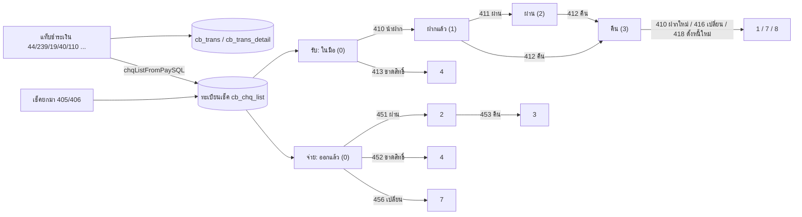

# เงินสด ธนาคาร และวงจรเช็ค (Cash, Bank & Cheque Lifecycle)

เงินเข้าออกทุกช่องทางเกิดจาก "แท็บชำระเงิน" ของเอกสารต้นทาง (ขายสด 44, รับชำระ 239, จ่ายชำระ 19, มัดจำ ฯลฯ) ซึ่งเขียน `cb_trans`/`cb_trans_detail` (`payStmts`, `trans.go:1338`) ส่วนเช็คที่รับ/จ่ายจะถูกนำเข้าทะเบียน `cb_chq_list` แล้วเดินสถานะด้วยเอกสารเช็คแต่ละชนิด ดู [[acc-payment-tab]] และ [[acc-cheque-transfer]]

## ภาพรวม

สถานะคำนวณใหม่จากแถวล่าสุด (เรียงวันที่/เวลาเอกสาร) ที่ `last_status = 0` ของเช็คแต่ละใบ (`chequeStatusSQL`, `cheque.go:32-63`):
- รับ (chq_type 1): 405→0, 410→1, 411→2, 412→3, 413→4, 414→6, 416→7, 418→8
- จ่าย (chq_type 2): 406→0, 451→2, 452→4, 453→3, 456→7
- บัตรเครดิต (chq_type 3): 461→1, 462→2
- wallet (chq_type 21): 463→1
- ไม่มีแถวใดเลย = 0

## ขั้นตอน

| ขั้น | เอกสาร/หน้าจอ | ตารางที่เขียน | ผลบัญชี | path:line |
|---|---|---|---|---|
| 1 | รายได้อื่น (250) / ค่าใช้จ่ายอื่น (260) และใบปรับ 252/254, 262/264 [[doc-other-income]] [[doc-other-expense]] [[doc-other-income-adjust]] [[doc-other-expense-adjust]] | [[tbl-ic-trans]], [[tbl-cb-trans]], GL | 250/254: Dr ช่องทางรับ (inquiry 1 หรือมี `cb_trans.total_amount_pay` > 0) หรือ Dr ลูกหนี้ / Cr รายได้ + ภาษีขาย · 252: Dr รายได้ + ภาษีขาย / Cr ช่องทางจ่ายเสมอ · 260/264: Dr ค่าใช้จ่าย + ภาษีซื้อ / Cr ช่องทางจ่าย (inquiry 1/3 หรือมี `total_amount_pay` > 0) หรือ Cr เจ้าหนี้ · 262: Dr ช่องทางรับเสมอ / Cr ค่าใช้จ่าย + ภาษีซื้อ · บัญชีรายได้/ค่าใช้จ่ายมาจาก `erp_income_list`/`erp_expenses_list.gl_account_code` ของรายการแรก | `frontend/account/tabs/transMenuMap.ts:1614`, `:1708`, `backend/internal/application/process/service.go:1821-1834`, `:1976-1994`, `:1995-2007`, `:2009-2059`, `:2061-2073` |
| 2 | เงินสดย่อย 300 (เมนู "คืน/ลด วงเงินสดย่อย") / 301 (เมนู "รับ/เพิ่ม วงเงินสดย่อย") [[doc-petty-cash]] | [[tbl-ic-trans]], [[tbl-ic-trans-detail]], [[tbl-cb-trans]], GL | 300: Dr เงินสดย่อย / Cr ช่องทางจ่าย · 301: Dr ช่องทางรับ / Cr เงินสดย่อย · บัญชีเงินสดย่อย = `cb_petty_cash.chart_of_account` ของรายการแรก ถ้าไม่มีใช้ลำดับ 1111-01 → 1112 → 1111 | `frontend/account/tabs/transMenuMap.ts:1802`, `:1817`, `backend/internal/application/process/service.go:2218-2231`, `backend/internal/application/process/gl_template.go:202` |
| 3 | ฝากเงิน (401) / ถอนเงิน (402) [[doc-bank-deposit-withdraw]] | [[tbl-ic-trans]], GL | 401: Dr ธนาคารตามสมุดบัญชีของแต่ละบรรทัด (`erp_pass_book.account_code_1`) / Cr เงินสด · 402: Dr เงินสด / Cr ธนาคาร · ถ้ายอดรวมบรรทัดไม่เท่ายอดเอกสาร ใช้บัญชีธนาคารของหัวเอกสารบรรทัดเดียว | `frontend/account/tabs/transMenuMap.ts:1891`, `:1906`, `backend/internal/application/process/service.go:2075-2133` |
| 4 | โอนระหว่างธนาคาร (422) [[doc-bank-transfer]] | [[tbl-ic-trans]], [[tbl-ic-trans-detail]] + คู่ขาเข้า 420 (`SyncTransferPair`) | Dr สมุดบัญชีปลายทาง (`item_code_2`) / Cr สมุดบัญชีต้นทาง (`item_code`) | `frontend/account/tabs/transMenuMap.ts:1921`, `backend/internal/application/process/service.go:2232-2252`, `backend/internal/application/process/cheque.go:101` |
| 5 | รับ/จ่ายเช็คในแท็บชำระเงิน หรือเช็คยกมา 405/406 [[doc-cheque-received-balance]] [[doc-cheque-paid-balance]] | [[tbl-cb-chq-list]], [[tbl-cb-trans-detail]] | ตอนรับ: Dr เช็ครับ 1122 · ตอนจ่าย: Cr เช็คจ่าย 2112 (ใน `payTenders`) · 405/406 ไม่ลง GL (ไม่อยู่ใน `glRebuildTransFlags`) | `backend/internal/application/process/trans.go:1543`, `backend/internal/application/process/cheque_forward.go:10`, `backend/internal/application/process/service.go:1871-1878`, `:1742-1756` |
| 6 | นำฝากเช็ครับ (410) `menu_cb_chq_in_payin` [[doc-cheque-received-lifecycle]] | [[tbl-ic-trans]], [[tbl-ic-trans-detail]], GL | Dr ธนาคาร (หรือ 1122-01 เช็คระหว่างเรียกเก็บ เมื่อเช็คใบนั้นมี 411 ที่ยังไม่ยกเลิก) / Cr เช็ครับ (ลำดับ 1122-00 → 1122 → 1121) | `frontend/account/tabs/transMenuMap.ts:2023`, `backend/internal/application/process/service.go:2260-2281` |
| 7 | เช็ครับผ่าน (411) `menu_cb_chq_in_pass` | ic_trans, GL และแก้ GL ของ 410 | Dr ธนาคาร / Cr 1122-01 เมื่อพบ 410 คู่กันที่ยังไม่ยกเลิก (และ UPDATE บรรทัด Dr ของ 410 ใน `gl_journal_detail` เป็น 1122-01) ถ้าไม่พบ 410 → Cr เช็ครับ 1122-00 | `frontend/account/tabs/transMenuMap.ts:2038`, `backend/internal/application/process/service.go:2282-2304` |
| 8 | เช็ครับคืน (412) | ic_trans, GL | Dr 1122-00 / Cr ธนาคาร | `frontend/account/tabs/transMenuMap.ts:2053`, `backend/internal/application/process/service.go:2305-2309` |
| 9 | เช็ครับขาดสิทธิ์ (413) / 414 / คืนเช็ค-ตั้งหนี้ใหม่ (418) | ic_trans, GL | Dr ลูกหนี้ / Cr 1122-00 | `frontend/account/tabs/transMenuMap.ts:2068`, `:2098`, `backend/internal/application/process/service.go:2310-2314` |
| 10 | เปลี่ยนเช็ครับ (416) `menu_cb_chq_renew` | ic_trans, GL | ตกกรณี default: Dr ธนาคาร / Cr 1122-00 | `frontend/account/tabs/transMenuMap.ts:2083`, `backend/internal/application/process/service.go:2315-2320` |
| 11 | เช็คจ่ายผ่าน (451) / ขาดสิทธิ์ (452) / คืน (453) / เปลี่ยน (456) [[doc-cheque-paid-lifecycle]] | ic_trans, GL | 451: Dr เช็คจ่าย 2112 / Cr ธนาคาร · 452, 453: Dr ธนาคาร / Cr เจ้าหนี้ · 456: Dr 2112 / Cr เจ้าหนี้ | `frontend/account/tabs/transMenuMap.ts:2212-2257`, `backend/internal/application/process/service.go:2322-2339` |
| 12 | บัตรเครดิต 461 (ขึ้นเงิน) / 462 (ยกเลิก) · wallet 463 [[doc-credit-card]] [[doc-wallet-pass]] | ic_trans, GL | 461: Dr ธนาคาร (มี VAT: Dr ธนาคารยอดก่อน VAT + Dr ภาษีซื้อ) / Cr ลูกหนี้ · 462 และ 463: Dr ลูกหนี้ / Cr ธนาคาร | `frontend/account/tabs/transMenuMap.ts:1964`, `:2342`, `:2357`, `backend/internal/application/process/service.go:2340-2358` |
| 13 | ประมวลผลเช็คใหม่ | [[tbl-cb-chq-list]] | คำนวณสถานะใหม่ทั้งหมด (ระบุเลขที่เอกสาร = สร้างคู่ 420 ของใบโอนนั้นใหม่ด้วย) | `backend/internal/application/process/cheque.go:329`, `backend/internal/adapter/inbound/http/router.go:190` |

หลังบันทึกเอกสาร `rebuildTransDerived` จะเรียก `SyncTransferPair` (เฉพาะ 422 ก่อนลง GL) และ `RebuildChequeStatus` ให้เช็คที่เกี่ยวข้องเมื่อเป็นเอกสาร 405-418, 451-456, 461-463 (`trans.go:604-608`, `:619-626`, `:631-633`, `cheque.go:68`, `cheque.go:101`) ทะเบียนเช็คดู [[doc-cheque-register]]

## จุดตรวจสอบ/validation

- ตัวเลือกเช็คให้หยิบได้เฉพาะสถานะที่ถูกต้อง (`chequeCandidateWhere`, `cheque.go:220-264`, `ChequeCandidates` `:266`, route `/cheque/candidates` ที่ `router.go:192`, จอ `frontend/account/transaction/ChequePickerModal.tsx`):

  | เอกสาร | สถานะเช็คที่หยิบได้ | เงื่อนไขเพิ่ม |
  |---|---|---|
  | 410, 413 | 0 หรือ 3 | — |
  | 411 | 1 | ถ้าระบุสมุดบัญชี: สมุดของ 410 ล่าสุดต้องตรง |
  | 412 | 1 หรือ 2 | ถ้าระบุสมุดบัญชี: สมุดของ 411 ล่าสุดต้องตรง |
  | 416, 418 | 0 หรือ 3 | ลูกค้าเดียวกัน |
  | 451, 452 | 0 หรือ 3 | ถ้าระบุสมุดบัญชี: `pass_book_code` ต้องตรง |
  | 453 | 2 | ถ้าระบุสมุดบัญชี: `pass_book_code` ต้องตรง |
  | 456 | 0 หรือ 3 | ผู้จำหน่ายเดียวกัน |
  | 461, 462 (บัตร) / 463 (wallet) | 0 | — |

- โอน 422 (`trans.go:1018-1029`) ตรวจว่า:
  - ต้องระบุสมุดบัญชีโอนเข้า
  - สมุดบัญชีโอนเข้าต้องไม่ใช่บัญชีเดียวกับโอนออก
  - ค่าธรรมเนียมต้องไม่ติดลบ
- บัญชี 1122-01 "เช็ครับระหว่างเรียกเก็บ" ถูกสร้างในผังบัญชีอัตโนมัติถ้ายังไม่มี (`service.go:1672-1676`, `:2255-2259`)
- `payReceiveFlags` (`trans.go:1331-1332`) กำหนดว่าเอกสารใดเป็น "ด้านรับเงิน" ของแท็บชำระเงิน (`cb_trans.pay_type` = 1 และเช็คในแท็บเป็นเช็ครับ) เอกสารอื่นเป็นด้านจ่าย (pay_type 2, เช็คจ่าย) (`trans.go:1372-1374`) — ชุดนี้มี 300 แต่ไม่มี 301

## ข้อผิดพลาดที่พบบ่อยตามโค้ด

- ทิศทางของ 300/301 ไม่ตรงกันในโค้ด ควรให้ลุงจืดยืนยัน:
  - เมนู 300 ชื่อ "คืน/ลด วงเงินสดย่อย" (`transMenuMap.ts:1799`) และแท็บชำระเงินจัด 300 เป็นด้านรับเงิน 301 เป็นด้านจ่าย (`trans.go:1331-1332`)
  - แต่ GL ลง 300 = Dr เงินสดย่อย / Cr ช่องทางเงิน และ 301 = Dr ช่องทางเงิน / Cr เงินสดย่อย และคอมเมนต์ในโค้ดเรียก 300 ว่า "Petty cash withdraw" (`service.go:2218`, `:2226-2230`)
- 453 ในสาขา else ของเช็คจ่ายเป็นโค้ดที่ไม่มีวันถูกเรียก เพราะ 452/453 ถูกจับไปก่อน (`service.go:2324-2338`)
- 463 (wallet) ลง GL แบบเดียวกับ 462 คือ Dr ลูกหนี้ / Cr ธนาคาร ขณะที่สถานะ 463→1 เหมือน 461 ขึ้นเงิน ทิศ GL จึงดูสวนกัน ควรตรวจกับลุงจืด (`service.go:2354-2358`, `cheque.go:41`)
- 416 เปลี่ยนเช็คไม่มีสาขา GL ของตัวเอง จึงใช้ default Dr ธนาคาร / Cr 1122-00 (`service.go:2315-2320`)
- 411 แก้ GL ของเอกสาร 410 อีกใบโดยตรง (`service.go:2295-2300`) ถ้าประมวลผล GL ใหม่ทั้งชุดจะได้ผลตามลำดับเอกสาร ดู [[acc-gl-rebuild]]

## ที่มาในโค้ด

- `backend/internal/application/process/cheque.go:32-63`, `:68`, `:101`, `:220-264`, `:329` — สถานะ, rebuild, คู่โอน 420, ตัวเลือกเช็ค, ประมวลผลเช็ค
- `backend/internal/application/process/cheque_forward.go:10` — เช็คยกมา 405/406
- `backend/internal/application/process/trans.go:593`, `:631`, `:1018-1029`, `:1331`, `:1338`, `:1543` — derived, `isChequeFlag`, ตรวจโอน, ด้านรับ/จ่าย, `payStmts`, `chqListFromPaySQL`
- `backend/internal/application/process/service.go:1742-1756`, `:1796-1803`, `:1871-1931`, `:2075-2133`, `:2218-2358` — ธง GL, บัญชีหลัก, tenders และ GL เงินสด/ธนาคาร/เช็ค/บัตร
- `backend/internal/application/process/gl_template.go:195`, `:202` — บัญชีจากสมุดบัญชีและเงินสดย่อย
- `frontend/account/tabs/transMenuMap.ts:1614-2357` — เมนูเงินสด/ธนาคาร/เช็ค
- `frontend/account/transaction/ChequePickerModal.tsx` — จอเลือกเช็ค
