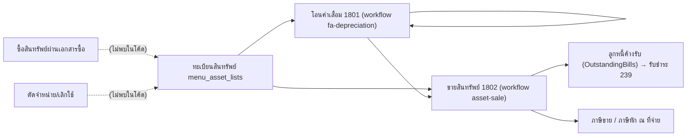

# วงจรสินทรัพย์ถาวร (Fixed Asset Lifecycle)

สินทรัพย์มี 3 ช่วงในโค้ด: ทะเบียนสินทรัพย์ (master), โอนค่าเสื่อมราคา (`as_trans` 1801) และขายสินทรัพย์ (`as_trans` 1802) ทั้งสองเอกสารลง GL เองตอนบันทึก ไม่ได้ลงผ่านรายการมาตรฐานของ `RebuildGL` (1801 บันทึก `trans_direct=1`, 1802 บันทึก `trans_direct=0`) ดู [[acc-fixed-asset-depreciation]] และ [[acc-fixed-asset-sale]]

## ภาพรวม

## ขั้นตอน

| ขั้น | เอกสาร/หน้าจอ | ตารางที่เขียน | ผลบัญชี | path:line |
|---|---|---|---|---|
| 1 | ทะเบียนสินทรัพย์ `menu_asset_lists` | `as_asset`, `as_asset_detail` (1 แถวต่อสินทรัพย์) | ไม่ลง GL · ต้องระบุชื่อ บัญชีสินทรัพย์ (`account_code`) บัญชีค่าเสื่อม (`depreciation_account_code`) และบัญชีค่าเสื่อมสะสม (`depreciation_sum_account_code`) · `as_asset_detail` เก็บราคาทุน (`as_buy_price`) อายุ อัตรา วันเริ่ม/สิ้นสุดคิดค่าเสื่อม · ค่าเริ่มต้นอัตราแบบเส้นตรง = 100 / อายุ | `backend/internal/application/process/master_detail_specs.go:81-88`, `:202-225`, `:658-682`, `backend/internal/application/process/asset_depreciation.go:66-73` |
| 2 | ได้มาซึ่งสินทรัพย์ | — | ไม่พบเส้นทางที่ผูกเอกสารซื้อเข้าทะเบียนสินทรัพย์ (ไม่พบในโค้ด) | — |
| 3 | โอนค่าเสื่อมราคา 1801 (`menu_asset_transfers`, หน้าจอประมวลผลระบบโหมด `fa_depreciation`) [[doc-asset-depreciation-transfer]] | [[tbl-as-trans]] (1801), [[tbl-as-trans-detail]] (1 แถวต่อสินทรัพย์), [[tbl-gl-journal]], [[tbl-gl-journal-detail]] | Dr ค่าเสื่อมราคา (`depreciation_account_code`) / Cr ค่าเสื่อมสะสม (`depreciation_sum_account_code`) รวมยอดต่อรหัสบัญชี · `trans_direct=1` · บันทึกซ้ำเลขเดิม = ลบแล้วสร้างใหม่ทั้งชุด | `backend/internal/application/process/fa_depreciation.go:719`, `:794`, `:823-825`, `:964-999`, `frontend/account/tabs/screenRegistry.tsx:1107-1108`, `frontend/account/process/SystemProcessWorkbenchScreen.tsx:565-613` |
| 4 | วิธีคำนวณ | — | เส้นตรงอย่างเดียว (ไม่อ่าน `calc_type`) มูลค่าคิดค่าเสื่อม = (มูลค่าคงเหลือ หรือราคาทุนถ้าคงเหลือเป็น 0) − ราคาซาก หารด้วยจำนวนปี · โหมดจำนวนวัน: 0 = สรรพากร, 1 = บัญชี 30/360, 2 = วันจริง · คิดเป็นวัน/เดือน/ปี · ปัดครึ่งขึ้นตามทศนิยม `erp_option.item_amount_decimal` (ค่าเริ่มต้น 2) | `backend/internal/application/process/fa_depreciation.go:32-38`, `:111-122`, `:141`, `:656-657`, `:783-790` |
| 5 | ลบเอกสารค่าเสื่อม | `as_trans`, `as_trans_detail`, `gl_journal`, `gl_journal_detail` | ลบทั้งชุด · ปฏิเสธถ้างวดของวันที่เอกสารปิดแล้ว (ถ้าไม่มีงวดครอบวันที่ ยังลบได้) · ปฏิเสธถ้าสินทรัพย์ในเอกสารถูกขาย (1802) ในวันที่เอกสารหรือหลังจากนั้น | `backend/internal/application/process/fa_depreciation.go:858`, `:867-876`, `:877`, `backend/internal/application/process/period.go:27-33` |
| 6 | ขายสินทรัพย์ 1802 `menu_asset_sale` [[doc-asset-sale]] | [[tbl-as-trans]], [[tbl-as-trans-detail]], [[tbl-cb-trans]] (ขายสด), [[tbl-gl-journal]], [[tbl-gl-journal-detail]], ภาษีขาย, [[tbl-gl-wht-list]], [[tbl-gl-wht-list-detail]] | Dr เงินสด/ลูกหนี้ (ยอดรวม) + Dr ค่าเสื่อมสะสม + Dr ขาดทุน / Cr ราคาทุน + Cr ภาษีขาย + Cr กำไร · ราคาทุน = `as_buy_price`, ค่าเสื่อมสะสม = `as_sum_value_balance` + ผลรวม 1801 ของสินทรัพย์นั้น · ถ้ารูปแบบเอกสารมี template GL จะลงตาม template แทน | `frontend/account/transaction/AssetSaleScreen.tsx:4`, `:182`, `backend/internal/application/process/fa_sale.go:183-203`, `:286-290`, `:349`, `:382`, `:513-597`, `:600`, `:645`, `:666` |
| 7 | รับชำระค่าขายสินทรัพย์ (เครดิต) | ap_ar_trans (239) | 1802 inquiry 0/2 ถูกนับเป็นหนี้ใน `arDebtWhere` และ `billDebtSource` รวม `as_trans` | `backend/internal/application/process/docs.go:600-601`, `:612-616`, `backend/internal/application/process/fa_sale.go:695` |

บัญชีที่ใช้ใน GL ขาย (กรณีไม่มี template):
- เงินสด (inquiry 1/3): `resolveChartAccount(ctx, tx, "1111", "1110", "1100")` (`fa_sale.go:336`)
- ลูกหนี้ (เครดิต): `account_code` ของลูกค้าใน `ar_customer_detail` ถ้าว่างใช้ `resolveChartAccount(ctx, tx, "1121", "1120")` (`fa_sale.go:339-345`)
- ภาษีขาย: `resolveChartAccount(ctx, tx, "2134", "2121", "2135", "2190")` (`fa_sale.go:347`)
- กำไร/ขาดทุน: ผังบัญชีรหัสแรกที่ชื่อตรง regex `(จำหน่าย|ขาย)สินทรัพย์` (`fa_sale.go:349`)

GL ขาย: ยอดรวมและ VAT ปัดครึ่งขึ้นที่ 2 ตำแหน่งก่อน เพื่อให้ Dr = Cr (`fa_sale.go:184-185`) กำไร/ขาดทุน = (ยอดรวม − ภาษีขาย) − (ราคาทุน − ค่าเสื่อมสะสม) (`fa_sale.go:186`) ถ้า Dr ≠ Cr จะปฏิเสธ (`fa_sale.go:373`)

## จุดตรวจสอบ/validation

- ขายสินทรัพย์ตรวจงวดเปิด 3 จุด: วันที่ของเอกสารตอนลบ (`fa_sale.go:422`) วันที่ใหม่ตอนบันทึก (`:431`) และวันที่เดิมเมื่อแก้ไข (`:448`)
- ขายสินทรัพย์ปฏิเสธถ้าสินทรัพย์ขายไปแล้วในเอกสาร 1802 อื่น หรือยังไม่กำหนดบัญชีสินทรัพย์/ค่าเสื่อมสะสม (`fa_sale.go:306-314`)
- โอนค่าเสื่อม:
  - ไม่ตรวจงวดตอนบันทึก (ฟังก์ชันบันทึกไม่เรียกตรวจงวด `fa_depreciation.go:793-794`)
  - ตอนลบตรวจงวดที่ `fa_depreciation.go:877`
  - ถ้าเดบิตไม่เท่าเครดิต (สินทรัพย์ขาดบัญชีใดบัญชีหนึ่ง) จะปฏิเสธ (`fa_depreciation.go:837`)
- ห้ามคิดค่าเสื่อมซ้ำ: ถ้ามีเอกสาร 1801 อื่นที่ช่วงเวลาทับกันและมีสินทรัพย์ตัวเดียวกันจะถูกปฏิเสธ (`checkDepOverlap`, `fa_depreciation.go:935`)
- ภาษีขายของการขายสร้างผ่าน `derivedVatStmts` (`fa_sale.go:645-647`) และภาษีหัก ณ ที่จ่ายผ่าน `saveAssetSaleWht` (`fa_sale.go:666`)
- เงินสด = inquiry 1/3 (`fa_sale.go:695`)

## ข้อผิดพลาดที่พบบ่อยตามโค้ด

- โอนค่าเสื่อมย้อนเข้างวดที่ปิดแล้วได้ เพราะไม่ตรวจงวดตอนบันทึก (`fa_depreciation.go:793-794`) ดูการปิดงวดที่ [[flow-period-year-close]]
- ถ้าผังบัญชีไม่มีชื่อที่ตรง `(จำหน่าย|ขาย)สินทรัพย์` บัญชีกำไร/ขาดทุนจะว่าง และถ้าการขายมีกำไรหรือขาดทุนโดยรูปแบบเอกสารไม่มี template GL การบันทึกจะถูกปฏิเสธ "ไม่พบผังบัญชี" (`fa_sale.go:349`, `:357-371`) ควรตั้งผังบัญชีก่อน ([[flow-new-company-setup]])
- ไม่มีเอกสารตัดจำหน่าย/เลิกใช้สินทรัพย์ มีแค่ master `menu_asset_setup_retire` (ตาราง `as_asset_retire`, `frontend/src/config/schemas/icMasterSchemas.ts:1045-1049`) (ไม่พบเอกสารในโค้ด)
- 1801 (โอนค่าเสื่อม) บันทึก `trans_direct=1` (`fa_depreciation.go:998`) จึงไม่ถูกสร้างใหม่ตอนประมวลผล GL ([[acc-gl-rebuild]]) ถ้าแก้ผังบัญชีต้องบันทึก 1801 ใหม่
- 1802 (ขาย) บันทึก `trans_direct=0` (`fa_sale.go:579`) แต่ 1802 ไม่อยู่ใน `glRebuildTransFlags` (`service.go:1742`) การประมวลผล GL ช่วงวันที่จึงลบและลงบัญชีใหม่เฉพาะ 1802 ที่รูปแบบเอกสารมี template GL (`gl_template.go:1112-1114`, `:1129-1136`) ส่วน 1802 ที่ไม่มี template ไม่ถูกแตะ

## ที่มาในโค้ด

- `backend/internal/application/process/master_detail_specs.go:81-88`, `:202-225`, `:658-682` — master สินทรัพย์
- `backend/internal/application/process/asset_depreciation.go:66-73` — ค่าเริ่มต้นอัตรา
- `backend/internal/application/process/fa_depreciation.go:32-38`, `:111-122`, `:141`, `:656-657`, `:719`, `:783-790`, `:793-794`, `:837`, `:858-877`, `:935`, `:964-999` — โอนค่าเสื่อม
- `backend/internal/application/process/fa_sale.go:183-203`, `:286-314`, `:336-349`, `:373`, `:382`, `:422-448`, `:513-597`, `:600`, `:645`, `:666`, `:695` — ขายสินทรัพย์
- `backend/internal/application/process/period.go:27-33` — `checkPeriodNotClosed`
- `backend/internal/application/process/gl_template.go:1096-1136`, `backend/internal/application/process/service.go:1742` — 1802 ตอนประมวลผล GL
- `backend/internal/application/process/docs.go:600-601`, `:612-616` — 1802 ในยอดลูกหนี้
- `backend/internal/adapter/inbound/http/process/workflow_handler.go:73`, `:80` — action `fa-depreciation`, `asset-sale`
- `frontend/account/transaction/AssetSaleScreen.tsx:4`, `:182` — จอขายสินทรัพย์
- `frontend/account/process/SystemProcessWorkbenchScreen.tsx:565-613` — จอโอนค่าเสื่อม
