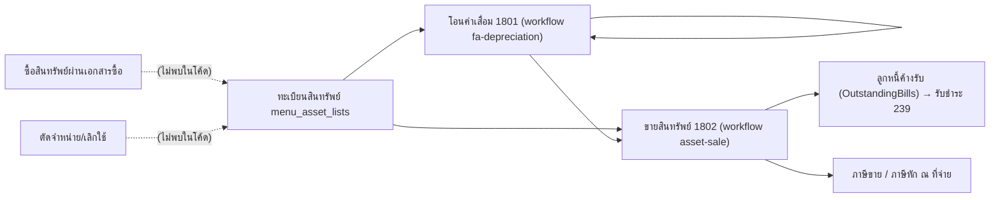

# วงจรสินทรัพย์ถาวร (Fixed Asset Lifecycle)

สินทรัพย์มี 3 ช่วงในโค้ด: ทะเบียนสินทรัพย์ (master), โอนค่าเสื่อมราคา (`as_trans` 1801) และขายสินทรัพย์ (`as_trans` 1802) ทั้งสองเอกสารลง GL เองโดยตรง (`trans_direct=1`) ไม่ผ่าน `RebuildGL` ดู [[acc-fixed-asset-depreciation]] และ [[acc-fixed-asset-sale]]

## ภาพรวม

## ขั้นตอน

| ขั้น | เอกสาร/หน้าจอ | ตารางที่เขียน | ผลบัญชี | path:line |
|---|---|---|---|---|
| 1 | ทะเบียนสินทรัพย์ `menu_asset_lists` | `as_asset`, `as_asset_detail` | ไม่ลง GL · เก็บราคาทุน รหัสบัญชีสินทรัพย์/ค่าเสื่อม/ค่าเสื่อมสะสม และอัตรา | `backend/internal/application/process/master_detail_specs.go:202-224`, `:658-680`, `backend/internal/application/process/asset_depreciation.go:66` |
| 2 | ได้มาซึ่งสินทรัพย์ | — | ไม่พบเส้นทางที่ผูกเอกสารซื้อเข้าทะเบียนสินทรัพย์ (ไม่พบในโค้ด) | — |
| 3 | โอนค่าเสื่อมราคา 1801 (`menu_asset_transfers`, หน้าจอประมวลผลระบบโหมด `fa_depreciation`) [[doc-asset-depreciation-transfer]] | [[tbl-as-trans]] (1801), [[tbl-as-trans-detail]] (1 แถวต่อสินทรัพย์), [[tbl-gl-journal]], [[tbl-gl-journal-detail]] | Dr ค่าเสื่อมราคา (`depreciation_account_code`) / Cr ค่าเสื่อมสะสม (`depreciation_sum_account_code`) รวมยอดต่อรหัสบัญชี · `trans_direct=1` | `backend/internal/application/process/fa_depreciation.go:719`, `:794`, `:966-999`, `frontend/account/process/SystemProcessWorkbenchScreen.tsx:565-614` |
| 4 | วิธีคำนวณ | — | เส้นตรงอย่างเดียว · โหมดจำนวนวัน: 0 = สรรพากร, 1 = บัญชี 30/360, 2 = วันจริง · คิดเป็นวัน/เดือน/ปี | `backend/internal/application/process/fa_depreciation.go:3-8`, `:28-33` |
| 5 | ลบเอกสารค่าเสื่อม | as_trans, as_trans_detail, gl_journal | ลบทั้งชุด ต้องอยู่ในงวดที่ยังไม่ปิด | `backend/internal/application/process/fa_depreciation.go:858`, `:877` |
| 6 | ขายสินทรัพย์ 1802 `menu_asset_sale` [[doc-asset-sale]] | [[tbl-as-trans]], [[tbl-as-trans-detail]], [[tbl-cb-trans]] (ขายสด), [[tbl-gl-journal]], [[tbl-gl-journal-detail]], ภาษีขาย, [[tbl-gl-wht-list]], [[tbl-gl-wht-list-detail]] | Dr เงินสด/ลูกหนี้ (ยอดรวม) + Dr ค่าเสื่อมสะสม + Dr ขาดทุน / Cr ราคาทุน + Cr ภาษีขาย + Cr กำไร · บัญชีกำไร/ขาดทุนหาจากชื่อผังบัญชีที่ตรง regex `(จำหน่าย\|ขาย)สินทรัพย์` · ใช้ template ก่อนถ้ามี | `frontend/account/transaction/AssetSaleScreen.tsx:4`, `:182`, `backend/internal/application/process/fa_sale.go:183-203`, `:349`, `:382`, `:515-589`, `:600`, `:645`, `:666` |
| 7 | รับชำระค่าขายสินทรัพย์ (เครดิต) | ap_ar_trans (239) | 1802 inquiry 0/2 ถูกนับเป็นหนี้ใน `arDebtWhere` และ `billDebtSource` รวม `as_trans` | `backend/internal/application/process/docs.go:599-618`, `backend/internal/application/process/fa_sale.go:695` |

GL ขาย: ยอดขายและ VAT ปัดครึ่งขึ้นที่ 2 ตำแหน่งก่อน เพื่อให้ Dr = Cr (`fa_sale.go:184-185`) กำไร/ขาดทุน = (ยอดก่อน VAT) − (ราคาทุน − ค่าเสื่อมสะสม) (`fa_sale.go:186`)

## จุดตรวจสอบ/validation

- ขายสินทรัพย์ตรวจงวดเปิด 3 จุด: วันที่ใหม่ วันที่ของเอกสาร และวันที่เดิมเมื่อแก้ไข (`fa_sale.go:422`, `:431`, `:448`)
- โอนค่าเสื่อม:
  - ไม่ตรวจงวดตอนบันทึก โดยตั้งใจตาม C# (`fa_depreciation.go:793`)
  - ตอนลบตรวจงวดที่ `fa_depreciation.go:877`
- ห้ามคิดค่าเสื่อมซ้ำ: ถ้ามีเอกสาร 1801 อื่นที่ช่วงเวลาทับกันจะถูกปฏิเสธ (`checkDepOverlap`, `fa_depreciation.go:933`)
- ภาษีขายของการขายสร้างผ่าน `derivedVatStmts` (`fa_sale.go:645-647`) และภาษีหัก ณ ที่จ่ายผ่าน `saveAssetSaleWht` (`fa_sale.go:666`)
- เงินสด = inquiry 1/3 (`fa_sale.go:695`)

## ข้อผิดพลาดที่พบบ่อยตามโค้ด

- โอนค่าเสื่อมย้อนเข้างวดที่ปิดแล้วได้ เพราะไม่ตรวจงวดตอนบันทึก (`fa_depreciation.go:793`) ควรตรวจกับ [[flow-period-year-close]]
- ถ้าผังบัญชีไม่มีชื่อที่ตรง `(จำหน่าย|ขาย)สินทรัพย์` บัญชีกำไร/ขาดทุนจะว่าง (`fa_sale.go:349`) ควรตั้งผังบัญชีก่อน ([[flow-new-company-setup]])
- ไม่มีเอกสารตัดจำหน่าย/เลิกใช้สินทรัพย์ มีแค่ master `menu_asset_setup_retire` (ไม่พบเอกสารในโค้ด)
- 1801 (โอนค่าเสื่อม) บันทึก `trans_direct=1` (`fa_depreciation.go:998`) จึงไม่ถูกสร้างใหม่ตอนประมวลผล GL ([[acc-gl-rebuild]]) ถ้าแก้ผังบัญชีต้องบันทึก 1801 ใหม่; 1802 (ขาย) บันทึก `trans_direct=0` (`fa_sale.go:579`) จึงถูกลบและลงบัญชีใหม่ทุกครั้งที่ประมวลผล GL ช่วงวันที่นั้น (`fa_sale.go:405`)

## ที่มาในโค้ด

- `backend/internal/application/process/master_detail_specs.go:202-224`, `:658-680` — master สินทรัพย์
- `backend/internal/application/process/asset_depreciation.go:66` — ค่าเริ่มต้นอัตรา
- `backend/internal/application/process/fa_depreciation.go:3-8`, `:28-33`, `:719`, `:793-794`, `:858`, `:877`, `:933`, `:966-999` — โอนค่าเสื่อม
- `backend/internal/application/process/fa_sale.go:183-203`, `:349`, `:382`, `:422-448`, `:515-589`, `:600`, `:645`, `:666`, `:695` — ขายสินทรัพย์
- `backend/internal/application/process/docs.go:599-618` — 1802 ในยอดลูกหนี้
- `backend/internal/adapter/inbound/http/process/workflow_handler.go:73`, `:80` — action `fa-depreciation`, `asset-sale`
- `frontend/account/transaction/AssetSaleScreen.tsx:4`, `:182` — จอขายสินทรัพย์
- `frontend/account/process/SystemProcessWorkbenchScreen.tsx:565-614` — จอโอนค่าเสื่อม
