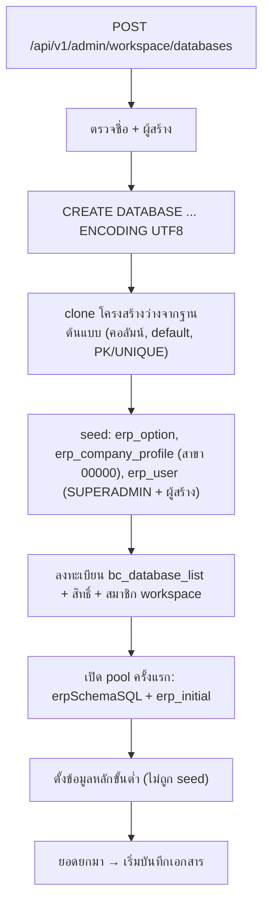

# ตั้งบริษัท/ฐานข้อมูลใหม่และข้อมูลหลักขั้นต่ำ (New Company Setup & Minimum Master Data)

ฐานข้อมูลบริษัทใหม่สร้างจาก "โครงสร้างว่าง" ของฐานต้นแบบ แล้ว seed ข้อมูลระบบเพียงเล็กน้อย ข้อมูลหลักที่เอกสารต้องใช้จริง (งวดบัญชี ผังบัญชี รูปแบบเลขที่ คลัง สินค้า ลูกค้า/ผู้จำหน่าย) ไม่ถูก seed ต้องตั้งเองก่อนบันทึกเอกสารใบแรก ดู [[proc-master-data]]

## ภาพรวม

## ขั้นตอน

| ขั้น | เอกสาร/หน้าจอ | ตารางที่เขียน | ผล | path:line |
|---|---|---|---|---|
| 1 | สร้างฐานข้อมูล (`WorkspaceCreateDatabase`) | — | ตรวจชื่อ (รูปแบบ, ชื่อสงวน, ไม่ซ้ำ) และต้องมีผู้สร้าง | `backend/internal/adapter/inbound/http/admin/workspace_google.go:343-378`, `:533`, `:587`, `backend/internal/adapter/inbound/http/router.go:240` |
| 2 | สร้าง database | ฐานใหม่ | `CREATE DATABASE "<ชื่อ>" ENCODING 'UTF8'` | `backend/internal/adapter/inbound/http/admin/workspace_google.go:597` |
| 3 | clone โครงสร้างว่าง (`cloneEmptySchemaFromTemplate`, จำกัดเวลา 45 วินาที) | ทุกตาราง (ไม่มีข้อมูล) | คอลัมน์ + default (คอลัมน์ `nextval` กลายเป็น SERIAL/BIGSERIAL; ถ้าสร้างไม่ผ่านจะสร้างใหม่แบบไม่มี default) และ PRIMARY KEY/UNIQUE จากฐานต้นแบบ | `backend/internal/adapter/inbound/http/admin/workspace_google.go:395`, `:405`, `:460-467`, `:469`, `:604-606` |
| 4 | seed ข้อมูลระบบ | [[tbl-erp-option]] (year_type 1, ทศนิยมทุกช่อง 2), [[tbl-erp-company-profile]] (สาขา 00000 สำนักงานใหญ่), [[tbl-erp-user]] (`SUPERADMIN` + รหัสผู้สร้างถ้าส่งมา ระดับ 9) | ไม่มีรายการเอกสารเลย · ทุกคำสั่ง seed ไม่สนใจ error (`_, _ =`) | `backend/internal/adapter/inbound/http/admin/workspace_google.go:503-529` |
| 5 | ลงทะเบียนฐานและสิทธิ์ | [[tbl-bc-database-list]] (กลุ่ม `MAIN`), [[tbl-bc-database-list-user-and-group]] (`SUPERADMIN`, `admin` และรหัสผู้สร้าง), สมาชิก workspace (ผู้สร้างเป็น `ADMIN`) | ผู้สร้างเห็นฐานในรายการ | `backend/internal/adapter/inbound/http/admin/workspace_google.go:619-622`, `:629-639`, `:641-657` |
| 6 | เปิด pool ครั้งแรก | ตารางที่ `erpSchemaSQL` สร้าง + `erp_initial` | สร้างตาราง/คอลัมน์/index เสริมแบบ `IF NOT EXISTS` และ seed `erp_initial` (คำนำหน้าชื่อ) ทำครั้งเดียวต่อฐานต่อการรันเซิร์ฟเวอร์ | `backend/internal/application/process/service.go:807`, `:881-897`, `:972-976` |
| 7 | ข้อมูลบริษัทและออปชัน (`config/CompanyProfileForm.tsx`, `config/OptionsForm.tsx`) | [[tbl-erp-company-profile]], [[tbl-erp-option]] | ออปชันคุมการตรวจตอนบันทึก (ภาษี สต็อก วงเงิน) | `frontend/account/config/CompanyProfileForm.tsx`, `frontend/account/config/OptionsForm.tsx`, `backend/internal/application/process/trans_save_rules.go:30` |
| 8 | งวดบัญชี `menu_account_period` | [[tbl-erp-account-period]] | จำเป็น: ไม่มีงวด = บันทึกเอกสารที่ตรวจงวดไม่ได้ | `backend/internal/application/process/master_detail_specs.go:473`, `backend/internal/application/process/period.go:17` |
| 9 | ผังบัญชี | [[tbl-gl-chart-of-account]] | GL มาตรฐานหารหัสตามลำดับ (เช่น เงินสด 1111/1110/1100, ธนาคาร 1112, ลูกหนี้ 1121, เจ้าหนี้ 2111, ซื้อ 5111, ขาย 4111, ภาษีซื้อ 1154, ภาษีขาย 2134) · สร้างให้อัตโนมัติแค่ 212015 และ 1122-01 | `backend/internal/application/process/service.go:1766-1783`, `:1796-1803`, `:1667-1676`, `:2254-2258` |
| 10 | รูปแบบเลขที่เอกสารและ template GL (`master/DocFormatScreen.tsx`) | [[tbl-erp-doc-format]], [[tbl-erp-doc-format-gl]] | เลขที่ใบใหม่และใบยกเลิกออกจากรูปแบบ · template GL ใช้ก่อนสูตรมาตรฐาน | `frontend/account/master/DocFormatScreen.tsx`, `backend/internal/application/process/doc_cancel.go:391`, [[acc-gl-template-engine]] |
| 11 | คลัง/ที่เก็บ หน่วยนับ สินค้า (`WarehouseScreen.tsx`, `UnitScreen.tsx`, `ItemScreen.tsx`) | `ic_inventory`, `ic_unit_use` และตารางคลัง/ที่เก็บ | บรรทัดเอกสารต้องมีรหัสสินค้าและหน่วยนับที่มีจริง ("ไม่พบรหัสสินค้า", "ไม่พบหน่วยนับ") และต้องกรอกคลัง/ที่เก็บ ("ป้อนข้อมูลคลังสินค้าไม่ครบ", "ป้อนข้อมูลที่เก็บสินค้าไม่ครบ") | `backend/internal/application/process/trans_lines_check.go:169`, `:188`, `:257`, `:260`, `frontend/account/master/WarehouseScreen.tsx` |
| 12 | ลูกค้า/ผู้จำหน่าย (`CustomerScreen.tsx`, `SupplierScreen.tsx`) | [[tbl-ar-customer]], [[tbl-ar-customer-detail]], [[tbl-ap-supplier]], [[tbl-ap-supplier-detail]] | เอกสารซื้อ/ขายต้องมีรหัสคู่ค้าที่มีจริง · ลูกค้าที่ปิดการใช้งานออกเอกสารใหม่บางประเภทไม่ได้ (ยกเว้นลูกค้าเริ่มต้นของ POS) | `backend/internal/application/process/trans_validate.go:216-254` |
| 13 | ธนาคาร/สมุดบัญชี | [[tbl-erp-bank]], [[tbl-erp-pass-book]] | GL มาตรฐานใช้ `account_code_1` ของสมุดบัญชีที่อยู่ในเอกสารแทนบัญชีธนาคาร 1112 · เช็คยกมาดึงธนาคาร/สาขาจากสมุดบัญชีเมื่อไม่ได้กรอก | `backend/internal/application/process/service.go:1806-1819`, `backend/internal/application/process/gl_template.go:195`, `backend/internal/application/process/cheque_forward.go:42-43` |
| 14 | ยอดยกมา: สต็อก 54 [[doc-stock-beginning-balance]], เจ้าหนี้ 81/83/85 [[doc-ap-beginning-balance]], ลูกหนี้ 93/95/97 [[doc-ar-beginning-balance]], เงินสด/ธนาคาร 602/604 [[doc-cash-bank-beginning]], เช็คยกมา 405/406 | ic_trans, cb_trans_detail, cb_chq_list | flag ยอดยกมาเหล่านี้ไม่อยู่ใน `glRebuildTransFlags` จึงไม่ลง GL อัตโนมัติ · ยอดหนี้: 81/83 และ 93/95 นับเป็นหนี้ ส่วน 85 และ 97 นับเป็นลดหนี้ | `backend/internal/application/process/service.go:1742-1756`, `backend/internal/application/process/docs.go:600-608`, `backend/internal/application/process/cheque_forward.go:10` |

## จุดตรวจสอบ/validation

- ต้องระบุผู้สร้างฐานข้อมูล (อีเมลเจ้าของ หรือรหัสผู้ใช้) ไม่เช่นนั้นตอบ "กรุณาระบุผู้สร้างฐานข้อมูล" (`workspace_google.go:587`)
- ชื่อฐาน (`workspace_google.go:343-378`):
  - แปลงเป็นตัวเล็ก ต้องตรงรูปแบบ `^[a-z][a-z0-9_]{2,40}$` (`workspace_google.go:19`)
  - ห้ามชื่อสงวน และห้ามขึ้นต้น `bcerpmain` หรือ `pg_`
  - ต้องไม่ซ้ำใน `bc_database_list` / `bc_google_workspace_db` และต้องไม่มี database ชื่อนี้ในเซิร์ฟเวอร์
- บันทึกเอกสารใบแรกต้องผ่านด่านของ `checkTransScreenSave` (`trans_validate.go:43`):
  - งวดบัญชี (ยกเว้น 521/522/523)
  - เลขที่เอกสาร (ต้องเลือกรูปแบบ)
  - สาขา / แผนก (เมื่อเปิดออปชันบังคับกรอก)
  - คู่ค้า
  - สินค้า/คลัง
- ยอดยกมาเจ้าหนี้/ลูกหนี้/เงินสด (81/83/85/93/95/97/602/604) และเอกสารมัดจำ: `checkTransScreenSave` ตรวจแค่งวดและสถานะแก้ไขแล้วจบ ไม่ผ่านด่านเลขที่/สาขา/คู่ค้า/สินค้าของฟังก์ชันนี้ (`trans_validate.go:71`, `backend/internal/application/process/trans.go:216`)
- `admin/handler.go:467` (`CreateDatabase`) เป็นการลงทะเบียนอย่างเดียว ไม่ได้สร้าง database จริง (ต่างจากเส้นทาง workspace)

## ข้อผิดพลาดที่พบบ่อยตามโค้ด

- ลืมสร้างงวดบัญชี → เอกสารขึ้น "ได้ถูกปิดงวดไปแล้ว หรือยังไม่ได้กำหนดงวดบัญชี" (`period.go:53-61`)
- ผังบัญชีไม่ครบ → `resolveChartAccount` ใช้รหัสตัวแรกเป็นทั้งรหัสและชื่อ GL จึงลงรหัสที่ไม่มีในผังโดยไม่ error (`service.go:1780-1781`) ถ้าไม่ระบุรหัสเลยจะได้ "9999 บัญชีพัก" (`service.go:1783`)
- seed ล้มเงียบ: ทุกคำสั่ง seed ไม่สนใจ error ถ้าโครงสร้างต้นแบบเปลี่ยน ฐานใหม่อาจไม่มีผู้ใช้/ออปชันโดยไม่มีข้อความ (`workspace_google.go:503-529`)
- clone ไม่สำเร็จ ("สร้างโครงสร้างตารางไม่สำเร็จ") → database ที่สร้างแล้วยังค้างอยู่ (ไม่พบคำสั่ง `DROP DATABASE`) สร้างซ้ำชื่อเดิมจะถูกปฏิเสธว่ามีอยู่ในเซิร์ฟเวอร์แล้ว (`workspace_google.go:606-608`, `:370-373`)
- ไม่ seed (ไม่พบในโค้ด): `erp_doc_format`, `gl_chart_of_account`, `erp_account_period`, คลัง, หน่วยนับ, ลูกค้า, ผู้จำหน่าย
- ไม่พบ wizard ตั้งค่าบริษัทแบบทีละขั้น ต้องเปิดจอ master ทีละจอเอง

## ที่มาในโค้ด

- `backend/internal/adapter/inbound/http/admin/workspace_google.go:19`, `:343-378`, `:395-529`, `:533-671` — ตรวจชื่อ, สร้างฐาน, clone, seed, ลงทะเบียน
- `backend/internal/adapter/inbound/http/admin/handler.go:113`, `:467` — `CreateProvider`, `CreateDatabase` (registry)
- `backend/internal/adapter/inbound/http/router.go:240` — route สร้างฐานของ workspace
- `backend/internal/application/process/service.go:807`, `:881-897`, `:972-976` — `erpSchemaSQL`, `erp_initial`
- `backend/internal/application/process/service.go:1667-1676`, `:1742-1756`, `:1766-1783`, `:1796-1819`, `:2254-2258` — ผังบัญชีที่ GL ต้องใช้
- `backend/internal/application/process/period.go:17`, `:53-61` — งวดบัญชี
- `backend/internal/application/process/trans_validate.go:43`, `:71`, `:168`, `:216-254` — ด่านตรวจตอนบันทึก
- `backend/internal/application/process/trans_lines_check.go:169`, `:188`, `:257`, `:260` — สินค้า/หน่วย/คลัง
- `backend/internal/application/process/docs.go:600-608` — flag ที่นับเป็นหนี้/ลดหนี้
- `backend/internal/application/process/master_detail_specs.go:473` — จองวดบัญชี
- `frontend/account/config/CompanyProfileForm.tsx`, `frontend/account/config/OptionsForm.tsx`, `frontend/account/master/*.tsx` — จอข้อมูลหลัก
