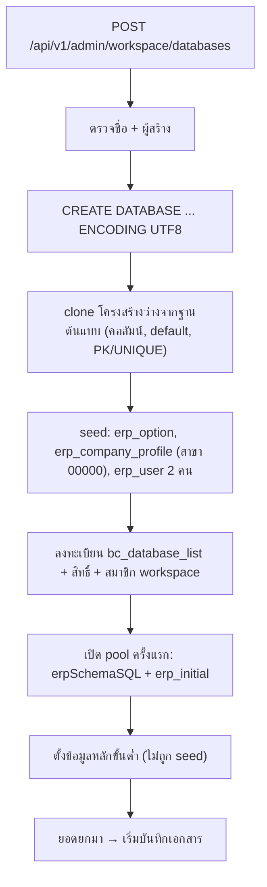

# ตั้งบริษัท/ฐานข้อมูลใหม่และข้อมูลหลักขั้นต่ำ (New Company Setup & Minimum Master Data)

ฐานข้อมูลบริษัทใหม่สร้างจาก "โครงสร้างว่าง" ของฐานต้นแบบ แล้ว seed ข้อมูลระบบเพียงเล็กน้อย ข้อมูลหลักที่เอกสารต้องใช้จริง (งวดบัญชี ผังบัญชี รูปแบบเลขที่ คลัง สินค้า ลูกค้า/ผู้จำหน่าย) ไม่ถูก seed ต้องตั้งเองก่อนบันทึกเอกสารใบแรก ดู [[proc-master-data]]

## ภาพรวม

## ขั้นตอน

| ขั้น | เอกสาร/หน้าจอ | ตารางที่เขียน | ผล | path:line |
|---|---|---|---|---|
| 1 | สร้างฐานข้อมูล (`WorkspaceCreateDatabase`) | — | ตรวจชื่อว่าง/ไม่ซ้ำ และต้องมีผู้สร้าง | `backend/internal/adapter/inbound/http/admin/workspace_google.go:343`, `:533`, `:587`, `backend/internal/adapter/inbound/http/router.go:240` |
| 2 | สร้าง database | ฐานใหม่ | `CREATE DATABASE "<ชื่อ>" ENCODING 'UTF8'` | `backend/internal/adapter/inbound/http/admin/workspace_google.go:597` |
| 3 | clone โครงสร้างว่าง (`cloneEmptySchemaFromTemplate`) | ทุกตาราง (ไม่มีข้อมูล) | คอลัมน์ + default และ PRIMARY KEY/UNIQUE จากฐานต้นแบบ | `backend/internal/adapter/inbound/http/admin/workspace_google.go:395`, `:405`, `:469`, `:606` |
| 4 | seed ข้อมูลระบบ | [[tbl-erp-option]] (year_type, ทศนิยม), [[tbl-erp-company-profile]] (สาขา 00000 สำนักงานใหญ่), [[tbl-erp-user]] (ผู้ดูแล + เจ้าของ ระดับ 9) | ไม่มีรายการเอกสารเลย · ทุกคำสั่ง seed ไม่สนใจ error (`_, _ =`) | `backend/internal/adapter/inbound/http/admin/workspace_google.go:503-527` |
| 5 | ลงทะเบียนฐานและสิทธิ์ | [[tbl-bc-database-list]], [[tbl-bc-database-list-user-and-group]], สมาชิก workspace | ผู้สร้างเห็นฐานในรายการ | `backend/internal/adapter/inbound/http/admin/workspace_google.go:620`, `:629-657` |
| 6 | เปิด pool ครั้งแรก | ตารางที่ `erpSchemaSQL` สร้าง + `erp_initial` | สร้างตารางเสริมแบบ `IF NOT EXISTS` และ seed `erp_initial` | `backend/internal/application/process/service.go:796`, `:870-876`, `:962` |
| 7 | ข้อมูลบริษัทและออปชัน (`config/CompanyProfileForm.tsx`, `config/OptionsForm.tsx`) | [[tbl-erp-company-profile]], [[tbl-erp-option]] | ออปชันคุมการตรวจตอนบันทึก (ภาษี สต็อก วงเงิน) | `frontend/account/config/CompanyProfileForm.tsx`, `frontend/account/config/OptionsForm.tsx`, `backend/internal/application/process/trans_save_rules.go:30` |
| 8 | งวดบัญชี `menu_account_period` | [[tbl-erp-account-period]] | จำเป็น: ไม่มีงวด = บันทึกไม่ได้ทุกเอกสาร | `backend/internal/application/process/master_detail_specs.go:473`, `backend/internal/application/process/period.go:17` |
| 9 | ผังบัญชี | [[tbl-gl-chart-of-account]] | GL มาตรฐานหารหัสตามลำดับ (เช่น เงินสด 1111/1110/1100, ธนาคาร 1112, ลูกหนี้ 1121, เจ้าหนี้ 2111, ซื้อ 5111, ขาย 4111, ภาษีซื้อ 1154, ภาษีขาย 2134) · สร้างให้อัตโนมัติแค่ 212015 และ 1122-01 | `backend/internal/application/process/service.go:1755-1772`, `:1785-1792`, `:1658`, `:2244-2248` |
| 10 | รูปแบบเลขที่เอกสารและ template GL (`master/DocFormatScreen.tsx`) | [[tbl-erp-doc-format]], [[tbl-erp-doc-format-gl]] | เลขที่ใบใหม่และใบยกเลิกออกจากรูปแบบ · template GL ใช้ก่อนสูตรมาตรฐาน | `frontend/account/master/DocFormatScreen.tsx`, `backend/internal/application/process/doc_cancel.go:391`, [[acc-gl-template-engine]] |
| 11 | คลัง/ที่เก็บ หน่วยนับ สินค้า (`WarehouseScreen.tsx`, `UnitScreen.tsx`, `ItemScreen.tsx`) | `ic_inventory`, `ic_unit_use` และตารางคลัง/ที่เก็บ | บรรทัดเอกสารต้องมีรหัสสินค้าและหน่วยนับที่มีจริง ("ไม่พบรหัสสินค้า", "ไม่พบหน่วยนับ") และต้องกรอกคลัง/ที่เก็บ ("ป้อนข้อมูลคลังสินค้าไม่ครบ") | `backend/internal/application/process/trans_lines_check.go:169`, `:188`, `:257`, `:260`, `frontend/account/master/WarehouseScreen.tsx` |
| 12 | ลูกค้า/ผู้จำหน่าย (`CustomerScreen.tsx`, `SupplierScreen.tsx`) | [[tbl-ar-customer]], [[tbl-ar-customer-detail]], [[tbl-ap-supplier]], [[tbl-ap-supplier-detail]] | เอกสารซื้อ/ขายต้องมีรหัสคู่ค้า | `backend/internal/application/process/trans_validate.go:216-232` |
| 13 | ธนาคาร/สมุดบัญชี | [[tbl-erp-bank]], [[tbl-erp-pass-book]] | ใช้กับฝาก/ถอน/โอน/เช็ค | `backend/internal/application/process/service.go:2064`, `:2221` |
| 14 | ยอดยกมา: สต็อก 54 [[doc-stock-beginning-balance]], เจ้าหนี้ 81/83/85 [[doc-ap-beginning-balance]], ลูกหนี้ 93/95/97 [[doc-ar-beginning-balance]], เงินสด/ธนาคาร 602/604 [[doc-cash-bank-beginning]], เช็คยกมา 405/406 | ic_trans, cb_chq_list | ยอดยกมาเหล่านี้ไม่ลง GL อัตโนมัติ (54/62/64, 81-85/93-97, 90xx) · เจ้าหนี้/ลูกหนี้ยกมาเป็นหนี้ใน `apDebtWhere`/`arDebtWhere` | `backend/internal/application/process/service.go:1737-1739`, `backend/internal/application/process/docs.go:599-608`, `backend/internal/application/process/cheque_forward.go:10` |

## จุดตรวจสอบ/validation

- ต้องระบุผู้สร้างฐานข้อมูล ไม่เช่นนั้นตอบ "กรุณาระบุผู้สร้างฐานข้อมูล" (`workspace_google.go:587`)
- ชื่อฐานต้องไม่ซ้ำกับใน `bc_database_list` (`workspace_google.go:343-358`)
- บันทึกเอกสารใบแรกต้องผ่านทุกด่านของ `checkTransScreenSave` (`trans_validate.go:43`):
  - งวดบัญชี
  - เลขที่เอกสาร
  - สาขา
  - แผนก
  - คู่ค้า
  - สินค้า/คลัง
- `admin/handler.go:467` (`CreateDatabase`) เป็นการลงทะเบียนอย่างเดียว ไม่ได้สร้าง database จริง (ต่างจากเส้นทาง workspace)

## ข้อผิดพลาดที่พบบ่อยตามโค้ด

- ลืมสร้างงวดบัญชี → ทุกเอกสารขึ้น "ได้ถูกปิดงวดไปแล้ว หรือยังไม่ได้กำหนดงวดบัญชี" (`period.go:53-61`)
- ผังบัญชีไม่ครบ → `resolveChartAccount` ใช้รหัสตัวแรกเป็นทั้งรหัสและชื่อ GL จึงลงรหัสที่ไม่มีในผังโดยไม่ error (`service.go:1769-1771`) ถ้าไม่ระบุรหัสเลยจะได้ "9999 บัญชีพัก" (`service.go:1772`)
- seed ล้มเงียบ: ทุกคำสั่ง seed ไม่สนใจ error ถ้าโครงสร้างต้นแบบเปลี่ยน ฐานใหม่อาจไม่มีผู้ใช้/ออปชันโดยไม่มีข้อความ (`workspace_google.go:503-527`)
- ไม่ seed (ไม่พบในโค้ด): `erp_doc_format`, `gl_chart_of_account`, `erp_account_period`, คลัง, หน่วยนับ, ลูกค้า, ผู้จำหน่าย
- ไม่พบ wizard ตั้งค่าบริษัทแบบทีละขั้น ต้องเปิดจอ master ทีละจอเอง

## ที่มาในโค้ด

- `backend/internal/adapter/inbound/http/admin/workspace_google.go:343`, `:395-527`, `:533-657` — สร้างฐาน, clone, seed, ลงทะเบียน
- `backend/internal/adapter/inbound/http/admin/handler.go:113`, `:467` — `CreateProvider`, `CreateDatabase` (registry)
- `backend/internal/adapter/inbound/http/router.go:240` — route สร้างฐานของ workspace
- `backend/internal/application/process/service.go:796`, `:870-876`, `:962` — `erpSchemaSQL`, `erp_initial`
- `backend/internal/application/process/service.go:1658`, `:1737-1739`, `:1755-1772`, `:1785-1792`, `:2244-2248` — ผังบัญชีที่ GL ต้องใช้
- `backend/internal/application/process/period.go:17`, `:53-61` — งวดบัญชี
- `backend/internal/application/process/trans_validate.go:43`, `:216-232` — ด่านตรวจตอนบันทึก
- `backend/internal/application/process/trans_lines_check.go:169`, `:188`, `:257`, `:260` — สินค้า/หน่วย/คลัง
- `backend/internal/application/process/master_detail_specs.go:473` — จองวดบัญชี
- `frontend/account/config/CompanyProfileForm.tsx`, `frontend/account/config/OptionsForm.tsx`, `frontend/account/master/*.tsx` — จอข้อมูลหลัก
