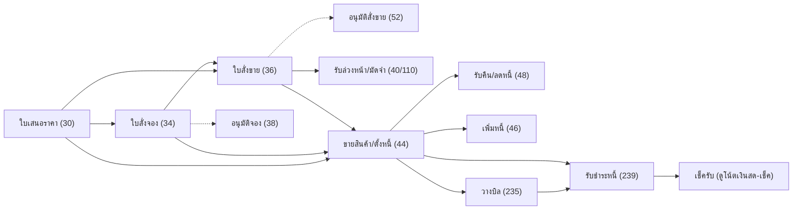

# ขายถึงรับเงิน (Order-to-Cash)

เส้นทางงานขายตั้งแต่เสนอราคาจนรับชำระหนี้ เอกสารฝั่งสินค้าบันทึกผ่าน `/api/v1/process/trans/save` ส่วนวางบิลและรับชำระบันทึกผ่าน `/api/v1/process/doc/save` ดู [[acc-transaction-save-flow]]

## ภาพรวม

โซ่ดึงเอกสารจาก `refImportSources` (`trans_ref_import_lines.go:52-57`): 34←30, 36←{30,34}, 44←{30,34,36}, 48←44, 46←44

## ขั้นตอน

| ขั้น | เอกสาร/หน้าจอ | ตารางที่เขียน | ผลบัญชี/สต็อก | path:line |
|---|---|---|---|---|
| 1 | ใบเสนอราคา (30) `menu_so_quotation_order` [[doc-sale-quotation]] | [[tbl-ic-trans]], [[tbl-ic-trans-detail]] | ไม่ตัดสต็อก ไม่ลง GL | `frontend/account/tabs/transMenuMap.ts:547` |
| 2 | ใบสั่งจอง (34) `menu_so_inquiry_order` [[doc-sale-reservation]] · อนุมัติใบสั่งจอง (38) | [[tbl-ic-trans]], [[tbl-ic-trans-detail]] | ไม่มีผลบัญชี · ตรวจวงเงินระดับใบสั่ง (`checkOrderCredit`) เฉพาะเมื่อเปิด `sr_ss_credit_check` | `frontend/account/tabs/transMenuMap.ts:590`, `:606`, `backend/internal/application/process/trans_credit.go:33-38`, `backend/internal/application/process/trans_save_rules.go:39` |
| 3 | ใบสั่งขาย (36) `menu_so_sale_order` [[doc-sale-order]] · อนุมัติใบสั่งขาย (52) | [[tbl-ic-trans]], [[tbl-ic-trans-detail]] | ไม่ตัดสต็อก แต่ 36 อยู่ในชุดตรวจยอดคงเหลือ (`stockCheckFlags`) | `frontend/account/tabs/transMenuMap.ts:635`, `:651`, `backend/internal/application/process/trans_save_rules.go:55` |
| 4 | รับเงินล่วงหน้า (40) / รับมัดจำ (110) [[doc-sale-advance-receipt]] [[doc-sale-deposit-receipt]] · คืน (42/112) อยู่ในการ์ดเดียวกัน | [[tbl-ic-trans]], [[tbl-cb-trans]], [[tbl-cb-trans-detail]] | 40: Dr ช่องทางรับ / Cr รับล่วงหน้า 214100 เต็มยอด · 110: Dr ช่องทางรับ / Cr มัดจำรับ 214220 ยอดก่อน VAT + Cr ภาษีขาย · 42/112 กลับข้าง (Dr บัญชีมัดจำ / Cr ช่องทางจ่าย) | `frontend/account/tabs/transMenuMap.ts:695`, `:725`, `:769`, `:785`, `backend/internal/application/process/trans_deposit.go:39-42`, `backend/internal/application/process/service.go:2196-2216` |
| 5 | ขายสินค้า/ตั้งหนี้ (44) `menu_so_invoice` [[doc-sale-invoice]] | [[tbl-ic-trans]], [[tbl-ic-trans-detail]], [[tbl-gl-journal]], [[tbl-gl-journal-detail]], ภาษีขาย, [[tbl-cb-trans]] (ขายสด) | สต็อกออก (ยกเว้นบรรทัด POS ที่มี doc_ref) · inquiry 0/2: Dr ลูกหนี้ 1121 · inquiry 1/3 (ขายสด): Dr เงินสด/ธนาคาร/บัตร (บัตรลงบัญชีลูกหนี้) ตามยอดใน `cb_trans` ถ้ารวมกันเท่ายอดรับ ไม่เช่นนั้นใช้ช่องทางรับของแท็บชำระเงิน · Dr มัดจำรับ 214220 เท่ายอดมัดจำที่ตัดใช้ (ก่อน VAT) / Cr ขาย 4111 (ยอดก่อน VAT + มัดจำที่ตัดใช้) + Cr ภาษีขาย 2134 · สูตรมาตรฐานไม่มีบรรทัดต้นทุนขาย | `frontend/account/tabs/transMenuMap.ts:831`, `backend/internal/application/process/stock_rebuild.go:22`, `backend/internal/application/process/service.go:2009-2059`, `:1839-1851` |
| 6 | รับคืน/ลดหนี้ (48) `menu_so_credit_note` [[doc-sale-return]] ← 44 | [[tbl-ic-trans]], GL | สต็อกเข้าเฉพาะ inquiry ≤1 · Dr ขาย (ยอดก่อน VAT) + Dr ภาษีขาย / Cr ลูกหนี้ (inquiry 0/2/4) หรือ Cr ช่องทางจ่าย (inquiry 1/3/5 คืนเป็นเงิน) | `frontend/account/tabs/transMenuMap.ts:863`, `backend/internal/application/process/stock_rebuild.go:21`, `backend/internal/application/process/service.go:2061-2073`, `backend/internal/application/process/pay_check.go:36` |
| 7 | เพิ่มหนี้ (46) `menu_so_invoice_add` [[doc-sale-debit-note]] ← 44 | [[tbl-ic-trans]], GL | สต็อกออกเฉพาะ inquiry 0 · Dr ลูกหนี้ (inquiry 1 = Dr ช่องทางรับ) / Cr ขาย + Cr ภาษีขาย · ไม่มีการแยกตามยอด `cb_trans` แบบขายสด และไม่มีมัดจำ | `frontend/account/tabs/transMenuMap.ts:894`, `backend/internal/application/process/stock_rebuild.go:20`, `backend/internal/application/process/service.go:2047-2059` |
| 8 | ลูกหนี้อื่น (99) / เพิ่ม-ลดหนี้อื่น (101/103) [[doc-ar-other-debt]] [[doc-ar-other-debit-credit-note]] | [[tbl-ic-trans]], GL | Dr ลูกหนี้ (inquiry 1 = Dr เงินสด) + Dr มัดจำรับที่ตัดใช้ (99) / Cr รายได้อื่น (ลำดับ 4210 → 4200 → 4111 → 4110) + Cr ภาษีขาย · 103 กลับข้าง | `frontend/account/tabs/transMenuMap.ts:1453`, `:1470`, `:1487`, `backend/internal/application/process/service.go:2135-2155` |
| 9 | วางบิล (235) `menu_ar_pay_bill` [[doc-ar-billing]] | [[tbl-ap-ar-trans]], [[tbl-ap-ar-trans-detail]] | ไม่ลง GL (ลง GL เฉพาะ 19/239) | `frontend/account/tabs/transMenuMap.ts:1548`, `backend/internal/application/process/docs.go:389-390` |
| 10 | รับชำระหนี้ (239) `menu_ar_debt_billing` [[doc-ar-receipt]] เลือกบิลจาก `/doc/bills` | [[tbl-ap-ar-trans]], [[tbl-ap-ar-trans-detail]], [[tbl-cb-trans]], [[tbl-cb-trans-detail]], [[tbl-cb-chq-list]], GL | Dr ช่องทางรับ (เงินสด/โอน/เช็ครับ 1122/บัตร → ลูกหนี้/ภาษีถูกหัก ณ ที่จ่าย ลำดับ 1153 → 1154 → 1152 → 2122) เมื่อยอดใน `cb_trans` รวมเท่ายอดรับ ไม่เช่นนั้น Dr เงินสดบรรทัดเดียว / Cr ลูกหนี้ (ยอด + ผลต่างอัตราแลกเปลี่ยน) · ขาดทุน Dr 511030 / กำไร Cr 420040 | `frontend/account/tabs/transMenuMap.ts:1577`, `backend/internal/application/process/service.go:2170-2194`, `:1871-1931`, `backend/internal/adapter/inbound/http/router.go:181` |

ยอดค้างลูกหนี้คำนวณสดโดย `OutstandingBills`: เอกสารหนี้ตาม `arDebtWhere` (44/250/254 inquiry 0/2, 46/93/95/99/101/418 และ `as_trans` 1802 ขายสินทรัพย์ inquiry 0/2) ร่วมกับเอกสารลดหนี้ตาม `arCreditWhere` (48 inquiry 0/2/4, 97/103, 252 inquiry 0/2) หักยอดที่ใบรับชำระอื่นจ่ายแล้ว `ap_ar_trans_detail.sum_pay_money` (บวก `lost_profit_exchange_amount` เฉพาะบิล 12/44/1802) (`docs.go:600-603`, `:621-626`, `:628`)

ต้นทุนขาย: สูตรมาตรฐานไม่สร้างบรรทัดต้นทุนขาย/สินค้าคงเหลือสำหรับ 44 (`service.go:2009-2059`) ต้นทุนถูกคำนวณในสต็อกด้วยต้นทุนเฉลี่ย ([[acc-inventory-cost-moving-average]]) ส่วน template เริ่มต้นตัด action 101/103 ออกเมื่อ `erp_option.inventory_gl_post = 0` (`gl_template_defaults.go:68`, `:89`) ดู [[acc-gl-template-engine]]

## จุดตรวจสอบ/validation

- ลำดับตรวจ `checkTransScreenSave` เหมือนฝั่งซื้อ (`trans_validate.go:43`) โดย `checkParty` บังคับรหัสลูกค้า (`trans_validate.go:216`)
- ขาย 44 ต้องไม่เกินยอดคงเหลือของใบเสนอราคา/ใบสั่งจอง/ใบสั่งขายที่อ้าง (`refSources`, `trans_validate.go:300-302`) ออปชัน `allow_sale_over_reserve` ข้ามการตรวจนี้ (`trans_validate.go:33`, `:81`)
- ใบที่ให้ดึงมาขาย 44 ต้อง `doc_success=0` และถ้าเปิด `doc_ref_reservation_approve` / `doc_ref_salesorder_approve` ใบ 34/36 ต้อง `approve_status=1` (`lookup_trans.go:145-146`, `:156-163`)
- ออปชัน `check_qty_over_doc_ref` ตรวจเฉพาะใบสั่งจอง 34 (อ้างใบเสนอราคา) และใบสั่งขาย 36 (อ้าง 30/34) (`trans_qty_over_ref.go:16-24`)
- สต็อกพอไหม: เฉพาะเอกสารใหม่ที่เปิด `issue_stock_control` และธงอยู่ใน 72/36/46/44/56 ยกเว้น 46 inquiry 1/2 (`trans_save_rules.go:55`, `:151-152`)
- วงเงินเครดิต: ดูรายละเอียดที่ [[acc-credit-limit-save-rules]]
  - ใบสั่ง 34/36 ใช้ `checkOrderCredit` เฉพาะเมื่อเปิด `sr_ss_credit_check` (`trans_credit.go:33-38`, `:178`)
  - เอกสารอื่นใช้ `checkCreditLimit` (`trans_save_rules.go:522`) ซึ่งตรวจเฉพาะธงใน `creditChecked`: 44 inquiry 0, 99 และ 250/254 inquiry 0/2 (`trans_save_rules.go:488`)
  - เกินวงเงินจะ block หรือถามยืนยัน หรือขอรหัสผ่านผู้อนุมัติ (prefix `CREDIT_PASSWORD:` ที่ `trans_credit.go:26`, ทางขอรหัส `trans_save_rules.go:564-566`)
- มัดจำ: `refDepositSources` (`trans_ref_import_header.go:352`) คือคู่ใบคืนมัดจำกับใบมัดจำที่อ้าง (42←40, 112←110) ส่วนการตัดใช้มัดจำในใบขายตรวจยอดคงเหลือใต้ล็อก (`trans_deposit.go:145-148`) ดู [[acc-deposit-advance]]

## ข้อผิดพลาดที่พบบ่อยตามโค้ด

| ข้อความ | สาเหตุ | path:line |
|---|---|---|
| "กรุณาป้อน รหัสลูกค้า" / "ไม่พบข้อมูล : ..." | ไม่กรอกหรือรหัสไม่มีใน master | `backend/internal/application/process/trans_validate.go:227`, `:232` |
| "เกินวงเงินเครดิตลูกค้า" / "...ต้องการบันทึกเพื่อขออนุมัติหรือไม่" | ยอดเกินวงเงินใบสั่ง 34/36 | `backend/internal/application/process/trans_credit.go:157-164` |
| "ยอดวงเงินเครดิตของลูกค้า เกินที่กำหนดไว้" | เกินวงเงินตอนขาย (`lock_credit_money` = block, `warning_credit_money` = ถามยืนยัน) | `backend/internal/application/process/trans_save_rules.go:513`, `:568`, `:571` |
| "ลูกค้า ... ยังไม่อนุมัติเปิดสถานะเครดิต" / "... ถูกปิดสถานะเครดิต" | สถานะเครดิตของลูกค้า | `backend/internal/application/process/trans_save_rules.go:544`, `:547` |
| "จำนวนเกินเอกสารอ้างอิง" | ขาย 44 เกินใบที่อ้าง หรือ 34/36 เกินใบที่อ้าง (เปิด `check_qty_over_doc_ref`) | `backend/internal/application/process/trans_validate.go:287`, `backend/internal/application/process/trans_qty_over_ref.go:71` |
| "ส่งคืนเกินจำนวน" | รับคืน 48 เกินจำนวนในใบขายที่อ้าง | `backend/internal/application/process/trans_validate.go:286`, `:294` |
| ข้อความงวดปิด | วันที่อยู่นอกงวดเปิด | `backend/internal/application/process/period.go:53-61` |

- ใบ 44 ที่เป็นเงินสด (inquiry 1/3) ไม่เป็นหนี้ จึงไม่ขึ้นในรายการรับชำระ (`docs.go:600`)
- ยกเลิกใบขาย ดู [[flow-cancel-edit-reversal]] · ภาษีขาย ดู [[flow-tax-vat-wht-reports]]

## ที่มาในโค้ด

- `backend/internal/application/process/trans_ref_import_lines.go:52`, `:107` — โซ่ดึงเอกสารและ `TransRefImport`
- `backend/internal/application/process/trans_ref_import.go:38` — ยอดคงเหลือให้ดึง ({44,36} หักจาก {37,44})
- `backend/internal/application/process/trans_ref_import_header.go:352` — `refDepositSources`
- `backend/internal/application/process/lookup_trans.go:140-171` — ตัวกรองใบอ้างอิง
- `backend/internal/application/process/trans_credit.go:26`, `:33`, `:178` — วงเงินใบสั่ง
- `backend/internal/application/process/trans_save_rules.go:55`, `:151`, `:488`, `:522` — สต็อกพอ/วงเงินขาย
- `backend/internal/application/process/stock_rebuild.go:18-22` — เงื่อนไขธง 44/46/48 ที่เข้าสต็อก
- `backend/internal/application/process/service.go:2009-2073`, `:2135-2155`, `:2170-2216` — GL มาตรฐานฝั่งขาย
- `backend/internal/application/process/gl_template_defaults.go:89` — template เริ่มต้นกับ `inventory_gl_post`
- `backend/internal/application/process/docs.go:600-628` — ลูกหนี้คงค้าง
- `frontend/account/tabs/transMenuMap.ts:547-894`, `:1548`, `:1577` — เมนูหน้าจอฝั่งขาย
