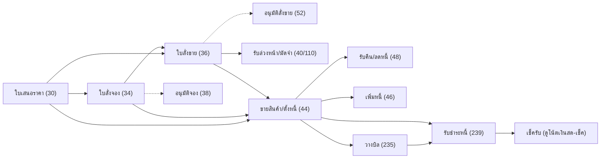

# ขายถึงรับเงิน (Order-to-Cash)

เส้นทางงานขายตั้งแต่เสนอราคาจนรับชำระหนี้ เอกสารฝั่งสินค้าบันทึกผ่าน `/api/v1/process/trans/save` ส่วนวางบิลและรับชำระบันทึกผ่าน `/api/v1/process/doc/save` ดู [[acc-transaction-save-flow]]

## ภาพรวม

โซ่ดึงเอกสารจาก `refImportSources` (`trans_ref_import_lines.go:52`): 34←30, 36←{30,34}, 44←{30,34,36}, 48←44, 46←44

## ขั้นตอน

| ขั้น | เอกสาร/หน้าจอ | ตารางที่เขียน | ผลบัญชี/สต็อก | path:line |
|---|---|---|---|---|
| 1 | ใบเสนอราคา (30) `menu_so_quotation_order` [[doc-sale-quotation]] | [[tbl-ic-trans]], [[tbl-ic-trans-detail]] | ไม่ตัดสต็อก ไม่ลง GL | `frontend/account/tabs/transMenuMap.ts:547` |
| 2 | ใบสั่งจอง (34) `menu_so_inquiry_order` [[doc-sale-reservation]] · อนุมัติใบสั่งจอง (38) | [[tbl-ic-trans]], [[tbl-ic-trans-detail]] | ไม่มีผลบัญชี · ตรวจวงเงินระดับใบสั่ง (`checkOrderCredit`) | `frontend/account/tabs/transMenuMap.ts:590`, `:606`, `backend/internal/application/process/trans_credit.go:33-38` |
| 3 | ใบสั่งขาย (36) `menu_so_sale_order` [[doc-sale-order]] · อนุมัติใบสั่งขาย (52) | [[tbl-ic-trans]], [[tbl-ic-trans-detail]] | ไม่ตัดสต็อก แต่ 36 อยู่ในชุดตรวจยอดคงเหลือ (`stockCheckFlags`) | `frontend/account/tabs/transMenuMap.ts:635`, `:651`, `backend/internal/application/process/trans_save_rules.go:55` |
| 4 | รับเงินล่วงหน้า (40) / รับมัดจำ (110) [[doc-sale-advance-receipt]] [[doc-sale-deposit-receipt]] · คืน (42/112) อยู่ในการ์ดเดียวกัน | [[tbl-ic-trans]], [[tbl-cb-trans]], [[tbl-cb-trans-detail]] | Dr ช่องทางรับ / Cr รับล่วงหน้า 214100 หรือ มัดจำรับ 214220 (คืน = กลับข้าง) | `frontend/account/tabs/transMenuMap.ts:695`, `:725`, `:769`, `:785`, `backend/internal/application/process/trans_deposit.go:36-41`, `backend/internal/application/process/service.go:2185` |
| 5 | ขายสินค้า/ตั้งหนี้ (44) `menu_so_invoice` [[doc-sale-invoice]] | [[tbl-ic-trans]], [[tbl-ic-trans-detail]], [[tbl-gl-journal]], [[tbl-gl-journal-detail]], ภาษีขาย, [[tbl-cb-trans]] (ขายสด) | สต็อกออก (ยกเว้น POS ที่มี doc_ref) · Dr ลูกหนี้ 1121 (inquiry 0/2) หรือ Dr ช่องทางรับแยกเงินสด/ธนาคาร/บัตร (inquiry 1/3) + Dr มัดจำที่ตัดใช้ / Cr ขาย 4111 (รวมมัดจำ ex-VAT) + Cr ภาษีขาย 2134 · สูตรมาตรฐานไม่มีบรรทัดต้นทุนขาย | `frontend/account/tabs/transMenuMap.ts:831`, `backend/internal/application/process/stock_rebuild.go:22`, `backend/internal/application/process/service.go:1998-2049` |
| 6 | รับคืน/ลดหนี้ (48) `menu_so_credit_note` [[doc-sale-return]] ← 44 | [[tbl-ic-trans]], GL | สต็อกเข้าเฉพาะ inquiry ≤1 · GL กลับข้างของ 44 (inquiry 1/3/5 คืนเป็นเงิน) | `frontend/account/tabs/transMenuMap.ts:863`, `backend/internal/application/process/stock_rebuild.go:21`, `backend/internal/application/process/service.go:2050` |
| 7 | เพิ่มหนี้ (46) `menu_so_invoice_add` [[doc-sale-debit-note]] ← 44 | [[tbl-ic-trans]], GL | สต็อกออกเฉพาะ inquiry 0 · GL แบบเดียวกับ 44 | `frontend/account/tabs/transMenuMap.ts:894`, `backend/internal/application/process/stock_rebuild.go:20`, `backend/internal/application/process/service.go:1998` |
| 8 | ลูกหนี้อื่น (99) / เพิ่ม-ลดหนี้อื่น (101/103) [[doc-ar-other-debt]] [[doc-ar-other-debit-credit-note]] | [[tbl-ic-trans]], GL | Dr ลูกหนี้ / Cr รายได้อื่น + ภาษีขาย (103 กลับข้าง) | `frontend/account/tabs/transMenuMap.ts:1453`, `backend/internal/application/process/service.go:2124` |
| 9 | วางบิล (235) `menu_ar_pay_bill` [[doc-ar-billing]] | [[tbl-ap-ar-trans]], [[tbl-ap-ar-trans-detail]] | ไม่ลง GL | `frontend/account/tabs/transMenuMap.ts:1548`, `backend/internal/application/process/docs.go:390` |
| 10 | รับชำระหนี้ (239) `menu_ar_debt_billing` [[doc-ar-receipt]] เลือกบิลจาก `/doc/bills` | [[tbl-ap-ar-trans]], [[tbl-ap-ar-trans-detail]], [[tbl-cb-trans]], [[tbl-cb-trans-detail]], [[tbl-cb-chq-list]], GL | Dr ช่องทางรับ (เงินสด/ธนาคาร/เช็ครับ 1122/ภาษีถูกหัก ณ ที่จ่าย 1153 ลำดับสำรอง 1154/1152) / Cr ลูกหนี้ · กำไร 420040 / ขาดทุน 511030 จากอัตราแลกเปลี่ยน | `frontend/account/tabs/transMenuMap.ts:1577`, `backend/internal/application/process/service.go:2159`, `backend/internal/adapter/inbound/http/router.go:181` |

ยอดค้างลูกหนี้คำนวณสดโดย `OutstandingBills`: เอกสารหนี้ตาม `arDebtWhere` (44/250/254 inquiry 0/2, 46/93/95/99/101/418 และ `as_trans` 1802 ขายสินทรัพย์ inquiry 0/2) ร่วมกับเอกสารลดหนี้ตาม `arCreditWhere` (48 inquiry 0/2/4, 97/103, 252) ลบ `ap_ar_trans_detail.sum_pay_money` (`docs.go:599-628`)

ต้นทุนขาย: สูตรมาตรฐานไม่สร้างบรรทัดต้นทุนขาย/สินค้าคงเหลือสำหรับ 44 (`service.go:1998-2049`) ต้นทุนถูกคำนวณในสต็อกด้วยต้นทุนเฉลี่ย ([[acc-inventory-cost-moving-average]]) ส่วน template เริ่มต้นตัด action 101/103 เมื่อ `inventory_gl_post=0` (`gl_template_defaults.go:55-69`) ดู [[acc-gl-template-engine]]

## จุดตรวจสอบ/validation

- ลำดับตรวจ `checkTransScreenSave` เหมือนฝั่งซื้อ (`trans_validate.go:43`) โดย `checkParty` บังคับรหัสลูกค้า
- ออปชัน `allow_sale_over_reserve` ข้ามการตรวจรายการอ้างอิงของ 44 (อ่านออปชันที่ `trans_validate.go:33`) ส่วนใบที่ให้ดึงต้อง `doc_success=0` และผ่านอนุมัติตาม `doc_ref_reservation_approve` / `doc_ref_salesorder_approve` (`lookup_trans.go:140`)
- สต็อกพอไหม: เฉพาะเอกสารใหม่ที่เปิด `issue_stock_control` และธงอยู่ใน 72/36/46/44/56 (`trans_save_rules.go:55`, `:151`)
- วงเงินเครดิต: ดูรายละเอียดที่ [[acc-credit-limit-save-rules]]
  - ใบสั่ง 34/36 ใช้ `checkOrderCredit` (`trans_credit.go:178`)
  - ตอนขาย ใช้ `creditChecked` ซึ่งครอบ 44 inquiry 0, 99 และ 250/254 inquiry 0/2 (`trans_save_rules.go:488`) แล้วเรียก `checkCreditLimit` (`:522`)
  - เกินวงเงินจะ block หรือขอรหัสผ่านผู้อนุมัติ (prefix `CREDIT_PASSWORD:` ที่ `trans_credit.go:26`)
- มัดจำที่ดึงมาใช้ต้องตรงคู่ `refDepositSources` (`trans_ref_import_header.go:352`) และตรวจยอดคงเหลือใต้ล็อก (`trans_deposit.go:145`) ดู [[acc-deposit-advance]]

## ข้อผิดพลาดที่พบบ่อยตามโค้ด

| ข้อความ | สาเหตุ | path:line |
|---|---|---|
| "กรุณาป้อน รหัสลูกค้า" / "ไม่พบข้อมูล : ..." | ไม่กรอกหรือรหัสไม่มีใน master | `backend/internal/application/process/trans_validate.go:222-232` |
| "เกินวงเงินเครดิตลูกค้า" / "...ต้องการบันทึกเพื่อขออนุมัติหรือไม่" | ยอดเกินวงเงินใบสั่ง | `backend/internal/application/process/trans_credit.go:157-164` |
| ข้อความวงเงินลูกหนี้ตอนขาย | `lock_credit_money` / `warning_credit_money` | `backend/internal/application/process/trans_save_rules.go:544`, `:547` |
| "จำนวนเกินเอกสารอ้างอิง" | ขายเกินใบสั่ง (เปิด `check_qty_over_doc_ref`) | `backend/internal/application/process/trans_validate.go:287` |
| ข้อความงวดปิด | วันที่อยู่นอกงวดเปิด | `backend/internal/application/process/period.go:53-61` |

- ใบ 44 ที่เป็นเงินสด (inquiry 1/3) ไม่เป็นหนี้ จึงไม่ขึ้นในรายการรับชำระ (`docs.go:599-618`)
- ยกเลิกใบขาย ดู [[flow-cancel-edit-reversal]] · ภาษีขาย ดู [[flow-tax-vat-wht-reports]]

## ที่มาในโค้ด

- `backend/internal/application/process/trans_ref_import_lines.go:52`, `:107` — โซ่ดึงเอกสารและ `TransRefImport`
- `backend/internal/application/process/trans_ref_import.go:24` — ยอดคงเหลือให้ดึง ({44,36} หักจาก {37,44})
- `backend/internal/application/process/trans_ref_import_header.go:352` — `refDepositSources`
- `backend/internal/application/process/lookup_trans.go:140` — ตัวกรองใบอ้างอิง
- `backend/internal/application/process/trans_credit.go:26`, `:33`, `:178` — วงเงินใบสั่ง
- `backend/internal/application/process/trans_save_rules.go:55`, `:151`, `:488`, `:522` — สต็อกพอ/วงเงินขาย
- `backend/internal/application/process/stock_rebuild.go:18-22` — เงื่อนไขธง 44/46/48 ที่เข้าสต็อก
- `backend/internal/application/process/service.go:1998-2063`, `:2124`, `:2159`, `:2185` — GL มาตรฐานฝั่งขาย
- `backend/internal/application/process/gl_template_defaults.go:55-69` — template เริ่มต้นกับ `inventory_gl_post`
- `backend/internal/application/process/docs.go:599-628` — ลูกหนี้คงค้าง
- `frontend/account/tabs/transMenuMap.ts:547-894`, `:1548`, `:1577` — เมนูหน้าจอฝั่งขาย
