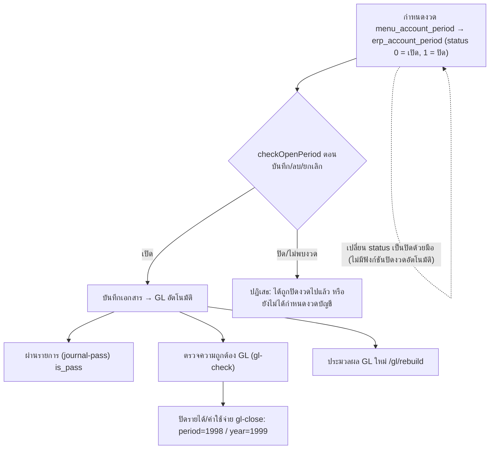

# งวดบัญชี ปิดงวด/ปิดปี และประมวลผล GL ใหม่ (Period & Year Close, GL Rebuild)

ในโค้ดมี 3 เรื่องที่คนบัญชีเรียกรวมว่า "ปิดงวด" ซึ่งแยกกันจริง:
1. สถานะงวดใน `erp_account_period` ใช้กันบันทึก/ลบ/ยกเลิกย้อนหลัง
2. รายการปิดบัญชีรายได้-ค่าใช้จ่าย (`GLClose`, flag 1998/1999)
3. ประมวลผล GL ใหม่ (`RebuildGL`)

ดู [[acc-period-close]] และ [[acc-gl-rebuild]]

## ภาพรวม

## ขั้นตอน

| ขั้น | เอกสาร/หน้าจอ | ตารางที่เขียน | ผลบัญชี | path:line |
|---|---|---|---|---|
| 1 | กำหนดงวดบัญชี `menu_account_period` | [[tbl-erp-account-period]] (`period_number`, `date_start`, `date_end`, `period_year`, `status`) | ไม่มีผลบัญชี · จอรับ status ได้แค่ 0 (เปิด) / 1 (ปิด) · ตอนบันทึกจอนี้ลบงวดทั้งตารางแล้วเขียนใหม่ตามตาราง | `backend/internal/application/process/master_detail_specs.go:473-480`, `backend/internal/application/process/period.go:35-49` |
| 2 | บันทึก/ลบ/ยกเลิกเอกสาร | — | อ่านงวดที่ครอบวันที่ (เรียง `period_number`, `roworder` เอาแถวแรก) ต้องพบและ status 0 | `backend/internal/application/process/period.go:17`, `:35-49`, `:68`, `:95`, `:109`, `:116`, `backend/internal/application/process/trans_validate.go:44`, `:106` |
| 3 | ผ่านรายการบัญชี (workflow `journal-pass`) หน้าจอประมวลผลระบบโหมด `gl_journal_pass` เมนู `menu_gl_journal_pass` ผ่านรายการ / `menu_gl_journal_pass_cancel` ยกเลิกผ่านรายการ: ดึงรายการด้วย `journal-list` แล้วติ๊กรายใบ [[scr-system-process-workbench]] | [[tbl-gl-journal]] `is_pass` | ทำเครื่องหมายผ่านรายการ (ใบที่มีรหัสบัญชีไม่พบในผัง / ใช้บัญชี status 1 / เดบิต ≠ เครดิต ทั้งที่หัวและผลรวมรายละเอียด ผ่านรายการไม่ได้) | `backend/internal/application/process/workflow.go:386-401`, `:442`, `:480`, `backend/internal/adapter/inbound/http/process/workflow_handler.go:45`, `:52`, `frontend/account/process/SystemProcessWorkbenchScreen.tsx:148`, `:425-446`, `:666-674` |
| 4 | ตรวจสอบ GL (workflow `gl-check`) หน้าจอประมวลผลระบบโหมด `gl_journal_pass` เมนู `menu_gl_check_data` ปุ่ม "เริ่มตรวจสอบ" [[scr-system-process-workbench]] | อ่านอย่างเดียว (ซิงก์เฉพาะ `journal_type` ของรายละเอียด) | ตรวจความถูกต้อง 8 ข้อ | `backend/internal/application/process/workflow.go:554`, `:587-614`, `:619-628`, `backend/internal/adapter/inbound/http/process/workflow_handler.go:59`, `frontend/account/process/SystemProcessWorkbenchScreen.tsx:657-665` |
| 5 | ปิดรายได้-ค่าใช้จ่าย (workflow `gl-close`) โหมด `period` → 1998 / `year` → 1999 (หน้าจอประมวลผลระบบ `gl_close_period`) | `gl_trans`, `gl_trans_detail`, [[tbl-gl-journal]], [[tbl-gl-journal-detail]] (journal_type 2, `trans_direct=1`, วันที่เอกสาร = วันสิ้นสุดช่วง) | กลับยอด (เดบิต − เครดิต) ของบัญชี account_type 3,4 ทุกตัวจาก `gl_journal_detail` ในช่วงวันที่ แล้วลงผลต่าง (กำไร = Σ(เครดิต − เดบิต), ขาดทุนเป็นลบ) เข้าบัญชีที่ผู้ใช้เลือก (`close_to_account`) · ไม่มีรหัสกำไรสะสมตายตัว | `backend/internal/application/process/workflow.go:766-771`, `:791-813`, `:817-818`, `:891`, `:913`, `frontend/account/process/SystemProcessWorkbenchScreen.tsx:530-563` |
| 6 | บันทึกปิดซ้ำเลขเดิม | ตารางเดียวกับขั้น 5 | ลบเอกสารปิดเลขเดิม (doc_no + flag) ใน 4 ตารางก่อน แล้วคำนวณใหม่ใน transaction เดียว | `backend/internal/application/process/workflow.go:844-849`, `:855` |
| 7 | ประมวลผล GL ใหม่ `/api/v1/process/gl/rebuild` (หน้าจอประมวลผลระบบโหมด `gl_process`) | [[tbl-gl-journal]], [[tbl-gl-journal-detail]] | ลบหัว GL ที่ไม่มีรายละเอียด แล้วลบ GL อัตโนมัติ (`trans_direct<>1`) เฉพาะ flag ใน `glRebuildTransFlags` แล้วสร้างใหม่จากเอกสารที่ `is_cancel=0` (template ก่อน ไม่มีจึงใช้สูตรมาตรฐาน) แล้วลงรายการกลับของเอกสารยกเลิก | `backend/internal/application/process/service.go:1308`, `:1331`, `:1426-1455`, `:1490-1493`, `:1505-1507`, `:1663`, `:1688`, `:1742-1756`, `backend/internal/adapter/inbound/http/router.go:172`, `frontend/account/process/SystemProcessWorkbenchScreen.tsx:652` |

ระหว่าง rebuild ระบบล็อก `gl_journal:rebuild` (`service.go:1331`) และเอกสารที่มี GL `trans_direct=1` จะไม่ถูกสร้างใหม่ (`service.go:1437-1455`, `:1493`, `:1507`) เช่น สมุดรายวันทั่วไป, ค่าเสื่อม 1801, รายการปิด 1998/1999 ส่วนขายสินทรัพย์ 1802 เป็น `trans_direct=0` แต่ไม่อยู่ใน `glRebuildTransFlags` จึงถูกลบ-ลงใหม่เฉพาะใบที่รูปแบบเอกสารมี template GL (`gl_template.go:1112-1114`, `:1129-1136`, `service.go:1663`) ดู [[flow-fixed-asset-lifecycle]]

## จุดตรวจสอบ/validation

- `checkOpenPeriod` (`period.go:17`): ไม่พบงวดหรือ status ≠ 0 จะปฏิเสธ วันที่ว่าง = วันนี้
- `checkPeriodNotClosed` (`period.go:27`): ผ่อนปรน ไม่พบงวดก็ผ่าน ใช้กับการลบค่าเสื่อม (`fa_depreciation.go:877`)
- ข้อยกเว้น:
  - คลังฝากขาย 521/522/523 บันทึกได้โดยไม่ตรวจงวด แต่การลบยังตรวจ (`period.go:128`, `trans_validate.go:44`, `:106`)
  - สมุดรายวันมือใช้ flag 0/1999 (`period.go:131`)
  - เอกสารเช็คไม่มีการตรวจงวดตอนบันทึก/ลบผ่าน `checkSaveDocPeriod`/`checkDeleteDocPeriod` (ตรวจเฉพาะสมุดรายวันและเจ้าหนี้/ลูกหนี้) (`period.go:109-124`)
- `GLClose` ตรวจว่า (`workflow.go:818-821`, `:834-835`, `:868-887`):
  - mode ต้องเป็น period หรือ year
  - ต้องมีเลขที่เอกสาร ≤25 ตัว สมุดรายวัน และบัญชีที่ปิดเข้า
  - สมุดรายวันต้องมีจริง และบัญชีที่ปิดเข้าต้องมีในผังและเป็น status 0 (บัญชีย่อย)
  - เลขที่เอกสารต้องไม่ถูกใช้กับเอกสารอื่น
- `RebuildGL` มาตรฐานอ่าน `period_number` จากงวด (ไม่พบ = 0) แต่ไม่ตรวจว่างวดปิดแล้ว (`service.go:1598-1607`)
- template ที่ Dr ≠ Cr ไม่ทำให้ทั้ง rebuild ล้ม: เอกสาร ic/รับ-จ่ายชำระจะใช้สูตรมาตรฐานแทนพร้อมคำเตือน (`gl_template.go:1046`, `service.go:1585-1592`) ส่วน flag ที่ลงด้วย template อย่างเดียว (72, 418 และขายสินทรัพย์ 1802) ระบบลบ GL อัตโนมัติเดิมก่อน (`gl_template.go:1096`, `:1133`) ถ้า template ไม่สมดุลจะข้ามไปโดยไม่มี GL ใหม่ของใบนั้น (`:1140`) ดู [[acc-gl-template-engine]]

## ข้อผิดพลาดที่พบบ่อยตามโค้ด

| ข้อความ/อาการ | สาเหตุ | path:line |
|---|---|---|
| "วันที่เอกสาร dd/mm/yyyy ได้ถูกปิดงวดไปแล้ว หรือยังไม่ได้กำหนดงวดบัญชี กรุณาตรวจสอบ" | งวดปิดหรือยังไม่สร้างงวดของปีนั้น | `backend/internal/application/process/period.go:53-61` |
| "ไม่พบงวดบัญชีของปี ..." | ปิดปีโดยยังไม่มีงวดของปี | `backend/internal/application/process/workflow.go:741` |
| "ไม่มียอดรายได้/ค่าใช้จ่ายในช่วงวันที่ ..." | ช่วงวันที่ไม่มียอด account_type 3,4 | `backend/internal/application/process/workflow.go:855` |
| "ไม่พบบัญชีที่ปิดเข้า ... (ต้องเป็นบัญชีย่อย)" | เลือกบัญชีที่ status ไม่ใช่ 0 หรือรหัสไม่มี | `backend/internal/application/process/workflow.go:882` |

- ไม่มีฟังก์ชันปิดงวดที่เปลี่ยน status ให้อัตโนมัติ ต้องแก้ status ในจอกำหนดงวดเอง (ไม่พบโค้ดที่ UPDATE `erp_account_period`)
- `GLClose` ไม่ตรวจงวดเปิด จึงบันทึกรายการปิดในงวดที่ปิดแล้วได้ (ไม่พบการเรียก `checkOpenPeriod` ใน `workflow.go:817-866`)
- flag 1999 ชนกัน 3 ความหมาย จึงควรระวังเวลา query ด้วย trans_flag:
  - รายการปิดสิ้นปี (`workflow.go:818`)
  - `flagJournalVat` = 1999 "บัญชี_ข้อมูลรายวัน" (`journaltax.go:17`)
  - อยู่ใน `journalFlags` ของสมุดรายวันมือ (`period.go:131`)
- `RebuildGL` สร้าง GL ใหม่ในงวดที่ปิดไปแล้วได้ ตัวเลขงบในงวดปิดจึงเปลี่ยนได้หลัง rebuild
- ยกเลิกเอกสารลงรายการกลับในวันที่ยกเลิก ดู [[flow-cancel-edit-reversal]]

## ที่มาในโค้ด

- `backend/internal/application/process/period.go:17-61`, `:68`, `:95`, `:109-124`, `:128`, `:131` — ตรวจงวด
- `backend/internal/application/process/trans_validate.go:44`, `:106` — ตรวจงวดตอนบันทึก/ลบเอกสาร ic (ยกเว้น 521-523 ตอนบันทึก)
- `backend/internal/application/process/master_detail_specs.go:473-480` — master งวดบัญชี
- `backend/internal/application/process/workflow.go:386-401`, `:442`, `:480`, `:554`, `:741`, `:766-866`, `:868-913` — ผ่านรายการ ตรวจ GL ปิดงวด/ปี
- `backend/internal/application/process/service.go:1308`, `:1331`, `:1426-1507`, `:1598-1607`, `:1663`, `:1688`, `:1742-1756` — ประมวลผล GL ใหม่
- `backend/internal/application/process/gl_template.go:1046`, `:1096-1140` — template ไม่สมดุล / flag ที่ลงด้วย template อย่างเดียว
- `backend/internal/adapter/inbound/http/process/workflow_handler.go:45`, `:52`, `:59`, `:66` — action `journal-list`, `journal-pass`, `gl-check`, `gl-close`
- `frontend/account/process/SystemProcessWorkbenchScreen.tsx:148`, `:530-563`, `:652` — เลือกโหมดผ่านรายการ/ตรวจสอบ จอปิดงวด และประมวลผล GL
