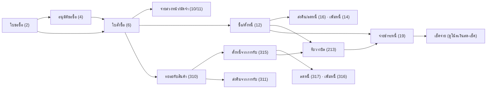

# จัดซื้อถึงจ่ายเงิน (Procure-to-Pay)

เส้นทางงานซื้อตั้งแต่ขอซื้อจนจ่ายเงินเจ้าหนี้ เอกสารฝั่งสินค้า (`ic_trans`) บันทึกผ่าน `/api/v1/process/trans/save` ส่วนวางบิลและจ่ายชำระ (`ap_ar_trans`) บันทึกผ่าน `/api/v1/process/doc/save` ดู [[acc-transaction-save-flow]] และ [[proc-doc-flow-numbering]]

## ภาพรวม

ลูกศร "ดึงจากเอกสาร" มาจาก `refImportSources` (`trans_ref_import_lines.go:52`) ได้แก่ 6←{4,2}, 12←6, 310←6, 315←310, 16←12, 311←310, 317←315, 14←12, 316←315

## ขั้นตอน

| ขั้น | เอกสาร/หน้าจอ | ตารางที่เขียน | ผลบัญชี/สต็อก | path:line |
|---|---|---|---|---|
| 1 | ใบขอซื้อ (2) `menu_purchase_requisition` [[doc-purchase-requisition]] | [[tbl-ic-trans]], [[tbl-ic-trans-detail]] | ไม่ตัดสต็อก ไม่ลง GL (2 ไม่อยู่ใน `stockRowsSQL` และ `glRebuildTransFlags`) | `frontend/account/tabs/transMenuMap.ts:60`, `backend/internal/application/process/stock_rebuild.go:18`, `backend/internal/application/process/service.go:1731` |
| 2 | อนุมัติใบขอซื้อ (4) | [[tbl-ic-trans]] | ไม่มีผลบัญชี | `frontend/account/tabs/transMenuMap.ts:74` |
| 3 | ใบสั่งซื้อ (6) `menu_po_purchase_order` [[doc-purchase-order]] ดึงจาก 4/2 · อนุมัติใบสั่งซื้อ (8) | [[tbl-ic-trans]], [[tbl-ic-trans-detail]] | ไม่ตัดสต็อก ไม่ลง GL | `frontend/account/tabs/transMenuMap.ts:103`, `:119`, `backend/internal/application/process/trans_ref_import_lines.go:52` |
| 4 | จ่ายเงินล่วงหน้า (10) / จ่ายมัดจำ (11) [[doc-purchase-advance-payment]] [[doc-purchase-deposit-payment]] | [[tbl-ic-trans]], [[tbl-cb-trans]], [[tbl-cb-trans-detail]] | Dr เงินจ่ายล่วงหน้า 115710 หรือ มัดจำ 153010 / Cr ช่องทางจ่าย (payTenders) | `backend/internal/application/process/trans_deposit.go:36-41`, `backend/internal/application/process/service.go:2185` |
| 5a | ซื้อสินค้า/ตั้งหนี้ (12) `menu_po_purchase_billing` [[doc-purchase-invoice]] ดึงจาก 6 | [[tbl-ic-trans]], [[tbl-ic-trans-detail]], [[tbl-gl-journal]], [[tbl-gl-journal-detail]] (+ ภาษีซื้อ ดู [[flow-tax-vat-wht-reports]]) | สต็อกเข้า (12 อยู่ใน `stockRowsSQL`) · Dr ซื้อ 5111 (รวมมัดจำที่ใช้ ex-VAT) + Dr ภาษีซื้อ 1154 / Cr เจ้าหนี้ 2111 (inquiry 0/2) หรือ Cr ช่องทางจ่าย (inquiry 1/3 = ซื้อเงินสด) / Cr บัญชีมัดจำที่ตัดใช้ | `frontend/account/tabs/transMenuMap.ts:299`, `backend/internal/application/process/service.go:1965-1983`, `:1828-1840` |
| 5b | ทยอยรับสินค้า (310) `menu_po_purchase_partial_item` [[doc-purchase-partial-receive]] ดึงจาก 6 | [[tbl-ic-trans]], [[tbl-ic-trans-detail]], GL | สต็อกเข้าที่ 310 · Dr ซื้อ / Cr เจ้าหนี้ไม่ถึงกำหนดตั้งหนี้ 212015 (สร้างผังบัญชีให้อัตโนมัติถ้าไม่มี) | `frontend/account/tabs/transMenuMap.ts:330`, `backend/internal/application/process/service.go:1923`, `:1658` |
| 5c | ตั้งหนี้จากการรับ (315) `menu_po_purchase_partial_1` [[doc-purchase-partial-invoice]] ดึงจาก 310 | [[tbl-ic-trans]], GL, ภาษีซื้อ | ไม่ตัดสต็อกซ้ำ (315 ไม่อยู่ใน `stockRowsSQL`) · Dr 212015 + ภาษีซื้อ / Cr เจ้าหนี้ (หรือช่องทางจ่ายเมื่อ inquiry 1/3) และ Cr มัดจำที่ใช้ | `frontend/account/tabs/transMenuMap.ts:361`, `backend/internal/application/process/service.go:1947` |
| 6 | ส่งคืน/ลดหนี้ (16) ← 12 · ส่งคืนจากการรับ (311) ← 310 · ลดหนี้ (317) ← 315 [[doc-purchase-return]] [[doc-purchase-partial-return]] [[doc-purchase-partial-credit-note]] | [[tbl-ic-trans]], GL | สต็อกออก (16, 311) · GL กลับข้างของ 12/310/315 | `frontend/account/tabs/transMenuMap.ts:392`, `:408`, `:424`, `backend/internal/application/process/service.go:1935`, `:1984` |
| 7 | เพิ่มหนี้ (14) ← 12 · เพิ่มหนี้ (316) ← 315 [[doc-purchase-debit-note]] [[doc-purchase-partial-debit-note]] | [[tbl-ic-trans]], GL | 14/16/311 inquiry 1/3 = ปรับมูลค่าอย่างเดียวไม่เปลี่ยนจำนวน (`stockValueOnlySQL`) · GL เหมือน 12 แต่ 14/316 ลงเจ้าหนี้เสมอ | `frontend/account/tabs/transMenuMap.ts:483`, `backend/internal/application/process/stock_rebuild.go:26`, `backend/internal/application/process/service.go:1976-1981` |
| 8 | รับวางบิล (213) `menu_ap_pay_bill` [[doc-ap-billing-receive]] | [[tbl-ap-ar-trans]], [[tbl-ap-ar-trans-detail]] | ไม่ลง GL (`glFlag` มีแค่ 19/239) | `frontend/account/tabs/transMenuMap.ts:1349`, `backend/internal/application/process/docs.go:390` |
| 9 | จ่ายชำระหนี้ (19) `menu_ap_debt_billing` [[doc-ap-payment]] เลือกบิลจาก `/doc/bills` | [[tbl-ap-ar-trans]], [[tbl-ap-ar-trans-detail]], [[tbl-cb-trans]], [[tbl-cb-trans-detail]], [[tbl-cb-chq-list]], GL | Dr เจ้าหนี้ / Cr ช่องทางจ่าย (เงินสด/ธนาคาร/เช็คจ่าย 2112/ภาษีหัก ณ ที่จ่าย 2122 ลำดับสำรอง 2123/2120) · กำไร 420040 / ขาดทุน 511030 จากอัตราแลกเปลี่ยน | `frontend/account/tabs/transMenuMap.ts:1378`, `backend/internal/application/process/service.go:2159`, `backend/internal/adapter/inbound/http/router.go:181` |

ยอดค้างเจ้าหนี้ไม่ได้เก็บเป็นคอลัมน์ `OutstandingBills` คำนวณจากเอกสารหนี้ตาม `apDebtWhere` (12/315/260/264 inquiry 0/2, 14/316/81/83/87/89) ร่วมกับเอกสารลดหนี้ `apCreditWhere` (16/317 inquiry 0/1, 85/91, 262) ลบยอดที่จ่ายแล้วใน `ap_ar_trans_detail.sum_pay_money` (`docs.go:599-628`)

## จุดตรวจสอบ/validation

- ก่อนบันทึก `checkTransScreenSave` (`trans_validate.go:43`) ตรวจตามลำดับ:
  - งวดบัญชีเปิดอยู่ ([[flow-period-year-close]])
  - เอกสารที่แก้ไม่ถูกล็อก/ยังแก้ได้
  - เลขที่เอกสาร สาขา แผนก วันส่ง (`checkScreenFields` :168)
  - รหัสเจ้าหนี้ (`checkParty` :216)
  - รายการอ้างอิง (`checkReferencedLines` :339)
  - จำนวนเกินเอกสารอ้างอิง
  - กฎบันทึก (`checkTransSaveRules`)
- ออปชัน `receive_more_po` ข้ามการตรวจรายการอ้างอิงของ 12/310 จึงรับเกินใบสั่งซื้อได้ ออปชัน `check_qty_over_doc_ref` เปิดการตรวจจำนวนเกิน (`trans_qty_over_ref.go:41`)
- ใบสั่งซื้อที่ให้ดึงต้อง `doc_success=0` สำหรับ 12/310/315 ส่วนการดึงเข้า 6 ต้องผ่านการอนุมัติตามออปชัน `ref_po_approve` และ `show_branch_doc_only` จำกัดสาขา (`lookup_trans.go:140`) ดู [[proc-lookup-filters]]
- ภาษีซื้อ: เมื่อเปิด `check_input_vat` และ VatType 0/1 เอกสาร 12/315/14/316/16/317 ต้องมีเลขที่และวันที่ใบกำกับ (`trans_save_rules.go:53`, `:140-145`) และตรวจเลขใบกำกับซ้ำที่ `trans_tax_doc_no.go:18`
- มัดจำ: ตอนใช้มัดจำจะล็อก `deposit:<doc>` แล้วตรวจยอดคงเหลือ (`trans_deposit.go:145`) และห้ามลบมัดจำที่ถูกใช้แล้ว (`trans_deposit.go:246`) ดู [[acc-deposit-advance]]
- ใบอ้างอิงต้องมีสินค้าที่ดึงมา (`trans_ref_check.go:54`)

## ข้อผิดพลาดที่พบบ่อยตามโค้ด

| ข้อความ | สาเหตุ | path:line |
|---|---|---|
| "กรุณาป้อน รหัสเจ้าหนี้" / "ไม่พบข้อมูล : ..." | ไม่กรอกหรือรหัสไม่มีใน master | `backend/internal/application/process/trans_validate.go:222-232` |
| "กรุณาป้อนเลขที่ใบกำกับภาษี" / "กรุณาป้อนวันที่ใบกำกับภาษี" | เปิด `check_input_vat` | `backend/internal/application/process/trans_save_rules.go:142`, `:145` |
| "จำนวนเกินเอกสารอ้างอิง" | รับ/ตั้งหนี้เกินใบสั่งซื้อ | `backend/internal/application/process/trans_validate.go:287` |
| "ไม่พบสินค้าในเอกสารอ้างอิง" | รายการไม่ตรงใบอ้างอิง | `backend/internal/application/process/trans_ref_check.go:54` |
| "วันที่เอกสาร ... ได้ถูกปิดงวดไปแล้ว หรือยังไม่ได้กำหนดงวดบัญชี" | ยังไม่สร้างงวดใน `erp_account_period` | `backend/internal/application/process/period.go:53-61` |

- ถ้าผังบัญชีไม่มีรหัสที่ระบบหา (เช่น 5111/1154/2111) `resolveChartAccount` จะใช้รหัสตัวแรกเป็นทั้งรหัสและชื่อบัญชี จึงลง GL เป็นรหัสที่ไม่มีในผัง (`service.go:1755-1772`) ดู [[flow-new-company-setup]]
- ถ้ามี template ใน `erp_doc_format_gl` ระบบใช้ template ก่อนสูตรมาตรฐาน ดู [[acc-gl-template-engine]] และ [[acc-gl-posting-standard]]
- ลดต้นทุนสินค้าด้วยต้นทุนเฉลี่ย ดู [[acc-inventory-cost-moving-average]] ส่วนยกเลิกเอกสาร ดู [[flow-cancel-edit-reversal]]

## ที่มาในโค้ด

- `backend/internal/application/process/trans_ref_import_lines.go:52` — `refImportSources` (โซ่ดึงเอกสาร)
- `backend/internal/application/process/trans_ref_import.go:24` — `refImportSpecs` ยอดคงเหลือให้ดึง ({12,6} หักจาก {7,12,310})
- `backend/internal/application/process/lookup_trans.go:140` — `refDocWhere`
- `backend/internal/application/process/trans_validate.go:43`, `:168`, `:216`, `:339` — ลำดับตรวจก่อนบันทึก
- `backend/internal/application/process/trans_save_rules.go:30`, `:53`, `:134` — ออปชันและกฎบันทึก
- `backend/internal/application/process/trans.go:267`, `:593` — `SaveTrans`, `rebuildTransDerived`
- `backend/internal/application/process/stock_rebuild.go:18`, `:26` — ธงที่เข้าสต็อก
- `backend/internal/application/process/service.go:1731`, `:1785-1792`, `:1923-1997`, `:2159`, `:2185` — GL มาตรฐานฝั่งซื้อ
- `backend/internal/application/process/trans_deposit.go:36-41`, `:145`, `:246` — มัดจำ/ล่วงหน้า
- `backend/internal/application/process/docs.go:119`, `:390`, `:599-628` — วางบิล/จ่ายชำระ/ยอดค้าง
- `frontend/account/tabs/transMenuMap.ts:60-483`, `:1349`, `:1378` — เมนูหน้าจอฝั่งซื้อ
- `frontend/account/transaction/UniversalTransScreen.tsx:2576` — `handleSave` แยกส่ง `/trans/save` หรือ `/doc/save`
