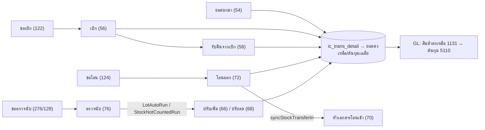

# เคลื่อนไหวสต็อกและต้นทุน (Stock Movement & Costing)

สต็อกไม่ได้บวกลบตอนบันทึกทีละบรรทัด หลังบันทึกเอกสารทุกใบ `rebuildTransDerived` คำนวณยอดคงเหลือและต้นทุนเฉลี่ยของสินค้าในเอกสารใหม่จากรายการจริง ([[acc-inventory-stock-rebuild]], [[acc-inventory-cost-moving-average]]) เอกสารซื้อ/ขายที่เข้าสต็อกดู [[flow-procure-to-pay]] และ [[flow-order-to-cash]]

## ภาพรวม

โซ่ดึงเอกสาร (`trans_ref_import_lines.go:52`): 56←122, 58←56, 72←124, 76←{276,128}

## ขั้นตอน

| ขั้น | เอกสาร/หน้าจอ | ตารางที่เขียน | ผลบัญชี/สต็อก | path:line |
|---|---|---|---|---|
| 1 | ยอดยกมา (54) `menu_ic_stk_balance` [[doc-stock-beginning-balance]] | [[tbl-ic-trans]], [[tbl-ic-trans-detail]] | สต็อกเข้า · ไม่ลง GL (54/62/64 ไม่อยู่ใน `glRebuildTransFlags`) | `frontend/account/tabs/transMenuMap.ts:928`, `backend/internal/application/process/service.go:1737` |
| 2 | ขอเบิก (122) `menu_ic_request_issue` [[doc-issue-request]] | [[tbl-ic-trans]], [[tbl-ic-trans-detail]] | ไม่ตัดสต็อก | `frontend/account/tabs/transMenuMap.ts:971` |
| 3 | เบิกสินค้า (56) `menu_ic_issue` [[doc-stock-issue]] ← 122 | [[tbl-ic-trans]], [[tbl-ic-trans-detail]], GL | สต็อกออก · Dr ต้นทุน 5110 / Cr สินค้าคงเหลือ 1131 | `frontend/account/tabs/transMenuMap.ts:1000`, `backend/internal/application/process/service.go:2146-2157` |
| 4 | รับคืนจากเบิก (58) [[doc-issue-return]] ← 56 | [[tbl-ic-trans]], GL | สต็อกเข้า · Dr 1131 / Cr 5110 | `frontend/account/tabs/transMenuMap.ts:1031`, `backend/internal/application/process/service.go:2150-2152` |
| 5 | รับสินค้าสำเร็จรูป (60) [[doc-finished-goods-receive]] | [[tbl-ic-trans]], GL | สต็อกเข้า · Dr 1131 / Cr 5110 | `backend/internal/application/process/service.go:2146-2152` |
| 6 | ขอโอน (124) [[doc-transfer-request]] → โอนออก (72) `menu_ic_transfer_wh_out` [[doc-stock-transfer]] | [[tbl-ic-trans]], [[tbl-ic-trans-detail]] + หัวเอกสาร 70 | ย้ายคลัง/ที่เก็บ หัว 70 สร้างใหม่จาก 72 ทุกครั้ง (สลับคอลัมน์ `_to`) · GL ลงเฉพาะเมื่อมี template (72 อยู่ใน `glTemplateOnlyFlags`) | `frontend/account/tabs/transMenuMap.ts:1062`, `:1077`, `backend/internal/application/process/stock_rebuild.go:66-72`, `backend/internal/application/process/gl_template.go:1096` |
| 7 | ขอตรวจนับ (276/128) [[doc-stock-count-request]] → ตรวจนับ (76) `menu_ic_stk_count` [[doc-stock-count]] | [[tbl-ic-trans]], [[tbl-ic-trans-detail]] | 76 ไม่อยู่ใน `stockRowsSQL` จึงไม่เปลี่ยนยอดเอง | `frontend/account/tabs/transMenuMap.ts:1137`, `backend/internal/application/process/stock_rebuild.go:18-19` |
| 8 | สร้างใบปรับจากผลนับ: `LotAutoRun` (ผลต่างนับ vs บัญชี) / `StockNotCountedRun` (ทำยอดสินค้าที่ไม่ถูกนับเป็นศูนย์) | [[tbl-ic-trans]] ผ่านเส้นทางบันทึกปกติ | สร้าง 66 (เพิ่ม) / 68 (ลด เลข "-N") แล้วผูกกับใบนับ ใบนับที่มีใบปรับแล้วถูกปฏิเสธ | `backend/internal/application/process/stock_lot.go:614-617`, `:900-901`, `:197` |
| 9 | ปรับเพิ่ม (66) / ปรับลด (68) [[doc-stock-adjust-increase]] [[doc-stock-adjust-decrease]] | [[tbl-ic-trans]], GL | 66: Dr 1131 / Cr 5110 · 68: Dr 5110 / Cr 1131 | `frontend/account/tabs/transMenuMap.ts:1153`, `:1167`, `backend/internal/application/process/service.go:2146-2157` |
| 10 | ประมวลผลสต็อกใหม่ทั้งหมด (หน้าจอประมวลผลระบบ) | ยอดคงเหลือ/ต้นทุนของสินค้าที่เลือก | คำนวณใหม่จาก `ic_trans_detail` | `backend/internal/adapter/inbound/http/router.go:171`, `backend/internal/application/process/service.go:548`, `frontend/account/process/SystemProcessWorkbenchScreen.tsx:624` |

ธงที่เข้าสต็อก (`stockRowsSQL`, `stock_rebuild.go:18-22`):
- เงื่อนไขพื้นฐาน: `last_status=0`, ไม่ใช่สำเนาเอกสาร และ `item_type` อยู่ใน 0/4/6
- ธงที่นับ: 12, 310, 14, 311, 16, 44, 46, 48, 54-73 และ 521-523
- ข้อยกเว้น:
  - 46 นับเฉพาะ inquiry 0
  - 48 นับเฉพาะ inquiry ≤1
  - 44 ของ POS ที่มี doc_ref ไม่นับ
- 14/16/311 ที่ inquiry 1/3 เปลี่ยนมูลค่าอย่างเดียว ไม่เปลี่ยนจำนวน (`stock_rebuild.go:26`)

## จุดตรวจสอบ/validation

- สต็อกพอไหม: ตรวจเฉพาะเอกสารใหม่ที่เปิด `issue_stock_control` และธงอยู่ใน 72/36/46/44/56 (`trans_save_rules.go:55`, `:151`) ออปชันอื่นที่อ่านมาด้วย ได้แก่ `stock_balance_control`, `ic_stock_control`, `transfer_stock_control`, `stock_accrued_control`, `stock_reserved_control` (`trans_save_rules.go:30`)
- รหัสสินค้า/หน่วยนับต้องมีจริงใน `ic_inventory`/`ic_unit_use` (`trans_lines_check.go:169`, `:188`) และต้องกรอกคลัง/ที่เก็บ ไม่เช่นนั้นขึ้น "ป้อนข้อมูลคลังสินค้าไม่ครบ" / "ป้อนข้อมูลที่เก็บสินค้าไม่ครบ" (`trans_lines_check.go:257`, `:260`) ดู [[proc-wh-shelf-permission]]
- ใบโอน 72: ล็อกเอกสาร+สินค้า แล้วสร้างหัว 70 ใหม่ทุกครั้ง ถ้าลบ 72 ก็ไม่เหลือหัว 70 (`stock_rebuild.go:66-72`)
- งวดบัญชี: คลังฝากขาย 521/522/523 บันทึกได้โดยไม่ตรวจงวด แต่การลบยังตรวจงวด (`period.go:126-128`)

## ข้อผิดพลาดที่พบบ่อยตามโค้ด

- GL ของ 66 ไม่ตรงมูลค่าสต็อก (ช่องว่างที่รู้แล้ว รอลุงจืดตัดสิน): บรรทัด 66 ที่ qty ≠ 0 และ inquiry ≠ 1 เข้าสต็อกด้วย qty × ต้นทุนเฉลี่ย แต่ GL มาตรฐานลง Dr สินค้าคงเหลือด้วยยอดรวมหัวเอกสาร (`service.go:2153-2155`)
- ขาย 44 ไม่มีบรรทัดต้นทุนขายในสูตรมาตรฐาน มูลค่าต้นทุนอยู่ในสต็อกเท่านั้น ([[flow-order-to-cash]])
- ใบปรับจากผลนับซ้ำ: `LotAutoRun` ปฏิเสธใบนับที่มีใบปรับที่ยังไม่ยกเลิกอยู่แล้ว (`stock_lot.go:614-616`)
- ต้นทุนแฝง ล็อต ยอดยกมา และงานเครื่องมือสต็อกอื่น ดู [[proc-stock-tools]] และ [[proc-hidden-cost]] (`hidden_cost.go:449`, `stock_beginning.go:307`, `stock_lot.go:387`, `:552`)
- ใช้ต้นทุนเฉลี่ยเคลื่อนที่เสมอ ไม่พบการใช้ FIFO ในเส้นทางบันทึก ดู [[acc-inventory-cost-moving-average]]

## ที่มาในโค้ด

- `backend/internal/application/process/stock_rebuild.go:18-22`, `:26`, `:66-72` — ธงสต็อก, มูลค่าอย่างเดียว, หัวโอนเข้า 70
- `backend/internal/application/process/trans.go:19-27`, `:593` — ค่าคงที่ 72/70/124/422 และ `rebuildTransDerived`
- `backend/internal/application/process/service.go:548`, `:1007`, `:1731-1744`, `:2146-2157` — `RebuildStock`, `rebuildStockTx`, ธง GL, GL สต็อก
- `backend/internal/application/process/gl_template.go:1096`, `:1100` — `glTemplateOnlyFlags` {72, 418}
- `backend/internal/application/process/stock_lot.go:197`, `:617`, `:901` — ใบปรับอัตโนมัติจากผลนับ
- `backend/internal/application/process/stock_tools.go:253`, `:351` — ตรวจนับ serial (76)
- `backend/internal/application/process/trans_save_rules.go:30`, `:55`, `:151` — ตรวจสต็อกพอ
- `backend/internal/application/process/trans_lines_check.go:169`, `:188`, `:257`, `:260`
- `backend/internal/adapter/inbound/http/process/stocktools_handler.go:112-160` — action เครื่องมือสต็อก
- `frontend/account/tabs/transMenuMap.ts:928-1167` — เมนูเอกสารคลัง
- `frontend/account/process/SystemProcessWorkbenchScreen.tsx:624` — ปุ่มประมวลผลสต็อก
