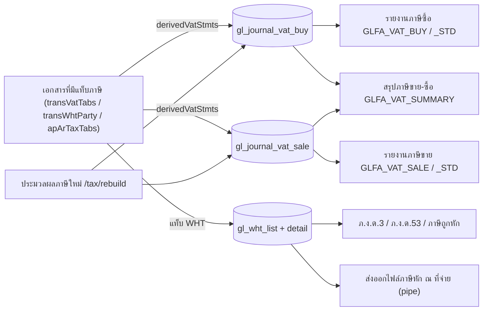

# ภาษีจากเอกสารถึงรายงาน VAT และ ภ.ง.ด. (Tax: Documents to VAT & WHT Reports)

เอกสารที่มีแท็บภาษีจะเขียนทะเบียนภาษีซื้อ/ขาย (`gl_journal_vat_buy` / `gl_journal_vat_sale`) และทะเบียนภาษีหัก ณ ที่จ่าย (`gl_wht_list` / `gl_wht_list_detail`) ตอนบันทึก รายงานภาษีอ่านจากทะเบียนเหล่านี้โดยตรง ดู [[acc-vat-register-wht]] โน้ตนี้อธิบายตามโค้ดเท่านั้น ไม่ได้อ้างข้อกฎหมายภาษี

## ภาพรวม

## ขั้นตอน

| ขั้น | เอกสาร/หน้าจอ | ตารางที่เขียน | ผลภาษี | path:line |
|---|---|---|---|---|
| 1 | เอกสารสินค้าที่มีแท็บ VAT: ซื้อ 12, 14, 16, 87, 89, 91, 260, 262, 264, 315, 316, 317, 461 และมัดจำซื้อ 11, 25 | [[tbl-gl-journal-vat-buy]] | `vat_calc` = 1 (เพิ่ม) หรือ −1 (ลดหนี้ 16, 91, 262, 317, 25) จำนวนเงินเก็บเป็นบวก | `backend/internal/application/process/trans_tax.go:37-42` |
| 2 | ขาย 44, 46, 48, 99, 101, 103, 144, 250, 252, 254, ขายสินทรัพย์ 1802 และมัดจำขาย 110, 112 | [[tbl-gl-journal-vat-sale]] | `vat_calc` −1 สำหรับ 48, 103, 252, 112 | `backend/internal/application/process/trans_tax.go:37-42`, `backend/internal/application/process/fa_sale.go:645` |
| 3 | แถวภาษีเริ่มต้นจากหัวเอกสาร (`defaultTransVat`) | ทะเบียนภาษี | vat_type 3 (ไม่กระทบภาษี) ไม่มีแถว · เลขที่/วันที่ใบกำกับว่างจะใช้ของเอกสาร · ฝั่งซื้อป้อนเอง (`ManualVat`) ได้ | `backend/internal/application/process/trans_tax.go:69-90` |
| 4 | จ่ายชำระ 19 / รับชำระ 239 ที่มีแท็บภาษี | ทะเบียนภาษี + WHT | `apArTaxTabs` vat_calc 1 · เขียนใน `apArTaxStmts` | `backend/internal/application/process/trans_tax.go:51`, `backend/internal/application/process/docs.go:378` |
| 5 | แท็บภาษีหัก ณ ที่จ่าย: ฝั่ง "ap" (12, 16, 260, 262, 264, 315, 11, 25) / ฝั่ง "ar" (44, 48, 144, 250, 252, 1802, 110, 112) | [[tbl-gl-wht-list]], [[tbl-gl-wht-list-detail]] | GL: ภาษีหัก ณ ที่จ่าย Cr 2122 (ฝั่งจ่าย) / ภาษีถูกหัก Dr 1153 (ฝั่งรับ) ผ่าน payTenders | `backend/internal/application/process/trans_tax.go:47-48`, `backend/internal/application/process/service.go:1863-1867` |
| 6 | GL ภาษี | [[tbl-gl-journal-detail]] | ภาษีซื้อ Dr 1154 · ภาษีขาย Cr 2134 | `backend/internal/application/process/service.go:1785-1792` |
| 7 | รายงานภาษีขาย/ซื้อ `menu_report_vat_sale` / `menu_report_vat_buy` | อ่านอย่างเดียว | จำนวน × `vat_calc` · เอกสารยกเลิก (`last_status=1`) เป็นศูนย์ · ฝั่งขายรวมสำเนาเอกสารเป็นศูนย์ด้วย · ฝั่งซื้อเฉพาะ vat_type 0 | `backend/internal/application/process/report_menu_gl_fa.go:1039-1049`, `:1701`, `:1706` |
| 8 | รายงานภาษีขาย/ซื้อ (มาตรฐาน) `menu_report_vat_sale_standard` / `_buy_standard` | อ่านอย่างเดียว | ใช้ฐานและจำนวนดิบ เฉพาะ vat_type 0 · ไม่ทำให้เอกสารยกเลิกเป็นศูนย์และไม่คูณ `vat_calc` | `backend/internal/application/process/report_menu_gl_fa.go:1092-1100`, `:1709-1710` |
| 9 | สรุปภาษีขาย − ภาษีซื้อรายเดือนภาษี `GLFA_VAT_SUMMARY` | อ่านอย่างเดียว | ผลต่างต่อเดือน | `backend/internal/application/process/report_menu_gl_fa.go:1712` |
| 10 | ภ.ง.ด.53 `menu_gl_wht_report_in_53` / ภ.ง.ด.3 `menu_gl_wht_report_in_3` / ภาษีถูกหัก `menu_gl_wht_report_sum` | อ่านอย่างเดียว | ลงวันที่ตาม `gl_wht_list_detail.due_date` · เอกสารที่ `last_status` ≠ 0 แสดงยอดศูนย์ | `backend/internal/application/process/report_menu_gl_fa.go:1137-1145`, `:1729-1731` |
| 11 | ส่งออกข้อมูลภาษีหัก ณ ที่จ่าย | ไฟล์ข้อความคั่นด้วย `\|` | หนึ่งบรรทัดต่อเอกสาร (สูงสุด 2 รายการเงินได้) · แสดงรายละเอียด = นิติบุคคล (ภ.ง.ด.53) ไม่เช่นนั้นบุคคล (ภ.ง.ด.3) · ไม่รวมเอกสารยกเลิก | `backend/internal/application/process/report_menu_gl_fa.go:1176-1178` |
| 12 | ประมวลผลภาษีใหม่ | ทะเบียนภาษีของเอกสาร | สร้างแถวภาษีใหม่จากหัวเอกสาร | `backend/internal/application/process/trans_tax.go:252`, `backend/internal/adapter/inbound/http/router.go:191` |

## จุดตรวจสอบ/validation

- `check_input_vat` และ VatType 0/1: ต้องป้อนเลขที่และวันที่ใบกำกับสำหรับธงใน `inputVatFlags` (`trans_save_rules.go:53`, `:140-145`)
- ตรวจเลขที่ใบกำกับภาษีซ้ำ (`checkTaxDocNo`, `trans_tax_doc_no.go:18`)
- ภาษีขายของขายสินทรัพย์ error จะขึ้นต้น "ภาษีขาย: ..." (`fa_sale.go:654`)

## ข้อผิดพลาดที่พบบ่อยตามโค้ด

- รายงานภาษีแบบ "มาตรฐาน" ไม่ตัดเอกสารยกเลิกและไม่ใช้เครื่องหมาย `vat_calc` ยอดจึงต่างจากรายงานปกติเมื่อมีใบยกเลิกหรือใบลดหนี้ (`report_menu_gl_fa.go:1092` เทียบกับ `:1041`)
- WHT ของ C# ทำให้รายการที่ไม่มีแถว `ic_trans` เป็นศูนย์ด้วย แต่โค้ดนี้ทำเฉพาะเอกสารที่ `last_status` ≠ 0 (คอมเมนต์ `ponytail:` ที่ `report_menu_gl_fa.go:1136`)
- ไม่พบในโค้ด:
  - การสร้างแบบ ภ.พ.30 และการปิดภาษี/ยื่นภาษี
  - ภ.ง.ด.1
  - รายงาน 50 ทวิ ฝั่ง backend
- รายงานภาษีระหว่างบริษัทเป็น stub
- ตัวเชื่อม e-Tax (`backend/internal/adapter/inbound/http/etax/handler.go`) เป็น mock ยังไม่ได้ส่งจริง
- ยกเลิกเอกสาร → ทะเบียนภาษียังอยู่ แต่รายงานปกติแสดงศูนย์ ดู [[flow-cancel-edit-reversal]]

## ที่มาในโค้ด

- `backend/internal/application/process/trans_tax.go:37-51`, `:69-90`, `:252` — ธงที่มีแท็บภาษี, แถวเริ่มต้น, rebuild
- `backend/internal/application/process/trans_tax_doc_no.go:18` — ตรวจเลขใบกำกับซ้ำ
- `backend/internal/application/process/trans_save_rules.go:53`, `:140-145` — บังคับเลขที่/วันที่ใบกำกับ
- `backend/internal/application/process/docs.go:378` — ภาษีของ ap_ar_trans
- `backend/internal/application/process/service.go:1785-1792`, `:1861-1867` — บัญชีภาษีใน GL
- `backend/internal/application/process/fa_sale.go:645-666` — ภาษีขายสินทรัพย์
- `backend/internal/application/process/report_menu_gl_fa.go:1039`, `:1092`, `:1137`, `:1178`, `:1701-1731` — รายงานภาษี
- `backend/internal/adapter/inbound/http/etax/handler.go` — e-Tax (mock)
