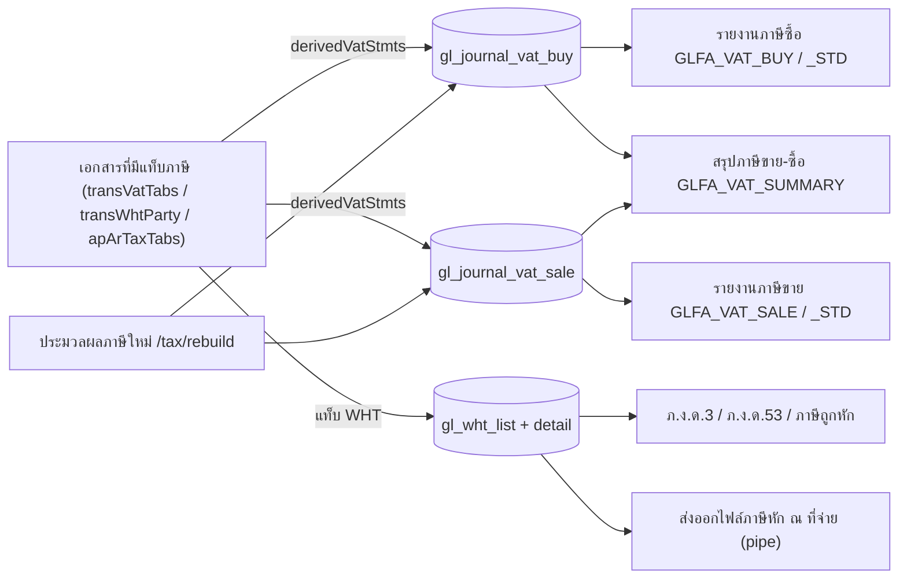

# ภาษีจากเอกสารถึงรายงาน VAT และ ภ.ง.ด. (Tax: Documents to VAT & WHT Reports)

เอกสารที่มีแท็บภาษีจะเขียนทะเบียนภาษีซื้อ/ขาย (`gl_journal_vat_buy` / `gl_journal_vat_sale`) และทะเบียนภาษีหัก ณ ที่จ่าย (`gl_wht_list` / `gl_wht_list_detail`) ตอนบันทึก รายงานภาษีอ่านจากทะเบียนเหล่านี้โดยตรง ดู [[acc-vat-register-wht]] โน้ตนี้อธิบายตามโค้ดเท่านั้น ไม่ได้อ้างข้อกฎหมายภาษี

## ภาพรวม

## ขั้นตอน

| ขั้น | เอกสาร/หน้าจอ | ตารางที่เขียน | ผลภาษี | path:line |
|---|---|---|---|---|
| 1 | เอกสารสินค้าที่มีแท็บ VAT: ซื้อ 12, 14, 16, 87, 89, 91, 260, 262, 264, 315, 316, 317, 461 และมัดจำซื้อ 11, 25 | [[tbl-gl-journal-vat-buy]] | `vat_calc` = 1 (เพิ่ม) หรือ −1 (ลดหนี้ 16, 91, 262, 317, 25) จำนวนเงินเก็บเป็นบวก | `backend/internal/application/process/trans_tax.go:37-43` |
| 2 | ขาย 44, 46, 48, 99, 101, 103, 144, 250, 252, 254, ขายสินทรัพย์ 1802 และมัดจำขาย 110, 112 | [[tbl-gl-journal-vat-sale]] | `vat_calc` −1 สำหรับ 48, 103, 252, 112 | `backend/internal/application/process/trans_tax.go:37-43`, `backend/internal/application/process/fa_sale.go:645` |
| 3 | แถวภาษีเริ่มต้นจากหัวเอกสาร (`defaultTransVat`) | ทะเบียนภาษี | vat_type 3 (ไม่กระทบภาษี) ไม่มีแถว · ยอดรวม = ฐานภาษี + VAT (ปัดครึ่งขึ้น 2 ตำแหน่งแต่ละตัว) · ถ้าอัตราเป็น 0 แต่มีฐานและ VAT คำนวณอัตรา = VAT × 100 / ฐาน · เลขที่/วันที่ใบกำกับว่างจะใช้ของเอกสาร · ป้อนแถวภาษีเองได้ (`ManualVat` หรือส่งมากกว่า 1 แถว) แล้วตั้ง `is_manual_vat = 1` | `backend/internal/application/process/trans_tax.go:70-87`, `:90-96`, `:115-129` |
| 4 | จ่ายชำระ 19 / รับชำระ 239 ที่มีแท็บภาษี | ทะเบียนภาษี + WHT | `apArTaxTabs` vat_calc 1 · เขียนใน `apArTaxStmts` · ถ้าไม่ส่งแท็บมา เก็บแถวเดิมไว้ | `backend/internal/application/process/trans_tax.go:53`, `:166-169`, `backend/internal/application/process/docs.go:378` |
| 5 | แท็บภาษีหัก ณ ที่จ่าย: ฝั่ง "ap" (12, 16, 260, 262, 264, 315, 11, 25) / ฝั่ง "ar" (44, 48, 144, 250, 252, 1802, 110, 112) | [[tbl-gl-wht-list]], [[tbl-gl-wht-list-detail]] | GL ผ่าน `payTenders`: ฝั่งจ่ายเครดิตภาษีหัก ณ ที่จ่าย `resolveChartAccount(ctx, tx, "2122", "2123", "2120")` / ฝั่งรับเดบิตภาษีถูกหัก `resolveChartAccount(ctx, tx, "1153", "1154", "1152", "2122")` ยอด WHT มาจาก `cb_trans.total_tax_at_pay` หรือผลรวม `gl_wht_list.tax_value` | `backend/internal/application/process/trans_tax.go:48-49`, `backend/internal/application/process/service.go:1871-1888`, `:1921-1925` |
| 6 | GL ภาษี | [[tbl-gl-journal-detail]] | ภาษีซื้อ Dr `resolveChartAccount(ctx, tx, "1154", "1151", "1155", "1190")` · ภาษีขาย Cr `resolveChartAccount(ctx, tx, "2134", "2121", "2135", "2190")` · ใบลดหนี้ (16, 317, 262, 91 / 48, 252) กลับข้าง | `backend/internal/application/process/service.go:1802-1803`, `:1995-2006`, `:2061-2066` |
| 7 | รายงานภาษีขาย/ซื้อ `menu_report_vat_sale` / `menu_report_vat_buy` | อ่านอย่างเดียว | กรองตามเดือนภาษี (`vat_effective_year`/`vat_effective_period`) · จำนวน × `vat_calc` · เอกสารยกเลิก (`last_status=1` ของ `ic_trans`) เป็นศูนย์ · ฝั่งขายรวมสำเนาเอกสารเป็นศูนย์ด้วย · ฝั่งซื้อเฉพาะ vat_type 0 | `backend/internal/application/process/report_menu_gl_fa.go:1026`, `:1042-1049`, `:1704`, `:1709` |
| 8 | รายงานภาษีขาย/ซื้อ (มาตรฐาน) `menu_report_vat_sale_standard` / `_buy_standard` | อ่านอย่างเดียว | ใช้ฐานและจำนวนดิบ เฉพาะ vat_type 0 · ไม่ทำให้เอกสารยกเลิกเป็นศูนย์และไม่คูณ `vat_calc` | `backend/internal/application/process/report_menu_gl_fa.go:1095`, `:1125`, `:1712-1713` |
| 9 | สรุปภาษีขาย − ภาษีซื้อรายเดือนภาษี `GLFA_VAT_SUMMARY` (`menu_gl_vat_report_sum`) | อ่านอย่างเดียว | ต่อเดือน: ฐาน/ภาษีขาย, ฐาน/ภาษีซื้อ (เฉพาะ vat_type 0) และ "ภาษีที่ต้องชำระ (ขอคืน)" = ภาษีขาย − ภาษีซื้อ ใช้ `vat_calc` และตัดเอกสารยกเลิกเหมือนขั้น 7 | `backend/internal/application/process/report_menu_gl_fa.go:1715-1725` |
| 10 | ภ.ง.ด.53 `menu_gl_wht_report_in_53` / ภ.ง.ด.3 `menu_gl_wht_report_in_3` / ภาษีถูกหัก `menu_gl_wht_report_sum` | อ่านอย่างเดียว | ลงวันที่ตาม `gl_wht_list_detail.due_date` · ภ.ง.ด.53 = ผู้มีเงินได้ status 1, ภ.ง.ด.3 = status 0 (จาก `cust_tax_type` หรือ `ap_status`) · เอกสารที่ `last_status` ≠ 0 แสดงยอดศูนย์ | `backend/internal/application/process/report_menu_gl_fa.go:1133-1134`, `:1140-1145`, `:1732-1734` |
| 11 | ส่งออกข้อมูลภาษีหัก ณ ที่จ่าย `menu_export_wht` | ไฟล์ข้อความคั่นด้วย `\|` | หนึ่งบรรทัดต่อเอกสาร (สูงสุด 2 รายการเงินได้) · แสดงรายละเอียด = นิติบุคคล (ภ.ง.ด.53) ไม่เช่นนั้นบุคคล (ภ.ง.ด.3) · เฉพาะฝั่งจ่าย (ผู้จำหน่าย) · ไม่รวมเอกสารยกเลิก | `backend/internal/application/process/report_menu_gl_fa.go:1181`, `:1188-1190`, `:1735` |
| 12 | ประมวลผลภาษีใหม่ (`/tax/rebuild`, สิทธิ์ admin) | ทะเบียนภาษีของเอกสาร `ic_trans` / `as_trans` | สร้างแถว VAT ใหม่จากหัวเอกสาร ยกเว้นเอกสารที่ป้อนภาษีเอง (`is_manual_vat = 1` หรือมีมากกว่า 1 แถว) · ไม่สร้าง WHT และ VAT ของ 19/239 ใหม่ · ลบแถว VAT/WHT ที่เอกสารต้นทางไม่มีแล้ว | `backend/internal/application/process/trans_tax.go:219-230`, `:236-247`, `:249-252`, `backend/internal/adapter/inbound/http/router.go:191`, `backend/internal/adapter/inbound/http/process/permission.go:49` |

## จุดตรวจสอบ/validation

- `check_input_vat` และ VatType 0/1: ต้องป้อนเลขที่และวันที่ใบกำกับสำหรับธงใน `inputVatFlags` (`trans_save_rules.go:53`, `:140-145`)
- ตรวจเลขที่ใบกำกับภาษีซ้ำ (`checkTaxDocNo`, `trans_tax_doc_no.go:18`) ข้ามเมื่อป้อนภาษีเอง (`:20`)
- ภาษีขายของขายสินทรัพย์ error จะขึ้นต้น "ภาษีขาย: ..." (`fa_sale.go:654`)

## ข้อผิดพลาดที่พบบ่อยตามโค้ด

- รายงานภาษีแบบ "มาตรฐาน" ไม่ตัดเอกสารยกเลิกและไม่ใช้เครื่องหมาย `vat_calc` ยอดจึงต่างจากรายงานปกติเมื่อมีใบยกเลิกหรือใบลดหนี้ (`report_menu_gl_fa.go:1125` เทียบกับ `:1045`)
- รายงาน WHT ทำยอดเป็นศูนย์เฉพาะเอกสารที่ `last_status` ≠ 0 รายการที่หาเอกสารต้นทางไม่พบยังแสดงยอดเต็ม (คอมเมนต์ `ponytail:` ที่ `report_menu_gl_fa.go:1139`, `:1145`)
- รายงาน ภ.ง.ด. อ่านเฉพาะธงใน `glfaWhtBuyFlags` (12, 14, 16, 19, 260, 1502, 11, 262, 264, 48) และ `glfaWhtSaleFlags` (44, 46, 239, 112, 110, 250, 1501) ซึ่งไม่ตรงกับธงที่มีแท็บ WHT: WHT ของ 315, 25, 144, 252 และขายสินทรัพย์ 1802 จึงไม่ขึ้นในรายงาน (`report_menu_gl_fa.go:1133-1134` เทียบกับ `trans_tax.go:48-49`)
- ไม่พบในโค้ด:
  - การสร้างแบบ ภ.พ.30 และการยื่นภาษี (การปิดบัญชีภาษีซื้อ-ขายมีแค่แม่แบบรายการประจำ `TPL-VAT-CLOSE` ที่ `frontend/account/transaction/GlRecurringBar.tsx:78-88`)
  - รายงาน ภ.ง.ด.1
  - รายงาน 50 ทวิ ฝั่ง backend (มีแค่ฟอร์มพิมพ์ `WHT-50TAWI` ใน `frontend/account/report/formDesignerPresets.ts:1538-1539`)
- รายงานภาษีระหว่างบริษัทคืนรายงานว่าง (`glfaNoSource`, `report_menu_gl_fa.go:1726-1729`)
- ตัวเชื่อม e-Tax สร้างรหัสประทับเวลาในโค้ดเอง (`backend/internal/adapter/inbound/http/etax/handler.go:337-340`) ยังไม่ได้ส่งจริง
- ยกเลิกเอกสาร → ทะเบียนภาษียังอยู่ แต่รายงานปกติแสดงศูนย์ ดู [[flow-cancel-edit-reversal]]

## ที่มาในโค้ด

- `backend/internal/application/process/trans_tax.go:37-53`, `:70-96`, `:115-129`, `:166-169`, `:219-252` — ธงที่มีแท็บภาษี, แถวเริ่มต้น, ป้อนเอง, rebuild
- `backend/internal/application/process/trans_tax_doc_no.go:18-20` — ตรวจเลขใบกำกับซ้ำ
- `backend/internal/application/process/trans_save_rules.go:53`, `:140-145` — บังคับเลขที่/วันที่ใบกำกับ
- `backend/internal/application/process/docs.go:378` — ภาษีของ ap_ar_trans
- `backend/internal/application/process/service.go:1802-1803`, `:1871-1888`, `:1995-2006`, `:2061-2066` — บัญชีภาษีใน GL
- `backend/internal/application/process/fa_sale.go:645-666` — ภาษีขายสินทรัพย์
- `backend/internal/application/process/report_menu_gl_fa.go:1026`, `:1042-1049`, `:1095-1125`, `:1133-1145`, `:1181-1190`, `:1704-1735` — รายงานภาษี
- `backend/internal/adapter/inbound/http/etax/handler.go:337-340` — e-Tax
