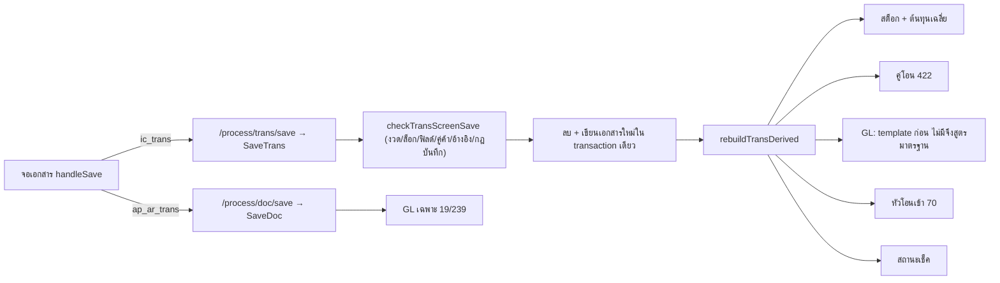

# เส้นทางงานธุรกิจ — ภาพรวม (Business Flows Overview)

โน้ตกลุ่มนี้เล่างานแบบต้นจนจบข้ามเอกสาร หน้าจอ ตาราง และสมุดบัญชีแยกประเภท ทุกขั้นอ้าง `path:line` ใน repo ส่วนที่โค้ดไม่มีเขียนว่า "(ไม่พบในโค้ด)" รายละเอียดรายเอกสารดู [[doctypes-overview]] ตารางดู [[tables-overview]]

## แกนกลางที่ทุก flow ใช้ร่วมกัน

- จอเอกสารแยกปลายทางตามชนิด: `ic_trans` ไป `/process/trans/save`, ที่เหลือไป `/process/doc/save` (`frontend/account/transaction/UniversalTransScreen.tsx:2583`)
- ข้อมูลดิบกับข้อมูล derive แยกกัน: บันทึก/แก้/ลบ/ยกเลิกทุกครั้งคำนวณสต็อก GL และเช็คใหม่จากข้อมูลดิบ (`backend/internal/application/process/trans.go:593`) ดู [[acc-transaction-save-flow]]
- ยอดค้างเจ้าหนี้/ลูกหนี้ไม่ถูกเก็บ คำนวณสดจากเอกสารหนี้ลบยอดชำระ (`backend/internal/application/process/docs.go:599-628`)
- `inquiry_type` แยกเงินสด/เงินเชื่อ: 1/3 = เงินสด, 0/2 = เงินเชื่อ สำหรับซื้อ 12 และขาย 44 (`backend/internal/application/process/service.go:1988`, `:2012`)
- GL มาตรฐานอยู่ที่ `buildStandardGLLines` (`backend/internal/application/process/service.go:1786`) ดู [[acc-gl-posting-standard]] และ [[acc-gl-template-engine]]

## รายการ flow

| Flow | tag | ครอบคลุม |
|---|---|---|
| [[flow-procure-to-pay]] | p2p | ขอซื้อ 2 → สั่งซื้อ 6 → มัดจำ 10/11 → ซื้อ 12 หรือทยอยรับ 310 → ตั้งหนี้ 315 → ลด/เพิ่มหนี้ → วางบิล 213 → จ่ายชำระ 19 |
| [[flow-order-to-cash]] | o2c | เสนอราคา 30 → จอง 34 → สั่งขาย 36 → มัดจำ 40/110 → ขาย 44 → ลด/เพิ่มหนี้ 48/46 → วางบิล 235 → รับชำระ 239 |
| [[flow-stock-movement-cost]] | stock | ยอดยกมา 54, เบิก 122/56/58, โอน 124/72/70, ตรวจนับ 76 → ใบปรับ 66/68, ต้นทุนเฉลี่ย, ประมวลผลสต็อก |
| [[flow-cash-bank-cheque]] | cash | รายได้/ค่าใช้จ่ายอื่น, เงินสดย่อย 300/301, ฝาก/ถอน/โอน 401/402/422, วงจรเช็ครับ 405-418, เช็คจ่าย 406-456, บัตร 461-463 |
| [[flow-fixed-asset-lifecycle]] | asset | ทะเบียนสินทรัพย์, โอนค่าเสื่อม 1801, ขายสินทรัพย์ 1802 |
| [[flow-period-year-close]] | close | งวดบัญชี, ผ่านรายการ, ตรวจ GL, ปิดงวด 1998 / ปิดปี 1999, ประมวลผล GL ใหม่ |
| [[flow-cancel-edit-reversal]] | close | แก้ไข, ลบ, ยกเลิก (ใบยกเลิก + GL กลับข้าง), คืนสถานะ, อนุมัติ |
| [[flow-tax-vat-wht-reports]] | tax | ทะเบียนภาษีซื้อ/ขาย, ภาษีหัก ณ ที่จ่าย, รายงาน VAT, ภ.ง.ด.3/53, ส่งออกไฟล์ |
| [[flow-new-company-setup]] | setup | สร้างฐานข้อมูล, seed, ข้อมูลหลักขั้นต่ำ, ยอดยกมา |

## ที่ยังไม่มีในโค้ด (ไม่พบในโค้ด)

- ตัดจำหน่าย/เลิกใช้สินทรัพย์เป็นเอกสาร มีแค่ master `menu_asset_setup_retire`
- ซื้อสินทรัพย์ผ่านเอกสารซื้อแล้วเข้าทะเบียนสินทรัพย์
- ฟังก์ชันปิดงวดที่เปลี่ยนสถานะงวดอัตโนมัติ (ต้องแก้ `erp_account_period.status` เอง)
- การสร้าง ภ.พ.30, ปิดภาษี/ยื่นภาษี
- ภ.ง.ด.1 และรายงาน 50 ทวิ ฝั่ง backend
- e-Tax ส่งจริง (ตัวเชื่อมสร้างรหัสประทับเวลาเองในโค้ด ดู [[flow-tax-vat-wht-reports]])
- wizard ตั้งค่าบริษัทใหม่
- บรรทัดต้นทุนขายในสูตร GL มาตรฐานของขาย 44

## จุดที่โค้ดดูขัดกันเอง (ควรให้ลุงจืดยืนยัน)

| เรื่อง | รายละเอียด | path:line |
|---|---|---|
| เงินสดย่อย 300 | เมนูชื่อ "คืน/ลด วงเงินสดย่อย" แต่ GL ลง Dr เงินสดย่อย และคอมเมนต์เรียก withdraw | `frontend/account/tabs/transMenuMap.ts:1799`, `backend/internal/application/process/service.go:2218` |
| flag 1999 | ใช้ทั้งปิดปี (`GLClose`), `flagJournalVat` และ `journalFlags` | `backend/internal/application/process/workflow.go:818`, `backend/internal/application/process/journaltax.go:17`, `backend/internal/application/process/period.go:131` |
| เช็คจ่าย 453 | 453 เข้าเงื่อนไขแรก (452/453) ก่อน เงื่อนไข 453 ในสาขา else จึงไม่มีวันทำงาน | `backend/internal/application/process/service.go:2324-2332` |
| wallet 463 | GL เหมือน 462 (Dr ลูกหนี้ / Cr ธนาคาร) แต่สถานะเหมือน 461 ขึ้นเงิน | `backend/internal/application/process/service.go:2340-2358`, `backend/internal/application/process/cheque.go:27` |
| ปรับเพิ่ม 66 | GL ใช้ยอดหัวเอกสาร แต่สต็อกใช้ qty × ต้นทุนเฉลี่ย (ช่องว่างที่รู้แล้ว) | `backend/internal/application/process/service.go:2164-2166` |
| ค่าเสื่อม 1801 / ปิดงวด / RebuildGL | ไม่ตรวจงวดปิดตอนบันทึก | `backend/internal/application/process/fa_depreciation.go:793`, `backend/internal/application/process/workflow.go:893-894`, `backend/internal/application/process/service.go:1597-1603` |
| seed ฐานใหม่ | ไม่สนใจ error | `backend/internal/adapter/inbound/http/admin/workspace_google.go` |
| รายงาน VAT มาตรฐาน | ไม่ตัดใบยกเลิกและไม่ใช้ `vat_calc` | `backend/internal/application/process/report_menu_gl_fa.go:1125` |

## ที่มาในโค้ด

- `backend/internal/application/process/trans.go:267`, `:382`, `:593` — บันทึก/ลบ/derive
- `backend/internal/application/process/docs.go:119`, `:166`, `:599-628` — เอกสารหนี้และยอดค้าง
- `backend/internal/application/process/trans_validate.go:42` — ด่านตรวจก่อนบันทึก
- `backend/internal/application/process/service.go:1308`, `:1742`, `:1786` — RebuildGL, ธง GL, GL มาตรฐาน
- `backend/internal/application/process/doc_cancel.go:49`, `:585` — ยกเลิกและกลับรายการ
- `backend/internal/adapter/inbound/http/router.go:168-205` — route `/api/v1/process/*`
- `frontend/account/transaction/UniversalTransScreen.tsx:2583` — `handleSave`
- `frontend/account/tabs/transMenuMap.ts` — แผนที่เมนู → trans_flag
