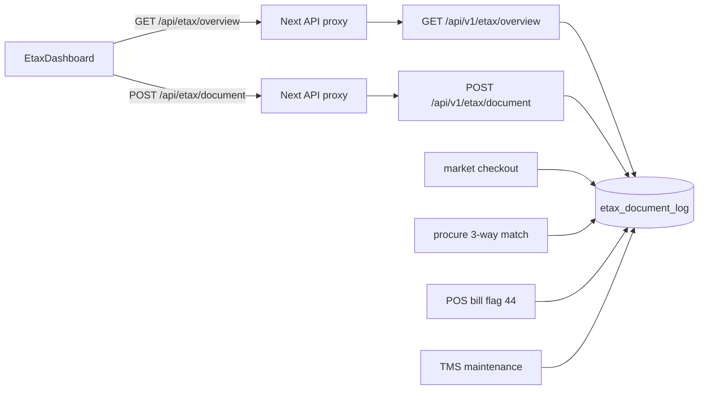

# ระบบใบกำกับภาษีอิเล็กทรอนิกส์ (sys-etax)

ระบบ `/etax` เป็นแดชบอร์ดที่รวมเอกสารภาษีจากทุกระบบย่อยไว้ในตารางเดียวคือ `etax_document_log` หน้าจอมีทะเบียนเอกสาร สรุปภาษีขาย ภาษีซื้อ และภาษีหัก ณ ที่จ่าย ฟอร์มสแกนบิลแบบ OCR และฟอร์มเอกสารขายให้นักท่องเที่ยว ชื่อหน้าใน metadata คือ "ระบบใบกำกับภาษีอิเล็กทรอนิกส์ (Smart e-Tax · ETDA Time Stamp · ภ.พ.30 · AI OCR)"

> ข้อสังเกตจากโค้ด: การประทับเวลา ETDA และการอ่าน OCR ในโค้ดชุดนี้เป็นการจำลองภายในระบบ ไม่มีการเรียกบริการภายนอก ดู [[sys-etax-document-stamp]]

## ใครใช้ และเปิดอย่างไร

- ใช้ได้เมื่อล็อกอินและเลือกฐานข้อมูลแล้ว ถ้ายังไม่มี session ระบบจะส่งไป `/login` และถ้ายังไม่เลือกฐานจะส่งไป `/select-database` (`page.tsx:12-13`)
- เปิดได้จากการ์ด "ภาษี e-Tax" ในหน้าเลือกระบบ (กลุ่ม `accounting`) หรือพิมพ์ `/etax` ตรง ๆ workspace host จับคู่เส้นทางนี้กับโมดูล `etax` ดู [[fe-app-shell-routing]]
- ทุก endpoint อยู่หลัง middleware `Auth` ของ backend ดู [[be-http-router-routes]]

## แท็บบนหน้าจอ

| แท็บ (`activeTab`) | ทำอะไร |
|---|---|
| `registry` | ทะเบียนเอกสาร e-Tax ทุกประเภท พร้อมปุ่มประทับเวลา (`STAMP_ETDA`) |
| `vat_wht` | สรุปภาษีขาย ภาษีซื้อ ภาษีสุทธิ และรายการหัก ณ ที่จ่าย ดู [[sys-etax-vat-wht-summary]] |
| `ocr_scan` | ฟอร์มสแกนบิลหรือสลิป ส่ง `SCAN_OCR` พร้อมรูป |
| `tourist_vrt` | สร้างเอกสารขายให้นักท่องเที่ยว (`SALES_ETAX_TOURIST_VRT`) |

## เส้นทางข้อมูล

- `GET /api/v1/etax/overview` เรียก `Overview` ซึ่งคืน KPI และรายการเอกสาร
- `POST /api/v1/etax/document` เรียก `CreateOrStampDocument` ซึ่งสร้างเอกสารใหม่หรือประทับเวลาเอกสารเดิม
- ตารางถูกสร้างเองครั้งแรกที่มีการเรียก (`ensureEtaxSeeded`) ข้อมูลตัวอย่างใส่ให้เฉพาะฐาน `bcdemo`

## ความสัมพันธ์กับระบบบัญชี

- `etax_document_log` เป็นตารางแยกต่างหาก ไม่ใช่ทะเบียนภาษีของระบบบัญชี ทะเบียนภาษีขายและภาษีซื้อของบัญชีอยู่ที่ [[tbl-gl-journal-vat-sale]] และ [[tbl-gl-journal-vat-buy]] ส่วนรายงานดูที่ [[flow-tax-vat-wht-reports]]
- ไคลเอนต์สั่ง SQL เขียนตารางนี้ตรง ๆ ไม่ได้ เพราะตารางนี้อยู่ในรายชื่อตารางเงินที่ถูกล็อก (`write_policy.go:24`) ดู [[std-data-integrity-money-transactions]]
- ค่าตั้งการเชื่อมต่อ e-Tax INET อยู่ในหน้าตั้งค่าบัญชี แท็บ 8 ดู [[sys-etax-vat-wht-summary]] และ [[scr-options]]

## ที่มาในโค้ด

- `frontend/src/app/etax/page.tsx:5-13` metadata และการ redirect เมื่อไม่มี session หรือยังไม่เลือกฐานข้อมูล
- `frontend/etax/EtaxDashboard.tsx:212` ดึง overview, `:677-728` ปุ่มแท็บทั้งสี่
- `frontend/shared/layout/SystemPortalScreen.tsx:144-155` การ์ดระบบ e-Tax ในหน้าเลือกระบบ
- `frontend/shared/layout/PersistentWorkspaceHost.tsx:164` จับคู่ `/etax` กับโมดูล `etax`
- `backend/internal/adapter/inbound/http/router.go:305-310` route `/api/v1/etax`
- `backend/internal/adapter/inbound/http/etax/handler.go:1-3` คำอธิบายแพ็กเกจ, `:150` `Overview`, `:168` `CreateOrStampDocument`, `:582-639` สร้างตารางและ seed เฉพาะ `bcdemo`
- `backend/internal/domain/query/write_policy.go:24` รายชื่อตารางเงินที่ไคลเอนต์เขียนตรงไม่ได้
- ดูเพิ่ม: [[sys-etax-document-stamp]] · [[sys-etax-vat-wht-summary]] · [[api-business-modules]] · [[acc-vat-register-wht]]
