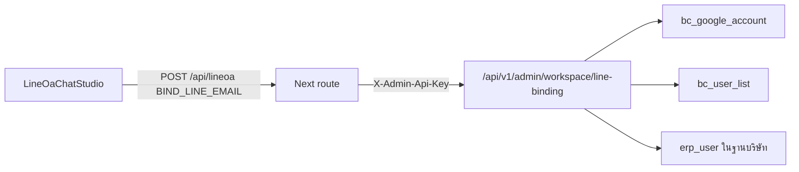

# ผูก LINE User ID กับอีเมลพนักงาน (sys-lineoa-line-binding)

ในหน้า `/lineoa` พนักงานผูก LINE User ID ของตนกับอีเมลที่ใช้เข้าระบบได้ ข้อมูลนี้เก็บในฐานหลักของ workspace ไม่ได้เก็บในฐานบริษัทอย่างเดียว ภาพรวมของระบบอยู่ที่ [[sys-lineoa-overview]]

## เส้นทางของคำขอ

- หน้าจอส่ง `action` เป็น `BIND_LINE_EMAIL` หรือ `UNBIND_LINE_EMAIL` พร้อม `bindPayload` ที่มี `email`, `lineUserId` และ `lineDisplayName` (`LineOaChatStudio.tsx:834-860`)
- Next route ใส่ `actor_email` และ `actor_user_code` จาก session ฝั่ง server ไม่ได้รับจากเบราว์เซอร์ แล้วเรียก backend ด้วย header `X-Admin-Api-Key` (`route.ts:606-640`)
- ตอนเปิดหน้าจอ GET ของ route อ่านการผูกด้วย `GET /api/v1/admin/workspace/line-binding` (`route.ts:252-273`)

## กุญแจ admin

| ฝั่ง | ที่อ่าน | พฤติกรรม |
|---|---|---|
| Next | `getAdminApiKey` อ่าน env `ADMIN_API_KEY` (`api-server.ts:70-79`) | ถ้าไม่ได้ตั้งและไม่ใช่ production จะใช้กุญแจสำหรับเครื่องพัฒนาที่กำหนดในโค้ด (ไม่คัดลอกมาที่นี่) ส่วน production คืน `null` |
| Go | `AdminAPIKey` จาก env `ADMIN_API_KEY` (`config.go:34`) | `AdminAuth` เทียบ header แบบ constant-time และปฏิเสธทุกคำขอถ้าไม่ได้ตั้งค่า (`adminauth.go:18-30`) |

route ทั้งสองอยู่ในกลุ่ม `/api/v1/admin` ที่ใช้ `AdminAuth` (`router.go:213-214`, `:246-247`) ดู [[be-admin-api]] · [[api-admin-workspace]]

## ผูก / ยกเลิกผูก (`WorkspaceBindLineAccount`, `workspace_google.go:1366-1481`)

1. `provider` ว่างจะใช้ `bcdemo` อีเมลต้องมีเครื่องหมาย `@` ถ้าไม่ส่งอีเมลเป้าหมายจะใช้อีเมลผู้สั่ง (`:1383-1397`)
2. สิทธิ์: ผูกให้อีเมลตัวเอง หรือผู้สั่งเป็น admin ของฐาน ไม่เช่นนั้นตอบ 403 `FORBIDDEN_LINE_BIND` (`:1407-1410`)
3. การผูกต้องมี LINE User ID ไม่เช่นนั้นตอบ `MISSING_LINE_ID` (`:1415-1421`)
4. ก่อนผูกใหม่ ล้าง LINE ID เดียวกันที่เคยผูกกับอีเมลอื่น เพื่อให้ 1 LINE ID ผูกได้กับ 1 อีเมล (`:1423-1427`)
5. ยกเลิกผูกจะล้างค่าใน `bc_google_account` ส่วนการผูกจะ upsert แถวตาม `email` (`:1434-1449`)
6. ตั้ง `bc_user_list.line_user_id` ตามอีเมล (`:1455-1459`) และถ้าส่งชื่อฐานมา จะเพิ่มคอลัมน์ `email`, `line_user_id` ใน `erp_user` ของฐานบริษัทถ้ายังไม่มี แล้วตั้งค่าตามอีเมล (`:1460-1467`)
7. ตอบอีเมล LINE ID และรายชื่อฐานที่อีเมลนี้เข้าได้ (`:1469-1481`)

`isDatabaseAdmin` ถือว่าเป็น admin เมื่อ (`:839-870`):

- มี `role` เป็น `ADMIN` ใน `bc_google_workspace_member` ของฐานนั้น หรือเป็น `owner_email` ใน `bc_google_workspace_db`
- หรือ `bc_user_list.user_level` ≥ 9 หรือรหัสผู้ใช้ตรงกับรหัสผู้ดูแลที่กำหนดตายตัวในโค้ด (`:868`)

คอลัมน์ `line_user_id`, `line_display_name`, `line_linked_at` และ index ของ `bc_google_account` สร้างด้วย `ensureWorkspaceTables` (`:36-54`) ดู [[tbl-bc-google-workspace]] · [[tbl-bc-user-list]] · [[tbl-erp-user]]

## อ่านการผูก (`WorkspaceResolveLineBinding`, `:1255-1364`)

- รับ `provider`, `database`, `line_user_id` หรือ `email` ถ้ามี LINE ID จะหาอีเมลจาก `bc_google_account` ก่อนแล้วจึง `bc_user_list` ถ้ามีอีเมลจะหา LINE ID ในลำดับเดียวกัน
- คืนรายชื่อฐานที่อีเมลเข้าได้ และ `staff_bindings` คือสมาชิกทุกคนของฐานนั้นพร้อม LINE ID โดยเรียง admin ขึ้นก่อน

## ข้อสังเกตจากโค้ด

- ถ้า Next ไม่มีกุญแจ admin หรือเรียก backend ไม่ได้ route จะตอบ `ok: true` พร้อมข้อมูลที่ส่งมาเหมือนผูกสำเร็จ แต่ไม่มีอะไรถูกบันทึก (`route.ts:657-668`)
- คำสั่งล้างค่าเดิม และการอัปเดต `bc_user_list` กับ `erp_user` ไม่ตรวจ error และไม่อยู่ใน transaction เดียวกับการ upsert (`workspace_google.go:1423-1467`)
- กรณี error จากฐานตอนผูก handler ส่งข้อความ error ของฐานกลับให้ผู้เรียก (`:1451`)

## ที่มาในโค้ด

- `frontend/lineoa/LineOaChatStudio.tsx:834-860` `handleBindStaffLineEmail`
- `frontend/src/app/api/lineoa/route.ts:252-273` อ่านการผูก, `:606-668` ผูกหรือยกเลิกผูกและค่าที่ตอบเมื่อเรียก backend ไม่ได้
- `frontend/src/lib/api-server.ts:70-79` `getAdminApiKey`
- `backend/internal/platform/config/config.go:34` env ของกุญแจ, `backend/internal/adapter/inbound/http/middleware/adminauth.go:18-30` `AdminAuth`
- `backend/internal/adapter/inbound/http/router.go:213-214`, `:246-247` route
- `backend/internal/adapter/inbound/http/admin/workspace_google.go:36-54` DDL, `:839-870` `isDatabaseAdmin`, `:1255-1364` อ่าน, `:1366-1481` ผูก
- ดูเพิ่ม: [[sys-lineoa-overview]] · [[sys-lineoa-chat-ai]] · [[api-admin-workspace]] · [[std-security-lessons-idor]]
