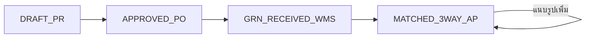

# เดินสถานะ PO 3-Way Matching และซิงก์ไปคลัง ERP e-Tax (sys-procure-3way-match-sync)

ปุ่มบนกระดาน PO (แท็บ `matching`) ส่ง `action_type: "ADVANCE"` พร้อม `po_doc_no` และ `next_stage` ไปที่ `POST /api/v1/procure/order` (`ProcureDashboard.tsx:595-601`) backend ไม่มี case ชื่อ `ADVANCE` แต่เมื่อมี `po_doc_no` คำขอจะไปเข้าทางเดินสถานะ PO เอง (`handler.go:1229` เป็นต้นไป)

## ลำดับสถานะ

- ถ้าไม่ส่ง `next_stage` มา backend จะเลือกให้เอง: `DRAFT_PR` ไป `APPROVED_PO`, `APPROVED_PO` ไป `GRN_RECEIVED_WMS` และสถานะอื่นทั้งหมดไป `MATCHED_3WAY_AP` (`handler.go:1243-1253`)
- ถ้าไม่พบ PO จะตอบ `KindNotFound` (`:1236-1239`)
- จำนวนและยอดเงินที่ใช้ซิงก์อ่านจากแถว PO ที่บันทึกไว้แล้ว (`:1261-1266`)
- เมื่อเดินไปขั้นรับของหรือขั้น 3-Way แล้วไม่มีรูปแนบ ระบบจะสร้างรูปตัวอย่างให้ (`:1282`)
- หน้าจอกำหนดปุ่มถัดไปของแต่ละสถานะ เมื่อถึง `MATCHED_3WAY_AP` แล้ว ปุ่มยังส่ง `MATCHED_3WAY_AP` ซ้ำเพื่อแนบรูปเพิ่ม (`ProcureDashboard.tsx:250-282`, `:1996-2001`)

## สถานะการจับคู่ (`match_status`)

| ขั้น | สิ่งที่โค้ดทำ (`:1318-1336`) |
|---|---|
| ก่อนรับของ | `PENDING_GRN (รอรับของเข้าคลัง WMS)` |
| `GRN_RECEIVED_WMS` | ตั้งจำนวนรับ = จำนวนสั่ง และสร้างเลขรับเข้า `WMS-PUT-<เวลา>` ถ้ายังไม่มี สถานะเป็น `2WAY_MATCHED (...)` |
| `MATCHED_3WAY_AP` | ตั้งจำนวนรับ = จำนวนแจ้งหนี้ = จำนวนสั่ง สร้างเลขใบกำกับซื้อ `TAX-AP-<เลข PO ที่ตัด PO ออก>` ถ้ายังไม่มี สถานะเป็น `3WAY_MATCHED_100% (...)` |

> ข้อสังเกตจากโค้ด: ระบบไม่ได้เทียบจำนวนหรือยอดของ PO ใบรับของ และใบกำกับภาษีจริง เพียงตั้งจำนวนทั้งสามให้เท่ากับจำนวนสั่ง

จากนั้นอัปเดตแถว PO ด้วยสถานะ จำนวน เลขเอกสาร และรูป (`:1341-1347`)

## ซิงก์ที่ 1: คลังและเอกสารสินค้า (`:1355-1404`)

ทำเฉพาะเมื่อเดินเข้า `GRN_RECEIVED_WMS` หรือ `MATCHED_3WAY_AP` จากสถานะที่ยังไม่ใช่สองขั้นนี้

- `INSERT INTO ic_trans` แบบ SQL ตรง ใช้เลขที่ `WMS-PUT-…`, `doc_date` = `CURRENT_DATE`, `trans_type` 1, `trans_flag` 12, `cust_code` = รหัสผู้ขาย, `total_value` = `total_before_vat` = มูลค่าก่อน VAT, `total_vat_value`, `total_amount` และ `remark` (`:1357-1359`)
- `INSERT INTO ic_trans_detail` หนึ่งบรรทัด ราคาต่อหน่วย = `divSatang(มูลค่า, จำนวน)` (`:1360-1362`)
- อ่านยอดเดิมใน bin เขียน `wms_movement_log` ประเภท `INBOUND_PUTAWAY` คำนวณ `wms_stock_bin` ใหม่ และลด `inbound_putaway_qty` (`:1364-1400`)

ธง 12 คือเอกสารซื้อสินค้า/ตั้งหนี้ ดู [[acc-trans-flag-map]] และ [[doc-purchase-invoice]]

> ข้อสังเกตจากโค้ด: แถว `ic_trans` นี้เขียนตรงโดยไม่ผ่านทางบันทึกเอกสารของระบบบัญชี และใน `procure/handler.go` ไม่มีการเขียน `gl_journal` หรือ `gl_journal_vat_buy` ยังไม่ได้ตรวจว่าการ rebuild GL ([[acc-gl-rebuild]]) จะทำอะไรกับแถวนี้ วงจรซื้อที่ลงบัญชีครบอยู่ที่ [[flow-procure-to-pay]]

## ซิงก์ที่ 2: ใบกำกับภาษีซื้อเข้า e-Tax (`:1406-1430`)

ทำเมื่อสถานะถัดไปเป็น `MATCHED_3WAY_AP` และมีเลขใบกำกับซื้อ

- insert `etax_document_log` โดยใช้ `doc_type` = `AP_INPUT_TAX_INVOICE`, `erp_ref_doc_no` และ `procure_ref_po_no` = เลขที่ PO, `wms_ref_doc_no` = เลขรับเข้า
- `vat_rate` 7, WHT 0, `etda_status` = `3WAY_MATCHED_VERIFIED`, รหัส `ETDA-AP-<เวลา>`, `ocr_confidence_pct` 99.6, `slip_verify_status` = `MATCHED_PO_GRN_AP`
- เลขผู้เสียภาษีของผู้ขายเป็นค่าคงที่ในโค้ด (ไม่คัดลอกมาที่นี่)

แถวนี้ถูกนับเป็นภาษีซื้อในหน้า `/etax` ดู [[sys-etax-vat-wht-summary]]

> ข้อสังเกตจากโค้ด: การกด "แนบรูปเพิ่ม" บน PO ที่ครบ 3-Way แล้วจะทำซิงก์ที่ 2 ซ้ำด้วยเลข `TAX-AP-…` เดิม DDL ใน `etax/handler.go:592-594` ไม่มี unique ที่ `etax_doc_no` แต่ `backend/migrations/0001_audit_schema.sql:76` กำหนด `UNIQUE` ไว้ ผลจึงขึ้นกับว่าตารางในฐานนั้นถูกสร้างจากที่ใด คือได้แถวซ้ำ หรือทั้ง batch ล้ม ยังไม่ได้ตรวจกับฐานจริง

## Transaction

คำสั่งทั้งหมด (อัปเดต PO, `ic_trans`, คลัง, e-Tax) รวมอยู่ใน `execBatch` ครั้งเดียว ถ้าขั้นใดล้ม จะไม่มี PO ที่ขึ้นสถานะรับของแล้วแต่ไม่มีเอกสารคลังหรือภาษี (`:1431-1437`, `KMS_SECURITY_DATA_INTEGRITY_LESSONS.md:77`) ดู [[std-data-integrity-money-transactions]]

## ที่มาในโค้ด

- `frontend/procure/ProcureDashboard.tsx:250-282` ปุ่มถัดไปของแต่ละสถานะ, `:595-601` ส่ง `ADVANCE`, `:1996-2001` ปุ่มบนกระดาน
- `backend/internal/adapter/inbound/http/procure/handler.go:1229-1266` อ่าน PO และเลือกสถานะถัดไป
- `backend/internal/adapter/inbound/http/procure/handler.go:1318-1336` `match_status` และเลขเอกสาร
- `backend/internal/adapter/inbound/http/procure/handler.go:1341-1347` อัปเดต PO
- `backend/internal/adapter/inbound/http/procure/handler.go:1355-1404` ซิงก์ `ic_trans` และ WMS
- `backend/internal/adapter/inbound/http/procure/handler.go:1406-1430` ซิงก์ e-Tax
- `backend/internal/adapter/inbound/http/procure/handler.go:1431-1437` `execBatch` เดียว
- `backend/internal/adapter/inbound/http/etax/handler.go:592-594`, `backend/migrations/0001_audit_schema.sql:74-76` นิยามคอลัมน์ `etax_doc_no` สองแบบ
- ดูเพิ่ม: [[sys-procure-overview]] · [[sys-procure-cart-rfq-po]] · [[faq-procure-to-pay-steps]] · [[tbl-ic-trans]] · [[tbl-ic-trans-detail]]
