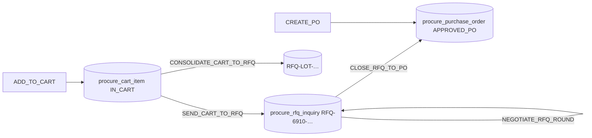

# ตะกร้าขอซื้อ สืบราคา และปิดเป็นใบสั่งซื้อ (sys-procure-cart-rfq-po)

ทุกปุ่มในแท็บ `cart_rfq` และ `create` ของหน้า `/procure` ส่ง `action_type` ไปที่ `POST /api/v1/procure/order` (`AdvanceOrCreateOrder`) ซึ่งรับได้ทั้ง JSON และ multipart ขนาดไม่เกิน 32 MB (`handler.go:352`) เมื่อทำเสร็จทุก action จะตอบกลับด้วย overview ชุดใหม่

## ขั้นตอนตะกร้าถึง PO

| `action_type` | ผลในโค้ด |
|---|---|
| `ADD_TO_CART`, `UPDATE_CART_QTY`, `REMOVE_CART_ITEM` | เพิ่ม แก้ หรือลบแถวใน `procure_cart_item` (`:453-594`) |
| `SEND_CART_TO_RFQ` | สร้าง RFQ หนึ่งใบต่อรายการในตะกร้าที่สถานะ `IN_CART` เลขที่เป็น `RFQ-6910-<เวลา>-<ลำดับ>` แล้วตั้งรายการในตะกร้าเป็น `SENT_TO_RFQ` ทุกแถวบันทึกใน batch เดียว (`:595-720`) |
| `CONSOLIDATE_CART_TO_RFQ` | รวมหลายรายการเป็น RFQ ใบเดียวเลขที่ `RFQ-LOT-<เวลา>` ชื่อรวมตัดที่ 220 ตัวอักษร และราคาดีสุดคิดเป็น 0.935 ของยอดฐาน (`:721-760`) |
| `NEGOTIATE_RFQ_ROUND` | ต่อรองอีกหนึ่งรอบ (`:850-982`) |
| `CLOSE_RFQ_TO_PO` | ปิด RFQ แล้วสร้าง PO (`:983-1100`) |
| `CREATE_PO` หรือไม่ส่ง `po_doc_no` | สร้าง PO ตรงจากฟอร์ม (`:1113-1150`) |

## ราคาเสนอของผู้ขาย (จำลอง)

`buildInitialVendorQuotes` สร้างใบเสนอราคา 3 ราย (`:1446-1506`)

- รหัส ชื่อ เกรด เครดิต และ lead time ของผู้ขายมาจาก `procure_supplier_matrix` สูงสุด 3 แถว ถ้าไม่มีจะใช้ค่าตั้งต้นในโค้ด
- ราคาเสนอ = ราคาฐาน × 0.97, 0.99, 1.02 ตามลำดับ และรายแรกถูกตั้งเป็นราคาดีที่สุดกับส่งฟรีเสมอ
- การต่อรองแต่ละรอบคูณราคาเดิมด้วย `0.962 − ((ลำดับ + รอบ) mod 2) × 0.012` แล้วเลือกรายที่ถูกสุด สถานะเป็น `NEGOTIATING_ROUND_<n>` และเมื่อถึงรอบ 3 จะเป็น `FINAL_QUOTE_ROUND_3` (`:875-912`)

> ข้อสังเกตจากโค้ด: ราคาเสนอและผลต่อรองคำนวณจากสูตรตายตัว ไม่ได้รับราคาจากผู้ขายจริง

## ปิด RFQ เป็น PO

- ราคาที่ชนะใช้ `unit_price` ที่ส่งมาก่อน ถ้าไม่มีจะใช้ `best_quoted_price` ของ RFQ หรือรายที่ `IsBest` (`:1002-1018`)
- ยอดประหยัดคำนวณด้วย `savingsSatang` (ราคาฐาน − ราคาที่ชนะ) × จำนวน และเปอร์เซ็นต์เทียบราคาฐาน คิดเฉพาะเมื่อส่วนต่างเป็นบวก (`:2695-2713`)
- PO ใหม่ได้เลขที่ `PO6910-<เวลา>` มูลค่า = จำนวน × ราคาที่ชนะ VAT ใช้ `vatAndNetSatang` (`:1033-1035`)
- อัปเดต RFQ เป็น `CLOSED_TO_PO` และ insert PO สถานะ `APPROVED_PO` ใน transaction เดียว (`:1073-1098`)

## สร้าง PO ตรง (`CREATE_PO`)

- เลขที่ PO ตั้งต้นเป็น `PO6910-<เวลา>` และเลขขอซื้ออ้างอิงได้จากการแทน `PO` ด้วย `PR` (`:1116-1120`)
- ค่าตั้งต้นเมื่อไม่ส่งมา: จำนวน 100, ราคา 310.00, bin `A-01-01` ส่วนผู้ขายและสินค้าใช้รหัสตัวอย่างในโค้ด (`:1118-1146`)
- มูลค่า = `mulSatang(จำนวน, ราคา)` และ VAT/ยอดรวมใช้ `vatAndNetSatang` (`:1148-1149`)

## การปัดเงิน

ตัวช่วยใน `handler.go:2644-2726` ใช้ `math/big.Rat` แล้วปัดครึ่งออกจากศูนย์ที่สตางค์

| ฟังก์ชัน | สูตร |
|---|---|
| `mulSatang(a, b)` | ปัด 2 ตำแหน่ง (a × b) |
| `vatAndNetSatang(base)` | VAT = ปัด 2 ตำแหน่ง (base × 7/100), ยอดรวม = ปัด 2 ตำแหน่ง (base + VAT) |
| `savingsSatang` | ตามหัวข้อด้านบน |

- อัตรา VAT 7/100 เขียนตายตัวในฟังก์ชัน (`:2715-2726`) ไม่ได้อ่านจากค่าตั้งของฐานข้อมูล
- ค่าที่ส่งใน JSON ยังเป็น `float64` ดูแนวทางการปัดที่ [[acc-rounding-decimal]]
- บทเรียนที่บันทึกไว้: ทุก action ของ Procure เป็น transaction เดียว และเลขที่เอกสารสร้างด้วย `docno.Stamp` (`KMS_SECURITY_DATA_INTEGRITY_LESSONS.md:77`)

## ที่มาในโค้ด

- `backend/internal/adapter/inbound/http/procure/handler.go:352` multipart 32 MB
- `backend/internal/adapter/inbound/http/procure/handler.go:453-594` action ของตะกร้า
- `backend/internal/adapter/inbound/http/procure/handler.go:595-720`, `:721-760` ส่ง RFQ ทีละรายการและแบบรวมล็อต
- `backend/internal/adapter/inbound/http/procure/handler.go:850-982` ต่อรองราคา
- `backend/internal/adapter/inbound/http/procure/handler.go:983-1100` ปิด RFQ เป็น PO
- `backend/internal/adapter/inbound/http/procure/handler.go:1113-1150` สร้าง PO ตรง
- `backend/internal/adapter/inbound/http/procure/handler.go:1446-1506` `buildInitialVendorQuotes`
- `backend/internal/adapter/inbound/http/procure/handler.go:2644-2726` ตัวช่วยคำนวณเงิน
- `frontend/procure/ProcureDashboard.tsx:396-638` ปุ่มที่ส่งแต่ละ action
- `docs/kms/KMS_SECURITY_DATA_INTEGRITY_LESSONS.md:77` บทเรียนเรื่อง transaction และเลขที่เอกสาร
- ดูเพิ่ม: [[sys-procure-overview]] · [[sys-procure-3way-match-sync]] · [[doc-purchase-order]] · [[flow-procure-to-pay]]
